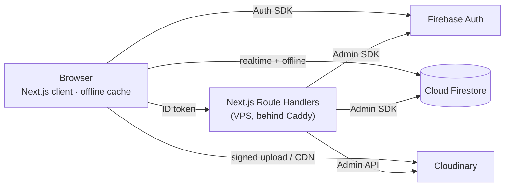

# 🌳 শিকড়

> Build your family tree in minutes, in **বাংলা** or **English**, with no sign-up needed.

**শিকড়** (pronounced *Shikor*, meaning "roots") is a web app for recording a family's history, starting from the oldest ancestor you remember. You add their sons and daughters, then their children, and keep going. You can explore the family as a **tree**, a **family card** (one family at a time, made for phones), a **circle chart** or an **index list**, and later as a **photo album** and a **timeline**. You can download any view as an **image or PDF**, or print the whole family as a **family book**.

The name is always written in Bangla, as **শিকড়**, in both the Bangla and the English interface.

**Ease of use is the top priority.** You can start without an account, everything saves automatically, and you can create an account later without losing anything.

> **Status:** 🏗️ *Phases 0–4 complete: guest sessions and accounts, the family data model with undoable editing commands, the dashboard, moving guest trees into an existing account, account deletion, and the Tree view: build a family from the tree with quick add, several children at once, a details panel that saves itself, search, undo and redo, and keyboard shortcuts, on phones and desktops. Next: Phase 5, person details and photos.* See [Project status](#project-status).

---

## Contents

- [Features](#features)
- [Tech stack](#tech-stack)
- [Architecture at a glance](#architecture-at-a-glance)
- [Documentation](#documentation)
- [Project status](#project-status)
- [Getting started](#getting-started)
- [Scripts](#scripts)
- [Project structure](#project-structure)
- [Contributing](#contributing)
- [Operations](#operations)
- [Privacy](#privacy)
- [License](#license)

---

## Features

| Feature | Release |
| --- | --- |
| **Start instantly as a guest.** Your tree is saved to the cloud and survives reloads and later visits. | v1.0 |
| **Create an account later** (email/password or Google). Your guest tree moves into it automatically. | v1.0 |
| **Add family fast.** Add children (several at once), spouses (including multiple marriages), parents and siblings. | v1.0 |
| **Rich profiles:** photo, nickname (ডাকনাম), dates, profession, education, addresses, phone, description, custom fields. | v1.0 |
| **Tree view:** pan and zoom, expand and collapse, focus on anyone, ancestor mode. | v1.0 |
| **Circle view:** oldest ancestor in the centre, generations in rings. | v1.0 |
| **List view:** numbered index (1, 1.1, 1.2 …) and a searchable directory. | v1.0 |
| **Family card:** one family at a time (parents above, children below); tap to move between families. The easiest view on a phone. | v1.0 |
| **Download as PNG or PDF** with perfect Bangla text, photos, titles and paper sizes. | v1.0 |
| **Bangla and English** throughout, including Bangla digits and dates. | v1.0 |
| **Undo/redo**, autosave, search, dark mode, keyboard shortcuts. | v1.0 |
| **JSON backup export.** | v1.0 |
| **Installable app** (PWA) that works offline. | v1.1 |
| **Import and export** JSON backups and **GEDCOM** (standard genealogy format). | v1.1 |
| **Generation album:** everyone's photos, one row per generation, with a slideshow. | v1.1 |
| **Share** a view-only link (contact details hidden) and **invite family to co-edit** in real time. | v1.2 |
| **Timeline:** everyone's lifespans across the years, with 1947, 1952 and 1971 markers. | v1.2 |
| **Family book:** a printable PDF book with a cover, contents, one section per family, photos and a name index. | v1.2 |
| **"How are we related?"** with Bangla kinship terms (চাচা, খালা, মামাতো ভাই …). | v1.3 |

The full requirements are in the [SRS](docs/SRS.md).

---

## Tech stack

| Area | Technology |
| --- | --- |
| Framework | **Next.js 16** (App Router) · **React 19** · **TypeScript** (strict) |
| UI | Tailwind CSS 4 · shadcn/ui (Radix) · motion · lucide icons |
| State & forms | Zustand · react-hook-form · Zod |
| i18n | next-intl (`/bn`, `/en`) · Hind Siliguri + Inter fonts |
| Visualizations | d3-hierarchy · d3-flextree · d3-shape · d3-zoom · d3-scale (custom SVG renderers) and HTML card views |
| Export | html-to-image · jsPDF |
| Auth & database | **Firebase Authentication** (anonymous, email, Google) · **Cloud Firestore** |
| Photos | **Cloudinary** (signed uploads, face-aware thumbnails) |
| Server | Next.js Route Handlers with the Firebase Admin SDK (there is no separate Express server) |
| PWA | Serwist (v1.1) |
| Testing | Vitest · Testing Library · Firebase Emulator Suite · Playwright · axe |
| Tooling | pnpm · ESLint · Prettier · Husky · commitlint · GitHub Actions |
| Hosting | Self-hosted on a Contabo VPS (Docker Compose: Next.js + Caddy for HTTPS), deployed by GitHub Actions · Firebase (Spark plan) · Cloudinary (free plan) |

The reasoning behind each choice is recorded in the [Design Document](docs/DESIGN.md#3-technology-stack) and its [ADRs](docs/DESIGN.md#4-architecture-decision-records).

---

## Architecture at a glance



- The browser reads and writes Firestore directly, protected by tested **Security Rules**.
- The server handles only privileged tasks: merging guest data into an existing account, deleting accounts, signing photo uploads, invites, public share pages and scheduled cleanup.
- Every edit is a **command** with an inverse, which is what powers undo/redo.

---

## Documentation

| Document | Purpose |
| --- | --- |
| [docs/SRS.md](docs/SRS.md) | Software Requirements Specification: *what* we build, with IDs, priorities, acceptance criteria and use cases |
| [docs/DESIGN.md](docs/DESIGN.md) | Design Document: architecture, data model, security rules, auth flows, visualizations, export, UI system |
| [docs/IMPLEMENTATION_PLAN.md](docs/IMPLEMENTATION_PLAN.md) | Phased plan with task IDs, estimates, exit criteria, Definition of Done |
| [CLAUDE.md](CLAUDE.md) | Conventions and rules for AI-assisted (and human) development |
| [.claude/skills/family-tree-dev/SKILL.md](.claude/skills/family-tree-dev/SKILL.md) | Step-by-step development workflows and recipes |
| [docs/PERFORMANCE.md](docs/PERFORMANCE.md) | Measured performance (the Tree view benchmark) and the decisions it led to |
| [CHANGELOG.md](CHANGELOG.md) | Notable changes per release |

---

## Project status

| Phase | Description | Status |
| --- | --- | --- |
| Docs | SRS, Design, Implementation Plan, CLAUDE.md, skill | ✅ Done |
| P0 | Foundation & tooling, deployment pipeline | ✅ Done (first deploy waits for the owner's VPS setup) |
| P1 | Authentication & guest session | ✅ Done (the iOS Safari redirect check waits for the domain) |
| P2 | Domain core, data layer & security rules | ✅ Done |
| P3 | App shell, dashboard, guest merge | ✅ Done |
| P4 | Tree view & core editing | ✅ Done |
| P5 | Person details & photos | ⏳ Next |
| P6 | List, Circle & Family card views | ⬜ |
| P7 | Export & JSON backup | ⬜ |
| P8 | Onboarding, polish → **v1.0** | ⬜ |
| P9–P11 | PWA, offline, import/GEDCOM, Generation album → **v1.1** | ⬜ |
| P12–P14 | Sharing & collaboration, Timeline, Family book → **v1.2** | ⬜ |
| P15 | Relationship finder → **v1.3** | ⬜ |

Task-level progress is tracked in the [Implementation Plan](docs/IMPLEMENTATION_PLAN.md).

---

## Getting started

You can run শিকড় locally **without any Firebase or Cloudinary account**: the app talks to the Firebase Emulator Suite on your machine.

### Prerequisites

- **Node.js 22 LTS** or newer, and **pnpm** (`corepack enable`; the version is pinned in `package.json`)
- **Java 21** (for the Firebase Emulator Suite; `firebase-tools` is installed as a dev dependency)

### 1. Clone and install

```bash
git clone https://github.com/redwanhasan980/Family-Tree.git
cd Family-Tree
pnpm install
cp .env.example .env.local      # NEXT_PUBLIC_USE_EMULATORS=true works out of the box
```

### 2. Run locally

```bash
pnpm emulators     # terminal 1: Auth + Firestore emulators (UI at http://127.0.0.1:4000)
pnpm seed          # optional: demo trees of 10–2,000 people; log in as demo@shikor.test / shikor-demo
pnpm dev           # terminal 2: http://localhost:3000 → redirects to /bn or /en
```

### 3. Check your work

```bash
pnpm typecheck && pnpm lint && pnpm test && pnpm i18n:check   # also run by the pre-commit hook
pnpm test:rules                                               # security rules on the emulator
pnpm exec playwright install chromium webkit                  # once, for end-to-end tests
pnpm build && pnpm test:e2e                                   # end-to-end tests (mobile + desktop)
```

The end-to-end tests start the Auth and Firestore emulators themselves, or reuse the ones from `pnpm emulators` if they are already running. The build must use the emulators (`NEXT_PUBLIC_USE_EMULATORS=true`, as in `.env.example`). If your machine already has a Chromium build and no WebKit, run them with `PLAYWRIGHT_CHROMIUM_PATH=/path/to/chrome pnpm test:e2e`; the iPhone (WebKit) project is then skipped.

### 4. Connect real services (before going live)

These need the owner's accounts (see [Implementation Plan §8](docs/IMPLEMENTATION_PLAN.md#8-before-phase-0-setup-actions-for-the-product-owner)):

1. **Firebase:** the production project is **`shikor-fe44d`** (Web app registered). Its Firestore database is in **`asia-south1` (Mumbai)** in production mode (the location cannot be changed later), and **Anonymous**, **Email/Password** and **Google** sign-in are enabled. Later, generate a service-account key for the Admin SDK (never commit it). Local development keeps using the emulators.
2. **Cloudinary:** create a free account and note the cloud name, API key and API secret. Keep *unsigned uploads* disabled.
3. **Server:** follow **[docs/DEPLOYMENT.md](docs/DEPLOYMENT.md)** to prepare the Contabo VPS and turn on automatic deploys. Public `NEXT_PUBLIC_*` values become GitHub repository variables; server secrets go into `/opt/shikor/.env` on the server.

| Variable | Where it comes from |
| --- | --- |
| `NEXT_PUBLIC_FIREBASE_API_KEY`, `NEXT_PUBLIC_FIREBASE_AUTH_DOMAIN`, `NEXT_PUBLIC_FIREBASE_PROJECT_ID`, `NEXT_PUBLIC_FIREBASE_APP_ID` | Firebase web app config |
| `NEXT_PUBLIC_CLOUDINARY_CLOUD_NAME` | Cloudinary dashboard |
| `NEXT_PUBLIC_USE_EMULATORS` | `true` locally, unset in deployments |
| `NEXT_PUBLIC_EMULATOR_HOST` | optional: emulator host the browser uses (default `127.0.0.1`) |
| `NEXT_PUBLIC_APP_URL` | `http://localhost:3000` locally |
| `FIREBASE_SERVICE_ACCOUNT` | base64 of the service-account JSON (`base64 -w0 key.json`) |
| `CLOUDINARY_API_KEY`, `CLOUDINARY_API_SECRET` | Cloudinary dashboard (**server only**) |
| `APP_ENV` | `dev` or `prod` |
| `CRON_SECRET` | any long random string (v1.1+) |
| `NEXT_PUBLIC_RECAPTCHA_SITE_KEY` | reCAPTCHA v3 site key for App Check (production). Once set, the server requires App Check tokens. |

### 5. Production notes

- **Google sign-in on your own domain** (so redirects work in Safari and other browsers that block third-party storage, [DESIGN §9.5](docs/DESIGN.md#95-google-sign-in-specifics)):
  1. Set `NEXT_PUBLIC_FIREBASE_AUTH_DOMAIN` to **your app's domain** (for example `shikor.app`, without `https://`) and `NEXT_PUBLIC_FIREBASE_PROJECT_ID` to `shikor-fe44d`, then redeploy. These values are built into the app, which then proxies `/__/auth/*` and `/__/firebase/*` to `shikor-fe44d.firebaseapp.com`.
  2. In *Firebase console → Authentication → Settings → Authorized domains*, add your domain.
  3. In *Google Cloud console → APIs & Services → Credentials → the "Web client (auto created by Google Service)" OAuth client*, add `https://<your-domain>/__/auth/handler` to **Authorized redirect URIs**.
  4. Check it: `https://<your-domain>/__/auth/handler` should load Firebase's page, and "Continue with Google" should work on an iPhone in Safari.
- Firestore rules and indexes are deployed by CI from `firebase/`. Do not edit them in the console.

---

## Scripts

| Command | Description |
| --- | --- |
| `pnpm dev` | Start the development server |
| `pnpm build` / `pnpm start` | Production build / serve |
| `pnpm emulators` | Start the Firebase Auth and Firestore emulators (project `demo-shikor`) |
| `pnpm seed` | Demo trees of 10, 150, 500 and 2,000 people for `demo@shikor.test` / `shikor-demo` (always targets the emulators, never a real project) |
| `pnpm typecheck` | TypeScript check |
| `pnpm lint` | ESLint (including the layering rules from CLAUDE.md) |
| `pnpm format` / `pnpm format:check` | Prettier write / check |
| `pnpm test` / `pnpm test:watch` / `pnpm test:coverage` | Unit and component tests (Vitest) |
| `pnpm test:rules` | Firestore security rules tests, plus integration tests (`*.emulator.test.ts`: every editing command under the rules, server tree admin) on the emulator |
| `pnpm test:e2e` | End-to-end tests (Playwright, mobile and desktop; run `pnpm build` first) |
| `pnpm i18n:check` | Verify Bangla and English messages have the same keys and ICU arguments |
| `pnpm bench:tree [tree] [phone\|desktop] [throttle]` | Tree view benchmark on the demo trees: render time and pan/zoom frame rate (needs the emulators, `pnpm seed`, and `pnpm build && pnpm start --port 3100`; see [docs/PERFORMANCE.md](docs/PERFORMANCE.md)) |

---

## Project structure

```text
src/app/[locale]/      pages (landing, auth, dashboard, editor, share)
src/app/api/           server Route Handlers (Admin SDK, Cloudinary)
src/features/          feature modules (auth, trees, editor, person, views, export, media, …)
src/lib/domain/        pure TypeScript domain logic (graph engine, validation, names, dates, kinship, GEDCOM)
src/lib/repositories/  Firestore data access
src/stores/            Zustand stores
messages/              en.json, bn.json
firebase/              security rules, indexes, rules tests
docs/                  SRS, design, implementation plan
e2e/                   Playwright tests
```

The full layout is in [DESIGN §5](docs/DESIGN.md#5-project-structure).

---

## Contributing

- **Workflow:** small, frequent commits pushed directly to `main`, each passing the checks. When collaborators join, switch to short-lived branches (`feat/<task-id>-<slug>`, `fix/…`, `docs/…`) with PRs into `main`.
- **Commits:** [Conventional Commits](https://www.conventionalcommits.org/), for example `feat(person): add custom fields`.
- **Before opening a PR:** `pnpm typecheck && pnpm lint && pnpm test && pnpm i18n:check`. Check the change on a phone-sized and a desktop-sized screen, in Bangla and English.
- Every UI string goes into **both** `messages/en.json` and `messages/bn.json`.
- Keep the docs in sync: README, DESIGN, plan checkboxes and CHANGELOG are updated in the same PR.

The full checklist is the [Definition of Done](docs/IMPLEMENTATION_PLAN.md#6-definition-of-ready--done).

---

## Operations

- **Deployment:** every push to `main` that passes CI deploys to the VPS, with automatic rollback if the new version is unhealthy. See [docs/DEPLOYMENT.md](docs/DEPLOYMENT.md) for setup, logs and manual rollbacks.
- **Free-tier budget:** Firebase Spark (50k reads/day), Cloudinary Free (25 credits/month), plus the VPS's fixed monthly price. The quota math and upgrade triggers are in [DESIGN §28](docs/DESIGN.md#28-cost--quota-analysis).
- **Monitoring runbook** (to be completed in P8): weekly checks of Firebase usage and Cloudinary credits; alerts at 70%.
- **Guest cleanup** (v1.1): a daily job removes guest accounts inactive for more than 365 days.

---

## Privacy

Family data is private to the tree's members. Contact details are hidden on shared links. Guest data is linked to the browser it was created in: create a free account to keep it safe and use it on other devices. Users can export or delete all their data at any time. The bilingual privacy page arrives in v1.0.

---

## License

To be decided by the project owner. Until then, all rights are reserved.
