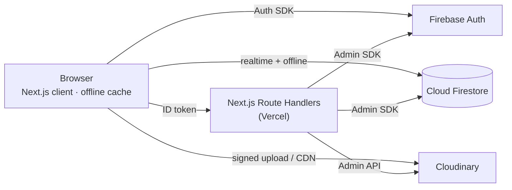

# 🌳 Family Tree · পারিবারিক বংশতালিকা

> Build your family tree in minutes, in **বাংলা** or **English**, with no sign-up needed.

Family Tree is a web app for recording a family's history, starting from the oldest ancestor you remember. You add their sons and daughters, then their children, and keep going. You can explore the family as a **tree**, a **circle chart** or an **index list**, and download any view as an **image or PDF** to share with relatives.

**Ease of use is the top priority.** You can start without an account, everything saves automatically, and you can create an account later without losing anything.

> **Status:** 📐 *Planning complete. Implementation starts with Phase 0.* See [Project status](#project-status).

---

## Contents

- [Features](#features)
- [Tech stack](#tech-stack)
- [Architecture at a glance](#architecture-at-a-glance)
- [Documentation](#documentation)
- [Project status](#project-status)
- [Getting started](#getting-started)
- [Scripts](#scripts)
- [Project structure](#project-structure)
- [Contributing](#contributing)
- [Operations](#operations)
- [Privacy](#privacy)
- [License](#license)

---

## Features

| Feature | Release |
| --- | --- |
| **Start instantly as a guest.** Your tree is saved to the cloud and survives reloads and later visits. | v1.0 |
| **Create an account later** (email/password or Google). Your guest tree moves into it automatically. | v1.0 |
| **Add family fast.** Add children (several at once), spouses (including multiple marriages), parents and siblings. | v1.0 |
| **Rich profiles:** photo, nickname (ডাকনাম), dates, profession, education, addresses, phone, description, custom fields. | v1.0 |
| **Tree view:** pan and zoom, expand and collapse, focus on anyone, ancestor mode. | v1.0 |
| **Circle view:** oldest ancestor in the centre, generations in rings. | v1.0 |
| **List view:** numbered index (1, 1.1, 1.2 …) and a searchable directory. | v1.0 |
| **Download as PNG or PDF** with perfect Bangla text, photos, titles and paper sizes. | v1.0 |
| **Bangla and English** throughout, including Bangla digits and dates. | v1.0 |
| **Undo/redo**, autosave, search, dark mode, keyboard shortcuts. | v1.0 |
| **JSON backup export.** | v1.0 |
| **Installable app** (PWA) that works offline. | v1.1 |
| **Import and export** JSON backups and **GEDCOM** (standard genealogy format). | v1.1 |
| **Share** a view-only link (contact details hidden) and **invite family to co-edit** in real time. | v1.2 |
| **"How are we related?"** with Bangla kinship terms (চাচা, খালা, মামাতো ভাই …). | v1.3 |

The full requirements are in the [SRS](docs/SRS.md).

---

## Tech stack

| Area | Technology |
| --- | --- |
| Framework | **Next.js 16** (App Router) · **React 19** · **TypeScript** (strict) |
| UI | Tailwind CSS 4 · shadcn/ui (Radix) · motion · lucide icons |
| State & forms | Zustand · react-hook-form · Zod |
| i18n | next-intl (`/bn`, `/en`) · Hind Siliguri + Inter fonts |
| Visualizations | d3-hierarchy · d3-flextree · d3-shape · d3-zoom (custom SVG renderers) |
| Export | html-to-image · jsPDF |
| Auth & database | **Firebase Authentication** (anonymous, email, Google) · **Cloud Firestore** |
| Photos | **Cloudinary** (signed uploads, face-aware thumbnails) |
| Server | Next.js Route Handlers with the Firebase Admin SDK (there is no separate Express server) |
| PWA | Serwist (v1.1) |
| Testing | Vitest · Testing Library · Firebase Emulator Suite · Playwright · axe |
| Tooling | pnpm · ESLint · Prettier · Husky · commitlint · GitHub Actions |
| Hosting | Vercel · Firebase (Spark plan) · Cloudinary (free plan) |

The reasoning behind each choice is recorded in the [Design Document](docs/DESIGN.md#3-technology-stack) and its [ADRs](docs/DESIGN.md#4-architecture-decision-records).

---

## Architecture at a glance



- The browser reads and writes Firestore directly, protected by tested **Security Rules**.
- The server handles only privileged tasks: merging guest data into an existing account, deleting accounts, signing photo uploads, invites, public share pages and scheduled cleanup.
- Every edit is a **command** with an inverse, which is what powers undo/redo.

---

## Documentation

| Document | Purpose |
| --- | --- |
| [docs/SRS.md](docs/SRS.md) | Software Requirements Specification: *what* we build, with IDs, priorities, acceptance criteria and use cases |
| [docs/DESIGN.md](docs/DESIGN.md) | Design Document: architecture, data model, security rules, auth flows, visualizations, export, UI system |
| [docs/IMPLEMENTATION_PLAN.md](docs/IMPLEMENTATION_PLAN.md) | Phased plan with task IDs, estimates, exit criteria, Definition of Done |
| [CLAUDE.md](CLAUDE.md) | Conventions and rules for AI-assisted (and human) development |
| [.claude/skills/family-tree-dev/SKILL.md](.claude/skills/family-tree-dev/SKILL.md) | Step-by-step development workflows and recipes |
| [CHANGELOG.md](CHANGELOG.md) | Notable changes per release |

---

## Project status

| Phase | Description | Status |
| --- | --- | --- |
| Docs | SRS, Design, Implementation Plan, CLAUDE.md, skill | ✅ Done |
| P0 | Foundation & tooling | ⏳ Next |
| P1 | Authentication & guest session | ⬜ |
| P2 | Domain core, data layer & security rules | ⬜ |
| P3 | App shell, dashboard, guest merge | ⬜ |
| P4 | Tree view & core editing | ⬜ |
| P5 | Person details & photos | ⬜ |
| P6 | List & Circle views | ⬜ |
| P7 | Export & JSON backup | ⬜ |
| P8 | Onboarding, polish → **v1.0** | ⬜ |
| P9–P10 | PWA, offline, import/GEDCOM → **v1.1** | ⬜ |
| P11 | Sharing & collaboration → **v1.2** | ⬜ |
| P12 | Relationship finder → **v1.3** | ⬜ |

Task-level progress is tracked in the [Implementation Plan](docs/IMPLEMENTATION_PLAN.md).

---

## Getting started

> These instructions describe the setup created in **Phase 0**. They will be verified and kept up to date as the code lands.

### Prerequisites

- **Node.js 22 LTS** or newer, and **pnpm** (`corepack enable`)
- **Java 11+** (required by the Firebase Emulator Suite)
- **Firebase CLI**: `pnpm dlx firebase-tools@latest login`
- Accounts: Firebase (Spark plan is fine), Cloudinary (free), Vercel (for deployments)

### 1. Clone and install

```bash
git clone https://github.com/redwanhasan980/Family-Tree.git
cd Family-Tree
pnpm install
```

### 2. Configure Firebase

1. Create a Firebase project (for development, for example `family-tree-dev`).
2. **Firestore:** create the database in **`asia-south1` (Mumbai)**. The location cannot be changed later.
3. **Authentication → Sign-in method:** enable **Anonymous**, **Email/Password** and **Google**.
4. **Project settings → Your apps:** add a **Web app** and copy its config values.
5. **Project settings → Service accounts:** generate a private key (for the Admin SDK). Never commit it.

### 3. Configure Cloudinary

Create a free account and note the **cloud name**, **API key** and **API secret**. Keep *unsigned uploads* disabled.

### 4. Environment variables

```bash
cp .env.example .env.local
```

| Variable | Where it comes from |
| --- | --- |
| `NEXT_PUBLIC_FIREBASE_API_KEY`, `NEXT_PUBLIC_FIREBASE_AUTH_DOMAIN`, `NEXT_PUBLIC_FIREBASE_PROJECT_ID`, `NEXT_PUBLIC_FIREBASE_APP_ID` | Firebase web app config |
| `NEXT_PUBLIC_CLOUDINARY_CLOUD_NAME` | Cloudinary dashboard |
| `NEXT_PUBLIC_USE_EMULATORS` | `true` for local development |
| `NEXT_PUBLIC_APP_URL` | `http://localhost:3000` locally |
| `FIREBASE_SERVICE_ACCOUNT` | base64 of the service-account JSON (`base64 -w0 key.json`) |
| `CLOUDINARY_API_KEY`, `CLOUDINARY_API_SECRET` | Cloudinary dashboard (**server only**) |
| `APP_ENV` | `dev` or `prod` |
| `CRON_SECRET` | any long random string (v1.1+) |
| `NEXT_PUBLIC_RECAPTCHA_SITE_KEY` | reCAPTCHA v3 site key for App Check (production) |

### 5. Run locally

```bash
pnpm emulators     # terminal 1: Firebase Auth + Firestore emulators (UI at http://localhost:4000)
pnpm seed          # optional: load sample trees into the emulator
pnpm dev           # terminal 2: http://localhost:3000
```

### 6. Production notes

- In production, set `NEXT_PUBLIC_FIREBASE_AUTH_DOMAIN` to **your app's domain**. Add `https://<your-domain>/__/auth/handler` to the Google OAuth client's authorized redirect URIs (the app proxies `/__/auth/*` to Firebase). See [DESIGN §9.5](docs/DESIGN.md#95-google-sign-in-specifics).
- Firestore rules and indexes are deployed by CI from `firebase/`. Do not edit them in the console.

---

## Scripts

| Command | Description |
| --- | --- |
| `pnpm dev` | Start the development server |
| `pnpm build` / `pnpm start` | Production build / serve |
| `pnpm emulators` | Start the Firebase emulators |
| `pnpm seed` | Seed the emulators with sample trees |
| `pnpm typecheck` | TypeScript check |
| `pnpm lint` / `pnpm format` | ESLint / Prettier |
| `pnpm test` | Unit and component tests (Vitest) |
| `pnpm test:rules` | Firestore security rules tests |
| `pnpm test:e2e` | End-to-end tests (Playwright, mobile and desktop) |
| `pnpm i18n:check` | Verify Bangla and English messages have the same keys |

---

## Project structure

```text
src/app/[locale]/      pages (landing, auth, dashboard, editor, share)
src/app/api/           server Route Handlers (Admin SDK, Cloudinary)
src/features/          feature modules (auth, trees, editor, person, views, export, media, …)
src/lib/domain/        pure TypeScript domain logic (graph engine, validation, names, dates, kinship, GEDCOM)
src/lib/repositories/  Firestore data access
src/stores/            Zustand stores
messages/              en.json, bn.json
firebase/              security rules, indexes, rules tests
docs/                  SRS, design, implementation plan
e2e/                   Playwright tests
```

The full layout is in [DESIGN §5](docs/DESIGN.md#5-project-structure).

---

## Contributing

- **Branches:** `feat/<task-id>-<slug>` (for example `feat/p4-07-bulk-add-children`), `fix/…`, `docs/…`. Open a PR into `main`, which is squash-merged.
- **Commits:** [Conventional Commits](https://www.conventionalcommits.org/), for example `feat(person): add custom fields`.
- **Before opening a PR:** `pnpm typecheck && pnpm lint && pnpm test && pnpm i18n:check`. Check the change on a phone-sized and a desktop-sized screen, in Bangla and English.
- Every UI string goes into **both** `messages/en.json` and `messages/bn.json`.
- Keep the docs in sync: README, DESIGN, plan checkboxes and CHANGELOG are updated in the same PR.

The full checklist is the [Definition of Done](docs/IMPLEMENTATION_PLAN.md#6-definition-of-ready--done).

---

## Operations

- **Free-tier budget:** Firebase Spark (50k reads/day), Cloudinary Free (25 credits/month), Vercel Hobby. The quota math and upgrade triggers are in [DESIGN §28](docs/DESIGN.md#28-cost--quota-analysis).
- **Monitoring runbook** (to be completed in P8): weekly checks of Firebase usage and Cloudinary credits; alerts at 70%.
- **Guest cleanup** (v1.1): a daily job removes guest accounts inactive for more than 365 days.

---

## Privacy

Family data is private to the tree's members. Contact details are hidden on shared links. Guest data is linked to the browser it was created in: create a free account to keep it safe and use it on other devices. Users can export or delete all their data at any time. The bilingual privacy page arrives in v1.0.

---

## License

To be decided by the project owner. Until then, all rights are reserved.
