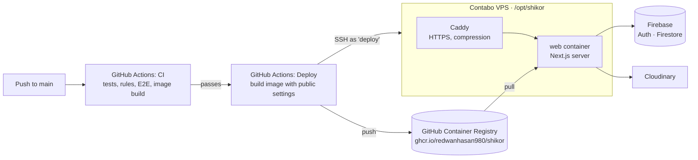

# Deploying শিকড় to your VPS

This guide is for the project owner. It sets up the Contabo VPS once. After that, every push to `main` that passes CI deploys automatically.

> **Never share your server's root password** in chats, issues or commits. Nothing in this guide needs it to leave your computer or the server.

---

## 1. How it works



- **The image is built on GitHub, not on the server**, so even a small VPS is enough.
- The server runs two containers with Docker Compose. **Caddy** gets and renews free HTTPS certificates (Let's Encrypt) and forwards requests to the **web** container.
- **The server keeps no app data.** People, trees and photos live in Firebase and Cloudinary. The only important file on the server is `/opt/shikor/.env`, which holds the server secrets.
- **Safe deploys:** `deploy.sh` waits for the new version to report healthy. If it doesn't, it switches back to the previous version automatically, and the Deploy run is marked as failed.

---

## 2. What you need

| Item | Recommendation |
| --- | --- |
| **VPS** | Contabo Cloud VPS with **Ubuntu 24.04**. Choose the region **closest to Bangladesh** (Singapore, or another Asian location if Contabo offers one). 2+ vCPU and 4+ GB RAM is plenty. |
| **Domain** | Needed for HTTPS and Google sign-in (Google does not accept a bare IP address). See SRS Q1 for name ideas. You can test on the IP first. |
| **Firebase** | The production project `shikor-fe44d`, with Firestore and Authentication set up ([Implementation Plan §8](./IMPLEMENTATION_PLAN.md#8-before-phase-0-setup-actions-for-the-product-owner)). |
| **Cloudinary** | A free account (needed from Phase 5, for photos). |
| **Your computer** | A terminal with `ssh` (macOS, Linux, or Windows 10+ PowerShell). |

---

## 3. One-time setup

### Step 1: Point your domain at the server

At your domain provider, create an **A record** for `@` (and optionally `www`) pointing to the VPS's **IPv4 address**. DNS can take from a few minutes to a few hours to update.

### Step 2: Create the deploy key (on your computer)

This key lets GitHub Actions log in as the limited `deploy` user. It is not your personal key.

```bash
ssh-keygen -t ed25519 -f shikor_deploy -C "github-actions-deploy" -N ""
```

This creates two files. `shikor_deploy` is the **private** key: it goes into GitHub secrets only. `shikor_deploy.pub` is the **public** key: it goes onto the server.

### Step 3: Prepare the server

Log in with the root password from Contabo's welcome email. If you can, add your own SSH key first (`ssh-copy-id root@YOUR_SERVER_IP`) so you can stop using the password.

```bash
ssh root@YOUR_SERVER_IP
curl -fsSL https://raw.githubusercontent.com/redwanhasan980/Family-Tree/main/deploy/setup-server.sh -o setup-server.sh
less setup-server.sh        # read it before running it
bash setup-server.sh --deploy-key "PASTE THE ONE LINE FROM shikor_deploy.pub" --domain your-domain.com
```

Leave out `--domain` to test on the IP first. The script:

- updates the system;
- installs Docker;
- creates the `deploy` user, which can only log in with the key;
- creates `/opt/shikor` with the Compose stack and a `.env` file;
- opens the firewall only for SSH, HTTP and HTTPS;
- turns on fail2ban and automatic security updates;
- adds swap on small servers.

It is safe to run again.

Once your own SSH key works for root, you can turn off password logins completely:

```bash
bash setup-server.sh --deploy-key "SAME KEY AS BEFORE" --harden-ssh
```

The script refuses to do this if no admin key exists, so you cannot lock yourself out.

### Step 4: Fill in the server secrets

```bash
nano /opt/shikor/.env
```

| Setting | Value |
| --- | --- |
| `SITE_ADDRESS` | your domain, e.g. `shikor.app, www.shikor.app` (or `:80` while testing on the IP) |
| `FIREBASE_SERVICE_ACCOUNT` | base64 of the `shikor-fe44d` service-account JSON (`base64 -w0 key.json`) |
| `CLOUDINARY_API_KEY`, `CLOUDINARY_API_SECRET` | from the Cloudinary dashboard (from Phase 5) |
| `CRON_SECRET` | already generated by the script; leave it |

The current placeholder site needs none of these secrets yet. Phase 1 and later features use them.

### Step 5: Record the server's fingerprint for GitHub

On **your computer**:

```bash
ssh-keyscan -t ed25519 YOUR_SERVER_IP
```

Copy the whole output line. To be sure it is really your server, compare it with the fingerprint shown on the server by `ssh-keygen -lf /etc/ssh/ssh_host_ed25519_key.pub`.

### Step 6: Configure GitHub

1. **Make `main` the default branch:** *Settings → General → Default branch → `main`*. This is required, because GitHub only starts the Deploy workflow from the default branch.
2. **Secrets:** *Settings → Secrets and variables → Actions → **Secrets** → New repository secret*.

   | Secret | Value |
   | --- | --- |
   | `DEPLOY_HOST` | the server's IP address |
   | `DEPLOY_USER` | `deploy` |
   | `DEPLOY_SSH_KEY` | the full contents of the private key file `shikor_deploy` |
   | `DEPLOY_KNOWN_HOSTS` | the line from Step 5 |
   | `DEPLOY_PORT` | only if SSH is not on port 22 |

3. **Variables:** same page, **Variables** tab. These values are public and are built into the web pages.

   | Variable | Value |
   | --- | --- |
   | `DEPLOY_ENABLED` | `true` (deploys stay off until this is set) |
   | `NEXT_PUBLIC_APP_URL` | `https://your-domain.com` (or `http://YOUR_SERVER_IP` while testing) |
   | `NEXT_PUBLIC_FIREBASE_API_KEY`, `…_AUTH_DOMAIN`, `…_PROJECT_ID`, `…_APP_ID` | from the `shikor-fe44d` web app config (Firebase console → Project settings → Your apps). The project ID is `shikor-fe44d` and the app ID is `1:58545906406:web:228d740e068a6b77799127`; `storageBucket`, `messagingSenderId` and `measurementId` are not used. In production `…_AUTH_DOMAIN` is **your domain** (DESIGN §9.5). |
   | `NEXT_PUBLIC_CLOUDINARY_CLOUD_NAME` | from Cloudinary (from Phase 5) |
   | `NEXT_PUBLIC_RECAPTCHA_SITE_KEY` | from reCAPTCHA (from Phase 8) |

4. Once Step 2 is done and the secret is saved, delete the private key from your computer, or keep it in a password manager.

### Step 7: First deploy

Go to *GitHub → Actions → **Deploy** → Run workflow* (on `main`). After a few minutes, open `https://your-domain.com/api/health`; it should show `{"status":"ok","version":"<commit>"}`.

### Step 8 (optional): Make the image public

*GitHub → your profile → **Packages** → `shikor` → Package settings → Change visibility → Public.* The code is already public and the image holds no secrets. With a public image, the server can pull versions without a token, which makes manual rollbacks simpler.

### Step 9: Firebase sign-in domains (from Phase 1)

Add your domain under *Firebase → Authentication → Settings → Authorized domains*. Add `https://your-domain.com/__/auth/handler` to the Google OAuth client's redirect URIs (DESIGN §9.5).

---

## 4. Everyday operations

| Task | How |
| --- | --- |
| **Deploy** | Push to `main`. Deploy runs after CI passes. Watch it in the **Actions** tab. |
| **Check health** | `https://your-domain.com/api/health` (also good for a free uptime monitor such as UptimeRobot) |
| **See logs** | `ssh root@SERVER` → `cd /opt/shikor && docker compose logs -f web` (Caddy: `logs -f caddy`) |
| **Roll back** | `sudo -u deploy /opt/shikor/deploy.sh <older-commit-sha>`. Add `SKIP_PULL=1` if that version is still on the server. |
| **Restart** | `cd /opt/shikor && docker compose restart web` |
| **Change a server secret** | Edit `/opt/shikor/.env`, then `docker compose up -d` |
| **Change a public `NEXT_PUBLIC_*` value** | Edit the GitHub variable, then re-run **Deploy**. These values are built into the image. |
| **Server updates** | Security updates install automatically. Reboot now and then; the containers start again on their own. |

---

## 5. Security notes

- **The `deploy` user can only log in with its key.** It belongs to the `docker` group, which gives root-level control of the server, so treat `DEPLOY_SSH_KEY` like a root credential. It is stored encrypted in GitHub secrets. To rotate it, create a new key, replace the line in `/home/deploy/.ssh/authorized_keys`, and update the secret.
- **Turn off password logins** with `--harden-ssh` once your own key works (Step 3).
- **Firewall:** only ports 22, 80 and 443 are open. The app container is not exposed directly; only Caddy is.
- **HTTPS:** Caddy renews certificates automatically. The app adds HSTS and the other security headers itself (DESIGN §24).
- **Backups:** the data lives in Firebase and Cloudinary. Keep a copy of `/opt/shikor/.env` in a password manager. A new server can be rebuilt with Steps 3–7.

---

## 6. Scheduled jobs (from v1.1)

The daily clean-up job (`/api/cron/cleanup`, P9-05) will be called by the server's own cron with `CRON_SECRET`. The exact cron line is added to this guide when that endpoint ships.

---

## 7. Troubleshooting

| Symptom | Fix |
| --- | --- |
| The Deploy workflow never runs | Check that `main` is the default branch and that `DEPLOY_ENABLED` is `true`. |
| "Host key verification failed" | `DEPLOY_KNOWN_HOSTS` doesn't match the server. Redo Step 5. |
| "Permission denied (publickey)" | `DEPLOY_SSH_KEY` doesn't match the key given to `setup-server.sh`. Re-run the script with the right `.pub` line. |
| "is not healthy … rolling back" | The new version failed to start. Read the logs printed in the Deploy run (or `docker compose logs web`). The site keeps running the previous version. |
| No HTTPS certificate | Check that the domain's A record points to the server, that `SITE_ADDRESS` is spelled correctly and that ports 80/443 are open. Then check `docker compose logs caddy`. |
| The site shows old content after a deploy | Hard-refresh the browser. Check `/api/health` to see which version is running. |
