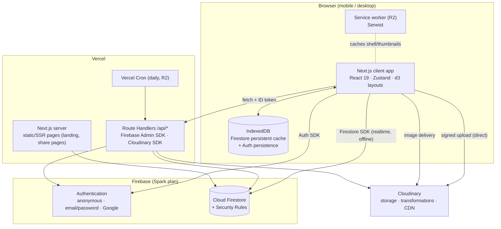
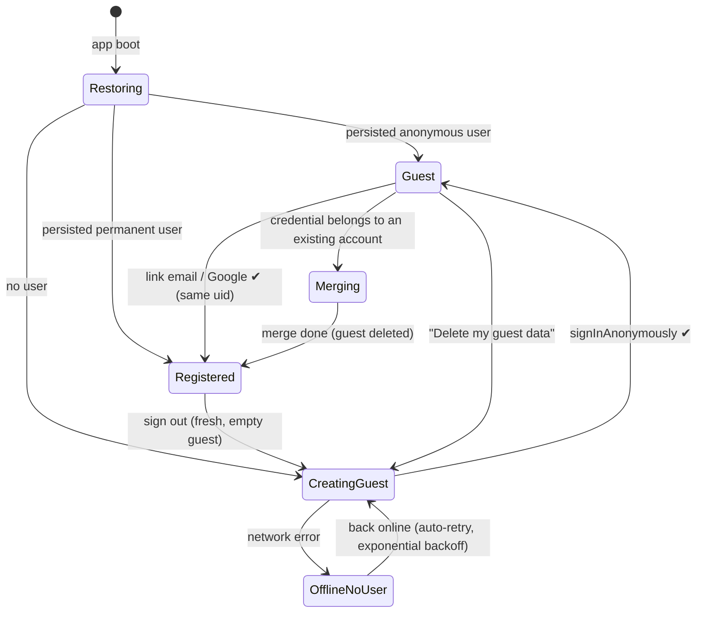
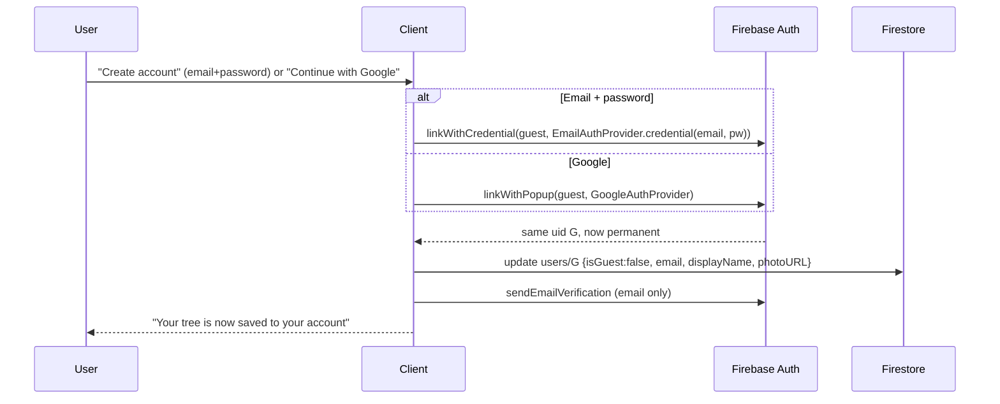
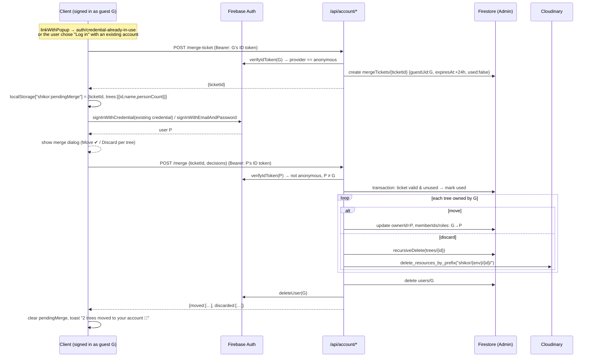
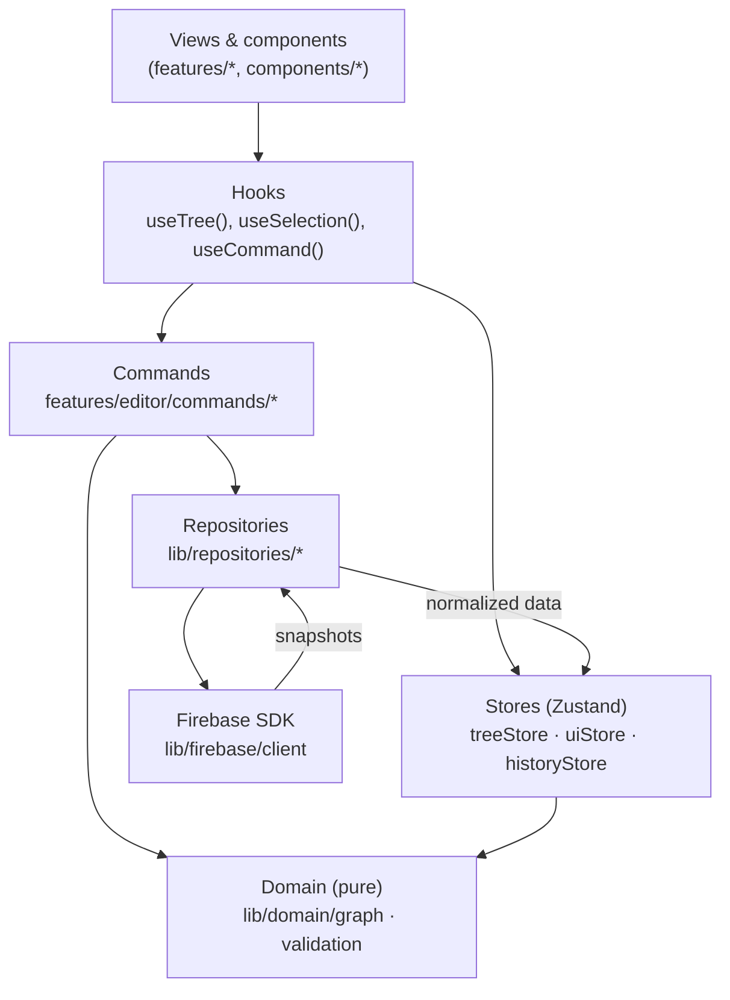
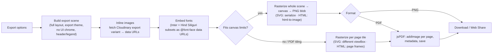
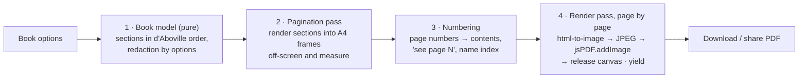
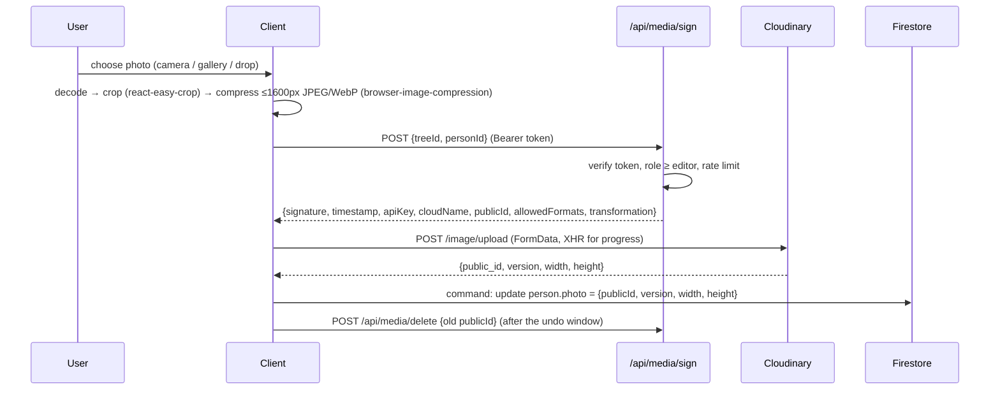

# Design Document

**Product:** শিকড় (pronounced *Shikor*, meaning "roots"), a bilingual (বাংলা / English) family-tree builder
**Document version:** 1.3 (adds the Family card, Generation album, Timeline and Family book; product named শিকড়)
**Date:** 2026-10-22
**Status:** Baseline for implementation
**Inputs:** [SRS](./SRS.md) · **Next:** [Implementation Plan](./IMPLEMENTATION_PLAN.md)

> This document explains **how** the requirements in the SRS are met. Requirement IDs (for example `REL-04`) link the two documents. When the design changes, update this document in the same pull request.

---

## Table of contents

1. [Goals & non-goals](#1-goals--non-goals)
2. [Architecture overview](#2-architecture-overview)
3. [Technology stack](#3-technology-stack)
4. [Architecture decision records](#4-architecture-decision-records)
5. [Project structure](#5-project-structure)
6. [Domain model (TypeScript)](#6-domain-model-typescript)
7. [Firestore data model](#7-firestore-data-model)
8. [Security rules](#8-security-rules)
9. [Authentication & guest lifecycle](#9-authentication--guest-lifecycle)
10. [Server API (Route Handlers)](#10-server-api-route-handlers)
11. [Client architecture & data flow](#11-client-architecture--data-flow)
12. [Graph engine](#12-graph-engine)
13. [Visualizations](#13-visualizations)
14. [Export pipeline](#14-export-pipeline)
15. [Media (Cloudinary)](#15-media-cloudinary)
16. [Internationalization](#16-internationalization)
17. [Relationship finder: kinship engine (R4)](#17-relationship-finder-kinship-engine-r4)
18. [Backup: JSON & GEDCOM (R1/R2)](#18-backup-json--gedcom-r1r2)
19. [PWA & offline (R2)](#19-pwa--offline-r2)
20. [Sharing & collaboration (R3)](#20-sharing--collaboration-r3)
21. [UI/UX design system](#21-uiux-design-system)
22. [Accessibility](#22-accessibility)
23. [Error handling, logging & observability](#23-error-handling-logging--observability)
24. [Security design](#24-security-design)
25. [Performance design](#25-performance-design)
26. [Testing strategy](#26-testing-strategy)
27. [Environments, configuration & CI/CD](#27-environments-configuration--cicd)
28. [Cost & quota analysis](#28-cost--quota-analysis)
29. [Risks & mitigations](#29-risks--mitigations)

---

## 1. Goals & non-goals

**Goals**

1. **Ease of use above everything.** Starting a tree takes 0 forms. Adding a relative takes 2 taps.
2. **Never lose data.** The guest account is created automatically, every edit is persisted, and the app survives going offline.
3. **One data model, many views.** Tree, Family card, Circle, List, Album and Timeline all render the same normalized graph, and the Family book is printed from it.
4. **Bangla is a first-class citizen**: UI, data entry, search, exports and kinship terms.
5. **Mobile and desktop are equally good.** Layouts are designed for each, not just squeezed.
6. **Professional engineering.** Typed end to end, tested security rules, CI, documented decisions.
7. **$0 to start.** Firebase Spark, Cloudinary Free and Vercel Hobby.

**Non-goals (for now):** native apps, server-side rendering of private trees, cross-user record matching, payments.

---

## 2. Architecture overview

### 2.1 Container view



### 2.2 Principles

| Principle | What it means in practice |
| --- | --- |
| **Client-first data access** | The browser reads and writes Firestore directly. **Security Rules are the access-control layer.** The server is used only for privileged operations: merge, account deletion, signing uploads, invites, public share pages, cron. |
| **Pure domain core** | Graph building, validation, layout, kinship and GEDCOM are pure TypeScript in `src/lib/domain`, with no React or Firebase imports. They are unit-tested to ≥ 90%. |
| **Commands for every mutation** | Every user change is a `Command` with forward and inverse write operations. That gives undo/redo, validation, batching and activity logging in one place. |
| **Offline-first** | The Firestore persistent cache plus latency compensation means the UI never waits for the network. |
| **Locale everywhere** | No hard-coded UI strings; locale-aware formatting; Bangla-safe string handling (grapheme-aware). |
| **Progressive delivery** | Visualization and export code is lazy-loaded. The landing page is static. |

---

## 3. Technology stack

Versions are the current stable releases at the time of writing (October 2026). The exact versions are pinned in `package.json` during Phase 0.

| Layer | Choice | Version | Why |
| --- | --- | --- | --- |
| Language | **TypeScript** (strict) | 6.0.x | Type safety end to end. TS 7 (native compiler) will be adopted when `typescript-eslint` supports it (it currently requires < 6.1). |
| Framework | **Next.js** (App Router) | 16.x | Static and SSR pages, Route Handlers (our "backend"), image and font optimization, first-class on Vercel. |
| UI runtime | React | 19.x | Ecosystem; React Compiler optional. |
| Styling | **Tailwind CSS** | 4.x | Design tokens through `@theme`; fast, consistent. |
| Components | **shadcn/ui** (Radix primitives) | latest | Accessible primitives we own and can restyle. Includes Drawer (vaul), Dialog, Popover, DropdownMenu, Tabs, Command (cmdk), Sonner toasts. |
| Icons | lucide-react | 1.x | Consistent line icons. |
| Animation | **motion** (formerly Framer Motion) | 14.x | Node transitions, sheets, delight. |
| State | **Zustand** | 5.x | Small, fast stores fed by Firestore listeners; selector-based re-render control. |
| Forms & validation | react-hook-form + **Zod** | 7.x / 4.x | Shared schemas for client, server and import validation. |
| i18n | **next-intl** | 4.x | App Router support, ICU messages, locale routing. |
| Theme | next-themes | 0.4.x | System/light/dark. |
| Layout math | d3-hierarchy, **d3-flextree**, d3-shape, d3-zoom, d3-interpolate, d3-scale | 3.x / 2.x / 4.x | Tree layout with variable-width couple nodes, sunburst partition, arcs, pan/zoom, timeline year scale. |
| Virtualization | @tanstack/react-virtual | 3.x | Long lists. |
| Export | **html-to-image**, **jsPDF** | 1.11 / 4.x | Rasterize browser-rendered output (correct Bangla shaping) and paginate into a PDF. SVG views are serialized directly; html-to-image is used for the HTML views and Family book pages (§14). |
| Images | react-easy-crop, browser-image-compression | 6.x / 2.x | Crop and compress before upload. |
| Auth & DB | **Firebase JS SDK** / **firebase-admin** | 13.x / 14.x | Mandated (C-01). |
| Media | **Cloudinary** (Node SDK on the server only) | 2.x | Decision D2. |
| PWA (R2) | **Serwist** (`@serwist/next`) | 9.x | Maintained successor to next-pwa. Turbopack compatibility is verified in a spike (risk R-08). |
| IDs | nanoid | 6.x | Random IDs for share links, invites and media. |
| Unit tests | **Vitest** + Testing Library | 5.x | Fast, ESM-native. |
| Rules tests | @firebase/rules-unit-testing + Firebase Emulator Suite (firebase-tools) | 6.x / 15.x | Tests every rule path. |
| E2E | **Playwright** + @axe-core/playwright | 1.6x / 4.x | Mobile and desktop projects, accessibility checks. |
| Lint & format | ESLint (flat config) + typescript-eslint, Prettier (+ tailwind plugin) | 9.x / 8.x / 3.x | Consistency. ESLint stays on 9.x until `eslint-plugin-react`, `-import` and `-jsx-a11y` support ESLint 10. |
| Git hooks | Husky + lint-staged + commitlint | 9.x / 17.x / 21.x | Conventional Commits, pre-commit checks. |
| Package manager | **pnpm** (via Corepack, pinned in `packageManager`) | latest | Fast, strict. |
| Runtime | Node.js | 22 LTS+ | Matches Vercel and CI. |
| Hosting | **Vercel** (Hobby to start) | n/a | Zero-config Next.js, preview deployments, cron. |
| Monitoring | Sentry (free developer plan, optional), Vercel Web Analytics (cookieless, optional) | n/a | Errors and Web Vitals without tracking users. |

**Why there is no Express server (decision D3, ADR-001).** Firestore is accessed directly from the client under security rules, and the handful of privileged operations fit naturally into Next.js Route Handlers on the same deployment. A separate Express service would add hosting, CORS, auth plumbing and cost with no functional gain. If a long-running service is ever needed (for example heavy server-side PDF rendering), an Express or Hono service can be added behind `/api` without changing the client contracts.

---

## 4. Architecture decision records

Short-form ADRs. Each has the status *Accepted* unless noted.

**ADR-001: Next.js full-stack, no separate backend.**
*Context:* the stack preference is TS, Next.js, Express and Vue, and Firebase is mandated. *Decision:* a single Next.js app; privileged logic lives in Route Handlers using the Admin SDK. *Consequences:* one repository, one deploy and shared types. Long-running jobs must fit within serverless time limits (they are batched).

**ADR-002: Anonymous auth with credential linking for guests.**
*Decision:* call `signInAnonymously` on first visit and keep it in `browserLocalPersistence` (IndexedDB). Upgrade with `linkWithCredential`/`linkWithPopup`, which keeps the user ID, so nothing needs to move. When the credential belongs to an existing account, use a **server-side merge with a merge ticket** (§9.4). *Consequences:* zero friction and no data copying in the common case. Guest data is unreachable if the browser storage is cleared, which is mitigated by user messaging and the JSON backup.

**ADR-003: Tree-scoped subcollections with relationship edge documents.**
*Decision:* `trees/{treeId}/persons/{personId}` and `trees/{treeId}/relationships/{relId}`, with deterministic relationship IDs (`p_{parent}_{child}`, `s_{a}_{b}`). *Alternatives:* embed parent IDs in person documents (fewer reads, but duplicated spouse data and weaker integrity), or one big tree document (1 MiB limit, write contention, coarse rules). *Consequences:* clean rules, natural collaboration, duplicate edges impossible by construction, relationships stored explicitly as the user asked. The cost is about N + M reads per cold load (§28).

**ADR-004: Cloudinary with server-signed direct uploads; store `publicId`, not URLs.**
*Decision:* the client asks `/api/media/sign` (which checks membership) for a signature, then uploads straight to Cloudinary. Persons store `{publicId, version, width, height}`, and URLs are built at render time for each size. *Consequences:* no API secret in the client, flexible sizes, CDN delivery, face-aware crops. Photos are public-if-known URLs (unguessable IDs), which is documented on the privacy page. Authenticated delivery can be adopted later.

**ADR-005: Custom SVG renderers on d3 layout math (not React Flow or family-chart).**
*Decision:* d3-flextree for the tree layout, d3-partition for the circle view, d3-scale for the timeline, and our own React SVG components with d3-zoom for the camera. This applies to the canvas views; the card views are plain HTML (ADR-013). *Why:* full control over couple and family rendering, Bangla text, theming, export fidelity and performance (imperative camera transforms, culling). Generic graph editors fit family semantics poorly, and existing family-tree libraries limit styling and export.

**ADR-006: Client-side export by rasterizing browser-rendered output.**
*Decision:* render the full scene off-screen, rasterize it to a canvas, and paginate into jsPDF as images. SVG views (Tree, Circle, Timeline) are **serialized directly** (`XMLSerializer` with embedded fonts and data-URL images), which avoids `foreignObject` and is reliable in Safari. HTML views (List, Family card, Album, Family book pages) use **html-to-image**, which wraps the DOM in an SVG `foreignObject`. *Why:* jsPDF's text API does not shape Bangla (conjuncts break). The browser shapes text correctly, so rasterizing preserves it. *Consequences:* PDF text is not selectable. "Print" (browser print with a print stylesheet) is offered for a vector, selectable list.

**ADR-007: Zustand stores fed by Firestore snapshot listeners (no TanStack Query).**
*Decision:* realtime listeners write normalized maps into a per-tree store; derived data (graph, layouts) is memoized in selectors. *Why:* Firestore already provides caching, realtime updates and an offline queue, so a second cache layer would duplicate it.

**ADR-008: next-intl with locale-prefixed routes.**
*Decision:* `/{locale}/…` with `bn` and `en`. The locale is detected by `src/proxy.ts` (Next.js 16's renamed middleware). Messages are JSON files, one per locale and namespace. *Consequences:* shareable localized URLs, a correct `<html lang>`, and SEO for the landing page.

**ADR-009: Vercel + Firebase Spark + Cloudinary Free, no Cloud Functions.**
*Decision:* keep a $0 baseline. Scheduled work runs as Vercel Cron, daily. *Consequences:* no Firestore triggers. Side effects such as deleting photos when a person is deleted are performed explicitly by the client or server code that makes the change. Orphan sweeps run in the daily cron (R2).

**ADR-010: Undo/redo with the command pattern and inverse batched writes.**
*Decision:* every command stores the forward operations and the inverse operations computed from the pre-change local state. *Consequences:* consistent undo across views, atomic multi-document operations, and one hook for validation and activity logging.

**ADR-011: Serwist for the PWA (R2).**
*Decision:* use Serwist for precaching and runtime caching. A spike verifies the Turbopack build in Phase 9; the fallback is a hand-written service worker built with `serwist` core, or a webpack build only for the service-worker step.

**ADR-012: Public share pages rendered on the server with the Admin SDK (R3).**
*Decision:* `/{locale}/s/{shareId}` is resolved on the server, and the data is **redacted** (contact fields and, optionally, living persons' details) before it is sent. *Why:* Firestore rules cannot hide individual fields from a reader, and share IDs must be revocable without exposing tree IDs.

**ADR-013: Two kinds of views: SVG canvas views and HTML card views.**
*Decision:* views that need pan and zoom over a large drawing (Tree, Circle, Timeline) are **SVG canvas views** with the shared camera. Views made of scrollable cards (Family card, List, Album) are plain **HTML/CSS** with no camera. *Why:* card views get native scrolling, text wrapping, accessibility and responsive CSS for free. Canvas views need precise geometry and smooth zoom. *Consequences:* two export paths (ADR-006). Every view consumes the same domain selectors (graph, focus, selection, colour-by), so behaviour stays consistent.

**ADR-014: Feature flags for staged views.**
*Decision:* views and outputs that ship in later releases (Album, Timeline, Family book) sit behind a typed `features.ts` flag set, which an environment variable can override in previews. *Why:* their code can merge to `main` early, while production users see only released features.

---

## 5. Project structure

```text
family-tree/
├── .claude/
│   └── skills/family-tree-dev/SKILL.md      # project playbook for Claude
├── .github/
│   ├── workflows/ci.yml                      # typecheck, lint, unit, rules, build, e2e
│   └── pull_request_template.md
├── docs/
│   ├── SRS.md · DESIGN.md · IMPLEMENTATION_PLAN.md
│   └── adr/                                  # long-form ADRs when a decision needs more than §4
├── e2e/                                      # Playwright specs (mobile + desktop projects)
├── firebase/
│   ├── firestore.rules
│   ├── firestore.indexes.json
│   └── tests/                                # rules unit tests (emulator)
├── messages/
│   ├── en.json
│   └── bn.json
├── public/                                   # icons, og images, maskable icons
├── scripts/
│   ├── check-i18n.ts                         # en/bn key parity (CI)
│   └── seed-emulator.ts                      # demo data for local dev
├── src/
│   ├── app/
│   │   ├── [locale]/
│   │   │   ├── layout.tsx                    # html lang, fonts, providers
│   │   │   ├── page.tsx                      # landing (static)
│   │   │   ├── (auth)/login/page.tsx
│   │   │   ├── (auth)/signup/page.tsx
│   │   │   ├── (auth)/reset-password/page.tsx
│   │   │   ├── (app)/layout.tsx              # <AuthGate> ensures a (guest) session
│   │   │   ├── (app)/start/page.tsx          # onboarding wizard
│   │   │   ├── (app)/trees/page.tsx          # dashboard
│   │   │   ├── (app)/trees/[treeId]/page.tsx # editor (?view=tree|circle|list&focus=…)
│   │   │   ├── (app)/settings/page.tsx
│   │   │   ├── s/[shareId]/page.tsx          # public share (R3, SSR)
│   │   │   ├── invite/[inviteId]/page.tsx    # invite acceptance (R3)
│   │   │   ├── help/page.tsx
│   │   │   └── privacy/page.tsx
│   │   ├── api/
│   │   │   ├── account/merge-ticket/route.ts
│   │   │   ├── account/merge/route.ts
│   │   │   ├── account/delete/route.ts
│   │   │   ├── media/sign/route.ts
│   │   │   ├── media/delete/route.ts
│   │   │   ├── invites/accept/route.ts       # R3
│   │   │   ├── trees/[treeId]/transfer/route.ts  # R3
│   │   │   └── cron/cleanup/route.ts         # R2
│   │   ├── manifest.ts                       # R2
│   │   ├── sw.ts                             # R2 (Serwist)
│   │   ├── robots.ts · sitemap.ts
│   ├── proxy.ts                              # next-intl locale routing (Next 16 "proxy")
│   ├── i18n/                                 # routing.ts, request.ts, navigation.ts
│   ├── components/
│   │   ├── ui/                               # shadcn primitives (owned code)
│   │   └── app/                              # AppHeader, LanguageSwitch, SaveStatus, Avatar…
│   ├── features/
│   │   ├── auth/                             # AuthProvider, guest bootstrap, link/merge flows
│   │   ├── trees/                            # dashboard, create/rename/delete, settings
│   │   ├── editor/                           # EditorShell, toolbar, selection, commands/, history
│   │   ├── person/                           # PersonPanel, PersonForm, QuickAdd, BulkAddChildren, PersonPicker
│   │   ├── views/
│   │   │   ├── shared/                       # camera, collapse state, colors, card model, text measure
│   │   │   ├── tree/                         # layout.ts, TreeView.tsx, PersonCard.tsx, Connectors.tsx
│   │   │   ├── circle/                       # layout.ts, CircleView.tsx, ArcLabel.tsx
│   │   │   ├── list/                         # OutlineList.tsx, Directory.tsx
│   │   │   ├── family/                       # FamilyCardView.tsx, ParentsRow, CoupleCard, ChildrenGrid (R1)
│   │   │   ├── album/                        # AlbumView.tsx, GenerationRow, Slideshow (R2)
│   │   │   └── timeline/                     # layout.ts, TimelineView.tsx, LifeBar, YearAxis (R3)
│   │   ├── export/                           # ExportDialog, scene builders, svgRaster.ts, htmlRaster.ts, pdf.ts
│   │   │   └── book/                         # Family book: model.ts, paginate.ts, pages/*, BookDialog (R3)
│   │   ├── media/                            # PhotoPicker, Cropper, upload.ts, cloudinaryUrl.ts
│   │   ├── onboarding/                       # wizard, coach marks
│   │   ├── backup/                           # json.ts (R1 export), import (R2), gedcom UI (R2)
│   │   ├── sharing/                          # R3
│   │   └── kinship/                          # R4 UI
│   ├── lib/
│   │   ├── domain/                           # PURE TS — no React/Firebase imports
│   │   │   ├── types.ts · schemas.ts (zod) · ids.ts
│   │   │   ├── graph/                        # build, families, descendants, ancestors, familyCard, generations, validate, search
│   │   │   ├── names.ts · dates.ts · text.ts # display names, partial dates, grapheme-safe helpers
│   │   │   ├── timeline.ts · historyEvents.ts# life ranges, overlap, historical markers (R3)
│   │   │   ├── kinship/                      # R4: path finding, signatures, term tables
│   │   │   └── gedcom/                       # R2: parser, serializer, mappers
│   │   ├── firebase/
│   │   │   ├── client.ts                     # app, auth, firestore (persistent cache), app check
│   │   │   ├── admin.ts                      # `import "server-only"`
│   │   │   └── converters.ts                 # Firestore <-> domain types
│   │   ├── repositories/                     # the ONLY place client code touches Firestore
│   │   │   ├── trees.ts · persons.ts · relationships.ts · users.ts · batch.ts
│   │   ├── server/                           # server-only helpers
│   │   │   ├── auth.ts                       # verifyRequest(): ID token + App Check
│   │   │   ├── http.ts                       # json/error helpers, error codes
│   │   │   ├── cloudinary.ts · rateLimit.ts · treeAdmin.ts (recursive delete, transfer)
│   │   ├── features.ts                       # feature flags for staged views (ADR-014)
│   │   ├── brand.ts                          # APP_NAME = 'শিকড়' + <AppName /> (always Bangla, I18N-10)
│   │   └── utils/
│   ├── stores/
│   │   ├── treeStore.ts                      # normalized persons/relationships for the open tree
│   │   ├── uiStore.ts                        # view, selection, focus, panel state
│   │   └── historyStore.ts                   # undo/redo stacks
│   └── styles/globals.css                    # Tailwind v4 @theme tokens (light/dark)
├── CLAUDE.md · README.md · CHANGELOG.md
├── firebase.json · .firebaserc
├── next.config.ts · tsconfig.json · eslint.config.mjs · prettier.config.mjs
├── vitest.config.ts · playwright.config.ts
└── package.json · pnpm-lock.yaml · .nvmrc · .env.example
```

**Conventions:** unit tests sit next to their source (`foo.ts` → `foo.test.ts`). Feature folders expose a public `index.ts`, and other features import only from it.

---

## 6. Domain model (TypeScript)

```ts
// src/lib/domain/types.ts — pure types shared by client, server, import/export
export type ID = string;
export type Locale = 'bn' | 'en';
export type Gender = 'male' | 'female' | 'unknown';
export type Role = 'owner' | 'editor' | 'viewer';
export type ViewKind = 'tree' | 'family' | 'circle' | 'list' | 'album' | 'timeline';

/** Year-only, year+month, or full date. People often know only the year. */
export interface PartialDate {
  year: number;
  month?: number; // 1-12
  day?: number;   // 1-31
  approximate?: boolean; // "circa"
}

export interface LocalizedName { en?: string; bn?: string } // at least one non-empty

export interface LifeEvent { date?: PartialDate; place?: string }

export interface PhotoRef {
  publicId: string;   // shikor/{env}/{treeId}/{personId}/{random}
  version: number;    // Cloudinary version for cache-busting
  width: number;
  height: number;
}

export interface CustomField { id: string; label: string; value: string }

export interface Person {
  id: ID;
  names: LocalizedName;
  nickname?: string;
  gender: Gender;
  isLiving: boolean;
  birth?: LifeEvent;
  death?: LifeEvent;
  profession?: string;
  education?: string;
  addresses?: { present?: string; permanent?: string };
  phones?: string[];
  email?: string;
  description?: string;
  photo?: PhotoRef | null;
  customFields?: CustomField[];
  /** Sibling sort key (fractional indexing). Falls back to birth date, then createdAt. */
  childOrder?: number;
  createdAt: Date; createdBy: ID; updatedAt: Date; updatedBy: ID;
  schemaVersion: 1;
}

export type ParentKind = 'biological' | 'adoptive' | 'step' | 'foster';
export type SpouseStatus = 'married' | 'divorced' | 'separated' | 'widowed';

export interface ParentLink {
  id: `p_${string}_${string}`; // p_{parentId}_{childId}
  type: 'parent';
  parentId: ID;
  childId: ID;
  kind: ParentKind;
  createdAt: Date; createdBy: ID; updatedAt: Date; updatedBy: ID;
  schemaVersion: 1;
}

export interface SpouseLink {
  id: `s_${string}_${string}`; // s_{minId}_{maxId}
  type: 'spouse';
  personIds: [ID, ID];         // sorted ascending
  status: SpouseStatus;
  marriageDate?: PartialDate;
  /** Marriage order when dates are unknown (1 = first marriage). */
  sequence?: number;
  createdAt: Date; createdBy: ID; updatedAt: Date; updatedBy: ID;
  schemaVersion: 1;
}

export type Relationship = ParentLink | SpouseLink;

export interface TreeSettings {
  nameDisplay: 'auto' | 'en' | 'bn' | 'both'; // auto = UI locale, falls back to the other
  colorBy: 'branch' | 'gender' | 'generation' | 'none';
  showPhotos: boolean;
  showDates: boolean;
  defaultView: ViewKind;
  kinshipStyle: 'bd' | 'wb'; // R4
}

export interface Tree {
  id: ID;
  name: string;
  description?: string;
  ownerId: ID;
  memberIds: ID[];                 // for array-contains queries
  roles: Record<ID, Role>;         // authoritative roles
  rootPersonId?: ID;
  personCount: number;             // maintained with increment()
  settings: TreeSettings;
  createdAt: Date; updatedAt: Date; updatedBy: ID;
  schemaVersion: 1;
}

export interface UserProfile {
  uid: ID;
  isGuest: boolean;
  displayName?: string;
  email?: string;
  photoURL?: string;
  locale: Locale;
  theme: 'system' | 'light' | 'dark';
  selfPersonIds: Record<ID /*treeId*/, ID /*personId*/>; // "This is me"
  onboardingCompleted: boolean;
  createdAt: Date;
  lastActiveAt: Date;              // written at most once per day
  schemaVersion: 1;
}
```

Zod schemas in `schemas.ts` mirror these types and enforce the SRS §6.2 limits. The server, the forms and the importers all use the **same** schemas.

---

## 7. Firestore data model

### 7.1 Collections

```text
users/{uid}                                   UserProfile
trees/{treeId}                                Tree
trees/{treeId}/persons/{personId}             Person
trees/{treeId}/relationships/{relId}          ParentLink | SpouseLink
trees/{treeId}/activity/{entryId}             ActivityEntry          (R3)
shareLinks/{shareId}                          ShareLink              (R3)
invites/{inviteId}                            Invite                 (R3)
mergeTickets/{ticketId}                       MergeTicket            (server-only)
rateLimits/{key}                              counter                (server-only)
```

### 7.2 Example documents

```jsonc
// trees/Xk2…
{
  "name": "করিম পরিবার",
  "ownerId": "uidA",
  "memberIds": ["uidA"],
  "roles": { "uidA": "owner" },
  "rootPersonId": "p9Q…",
  "personCount": 57,
  "settings": { "nameDisplay": "auto", "colorBy": "branch", "showPhotos": true,
                "showDates": true, "defaultView": "tree", "kinshipStyle": "bd" },
  "createdAt": "<ts>", "updatedAt": "<ts>", "updatedBy": "uidA", "schemaVersion": 1
}

// trees/Xk2…/persons/p9Q…
{
  "names": { "bn": "আব্দুল করিম", "en": "Abdul Karim" },
  "nickname": "করিম মিয়া",
  "gender": "male",
  "isLiving": false,
  "birth": { "date": { "year": 1931, "approximate": true }, "place": "শিবগঞ্জ, চাঁপাইনবাবগঞ্জ" },
  "death": { "date": { "year": 2004, "month": 3 } },
  "profession": "কৃষক",
  "photo": { "publicId": "shikor/prod/Xk2…/p9Q…/a8Fz…", "version": 1729500000, "width": 1200, "height": 1200 },
  "createdAt": "<ts>", "createdBy": "uidA", "updatedAt": "<ts>", "updatedBy": "uidA", "schemaVersion": 1
}

// trees/Xk2…/relationships/p_p9Q…_c3L…
{ "type": "parent", "parentId": "p9Q…", "childId": "c3L…", "kind": "biological", "...stamps": "…" }

// trees/Xk2…/relationships/s_a1…_p9Q…   (ids sorted)
{ "type": "spouse", "personIds": ["a1…", "p9Q…"], "status": "married", "sequence": 1, "...stamps": "…" }
```

### 7.3 Key design points

- **Deterministic relationship IDs** make duplicate edges impossible. The same parent/child pair always writes the same document.
- **Persons and relationships are separate** so that a relationship can be edited (kind, status, mother change) without touching person documents.
- **Membership lives in the tree document** (`memberIds` for queries, `roles` for authorization). Rules read it through a single cached `get()`.
- `personCount` is updated with `increment(±n)` in the same batch as person creation and deletion.
- **Tree `updatedAt`** is "touched" at most once per minute per session (debounced) to save writes. Structural batches (add/delete) always touch it.
- `schemaVersion` on every document enables lazy migrations. The client upgrades old shapes on read, and the next write persists the new shape (OPS-04).
- **Field limits** follow SRS §6.2 and are enforced in Zod and in the rules.

### 7.4 Queries

| Use | Query | Index |
| --- | --- | --- |
| Dashboard | `trees where memberIds array-contains uid orderBy updatedAt desc` | composite: `memberIds (CONTAINS) + updatedAt (DESC)` |
| Open tree | `persons` (whole collection) and `relationships` (whole collection) as two listeners | none (collection scans) |
| Merge / delete (server) | `trees where ownerId == uid` | automatic single-field |
| Guest cleanup (server, R2) | `users where isGuest == true and lastActiveAt < cutoff` | composite: `isGuest + lastActiveAt` |
| Activity (R3) | `activity orderBy at desc limit 50` | automatic |

`firestore.indexes.json` also **exempts long text fields** (`description`, `customFields`, `addresses`) from single-field indexing. This saves storage and write cost.

### 7.5 Loading a tree (read budget)

Opening a tree attaches 3 listeners (tree document, persons, relationships), which costs **1 + N + M reads** on a cold session. With the persistent cache, the view renders **immediately from IndexedDB** (`getDocsFromCache`) while the listeners sync. Listeners that resume within about 30 minutes are charged only for changed documents. §28 has the quota math.

---

## 8. Security rules

`firebase/firestore.rules` is the source of truth. Every rule path is covered by tests in `firebase/tests` (NFR-SEC-01). This is the baseline draft:

```js
rules_version = '2';
service cloud.firestore {
  match /databases/{database}/documents {

    // ---------- helpers ----------
    function signedIn() { return request.auth != null; }
    function me() { return request.auth.uid; }
    function isGuest() { return request.auth.token.firebase.sign_in_provider == 'anonymous'; }
    function treeDoc(treeId) { return get(/databases/$(database)/documents/trees/$(treeId)).data; }
    function roleOf(treeId) { return treeDoc(treeId).roles.get(me(), ''); }
    function canRead(treeId) { return signedIn() && roleOf(treeId) in ['owner', 'editor', 'viewer']; }
    function canEdit(treeId) { return signedIn() && roleOf(treeId) in ['owner', 'editor']; }
    // Every write must be stamped by the caller with a server timestamp.
    function stamped(d) { return d.updatedBy == me() && d.updatedAt == request.time; }
    function optStr(d, k, max) { return !(k in d) || (d[k] is string && d[k].size() <= max); }
    function changedKeys() { return request.resource.data.diff(resource.data).affectedKeys(); }

    // ---------- users ----------
    match /users/{uid} {
      allow read: if signedIn() && me() == uid;
      allow create, update: if signedIn() && me() == uid && validUser(request.resource.data);
      allow delete: if false;                       // server only (merge / account deletion)
    }

    // ---------- trees ----------
    match /trees/{treeId} {
      allow get:  if signedIn() && resource.data.roles.get(me(), '') != '';
      allow list: if signedIn() && me() in resource.data.memberIds;
      allow create: if signedIn()
        && request.resource.data.ownerId == me()
        && request.resource.data.memberIds == [me()]
        && request.resource.data.roles.keys().hasOnly([me()])
        && request.resource.data.roles[me()] == 'owner'
        && validTree(request.resource.data) && stamped(request.resource.data);
      allow update: if signedIn() && validTree(request.resource.data) && stamped(request.resource.data)
        && (ownerUpdate() || editorUpdate() || selfLeave());
      allow delete: if signedIn() && resource.data.ownerId == me();

      // The owner may edit everything except ownership; may remove members or change roles,
      // but never add members (that happens on the server through invites, R3).
      function ownerUpdate() {
        return resource.data.ownerId == me()
          && !changedKeys().hasAny(['ownerId', 'createdAt'])
          && request.resource.data.memberIds.toSet().difference(resource.data.memberIds.toSet()).size() == 0
          && request.resource.data.roles.keys().toSet() == request.resource.data.memberIds.toSet()
          && request.resource.data.roles[me()] == 'owner';
      }
      function editorUpdate() {
        return resource.data.roles.get(me(), '') == 'editor'
          && changedKeys().hasOnly(['name', 'description', 'rootPersonId', 'settings',
                                    'personCount', 'updatedAt', 'updatedBy']);
      }
      function selfLeave() {
        return me() in resource.data.memberIds && resource.data.ownerId != me()
          && changedKeys().hasOnly(['memberIds', 'roles', 'updatedAt', 'updatedBy'])
          && request.resource.data.memberIds.toSet() == resource.data.memberIds.toSet().difference([me()].toSet())
          && !request.resource.data.roles.keys().hasAny([me()]);
      }

      match /persons/{personId} {
        allow read: if canRead(treeId);
        allow create, update: if canEdit(treeId)
          && validPerson(request.resource.data, treeId, personId) && stamped(request.resource.data);
        allow delete: if canEdit(treeId);
      }

      match /relationships/{relId} {
        allow read: if canRead(treeId);
        allow create, update: if canEdit(treeId)
          && validRelationship(relId, request.resource.data) && stamped(request.resource.data);
        allow delete: if canEdit(treeId);
      }

      match /activity/{entryId} {                  // R3: append-only
        allow read: if canRead(treeId);
        allow create: if canEdit(treeId)
          && request.resource.data.actorId == me() && request.resource.data.at == request.time;
        allow update, delete: if false;
      }
    }

    // ---------- R3: share links & invites (read by the server via the Admin SDK) ----------
    match /shareLinks/{shareId} {
      allow read, delete: if signedIn() && resource.data.createdBy == me();
      allow create: if signedIn() && request.resource.data.createdBy == me()
        && treeDoc(request.resource.data.treeId).ownerId == me();
      allow update: if signedIn() && resource.data.createdBy == me()
        && changedKeys().hasOnly(['enabled', 'options', 'updatedAt']);
    }
    match /invites/{inviteId} {
      allow read, delete: if signedIn() && resource.data.createdBy == me();
      allow create: if signedIn() && !isGuest() && request.auth.token.email_verified == true
        && request.resource.data.createdBy == me()
        && treeDoc(request.resource.data.treeId).ownerId == me()
        && request.resource.data.role in ['editor', 'viewer']
        && request.resource.data.uses == 0;
      allow update: if false;                      // accepted on the server
    }

    // mergeTickets, rateLimits: no client access (default deny).

    // ---------- validators ----------
    function validPerson(p, treeId, personId) {
      return p.keys().hasAll(['names', 'gender', 'isLiving', 'createdAt', 'createdBy',
                              'updatedAt', 'updatedBy', 'schemaVersion'])
        && p.keys().hasOnly(['names', 'nickname', 'gender', 'isLiving', 'birth', 'death',
                             'profession', 'education', 'addresses', 'phones', 'email',
                             'description', 'photo', 'customFields', 'childOrder',
                             'createdAt', 'createdBy', 'updatedAt', 'updatedBy', 'schemaVersion'])
        && p.names is map && p.names.keys().hasOnly(['en', 'bn'])
        && optStr(p.names, 'en', 120) && optStr(p.names, 'bn', 120)
        && (p.names.get('en', '').size() > 0 || p.names.get('bn', '').size() > 0)
        && p.gender in ['male', 'female', 'unknown'] && p.isLiving is bool
        && optStr(p, 'nickname', 60) && optStr(p, 'profession', 120) && optStr(p, 'education', 120)
        && optStr(p, 'email', 254) && optStr(p, 'description', 2000)
        && (!('phones' in p) || (p.phones is list && p.phones.size() <= 3))
        && (!('customFields' in p) || (p.customFields is list && p.customFields.size() <= 20))
        && (!('photo' in p) || p.photo == null
            || (p.photo.publicId is string
                && p.photo.publicId.matches('^shikor/[a-z]+/' + treeId + '/' + personId + '/[A-Za-z0-9_-]+$')));
    }

    function validRelationship(relId, r) {
      return (r.type == 'parent'
          && r.keys().hasOnly(['type', 'parentId', 'childId', 'kind',
                               'createdAt', 'createdBy', 'updatedAt', 'updatedBy', 'schemaVersion'])
          && r.parentId is string && r.childId is string && r.parentId != r.childId
          && relId == 'p_' + r.parentId + '_' + r.childId
          && r.kind in ['biological', 'adoptive', 'step', 'foster'])
        || (r.type == 'spouse'
          && r.keys().hasOnly(['type', 'personIds', 'status', 'marriageDate', 'sequence',
                               'createdAt', 'createdBy', 'updatedAt', 'updatedBy', 'schemaVersion'])
          && r.personIds is list && r.personIds.size() == 2 && r.personIds[0] < r.personIds[1]
          && relId == 's_' + r.personIds[0] + '_' + r.personIds[1]
          && r.status in ['married', 'divorced', 'separated', 'widowed']);
    }

    function validTree(t) {
      return t.name is string && t.name.size() >= 1 && t.name.size() <= 80
        && optStr(t, 'description', 500)
        && t.memberIds is list && t.memberIds.size() <= 50
        && t.roles is map && t.settings is map
        && t.personCount is int && t.personCount >= 0;
    }

    function validUser(u) {
      return u.isGuest is bool && u.locale in ['bn', 'en']
        && optStr(u, 'displayName', 80)
        && (!('selfPersonIds' in u) || u.selfPersonIds is map);
    }
  }
}
```

**What the rules intentionally do *not* enforce:** cross-document graph integrity (cycles, one biological father, endpoints existing). Rules may make at most 20 document-access calls per batched write, and a bulk add would exceed that. These invariants are enforced by the **domain validation layer** (§12.5). The graph builder **tolerates** violations (it skips and reports dangling or invalid edges) instead of crashing (NFR-REL-04).

**Rules testing checklist:** owner/editor/viewer/non-member/guest × read/create/update/delete for every collection; role escalation attempts (an editor adding themselves as owner, an owner adding a member directly, changing `ownerId`); malformed persons (missing name, too-long description, a foreign photo `publicId`); relationship ID mismatches; unsorted spouse IDs; self-leave edge cases; R3 invites by unverified or guest users.

---

## 9. Authentication & guest lifecycle

### 9.1 Client setup

```ts
// src/lib/firebase/client.ts (sketch)
const app = getApps()[0] ?? initializeApp(firebaseConfig);
export const auth = initializeAuth(app, {
  persistence: [indexedDBLocalPersistence, browserLocalPersistence],
  popupRedirectResolver: browserPopupRedirectResolver,
});
export const db = initializeFirestore(app, {
  localCache: persistentLocalCache({ tabManager: persistentMultipleTabManager() }),
});
if (process.env.NEXT_PUBLIC_USE_EMULATORS === 'true') { /* connect emulators */ }
// App Check (reCAPTCHA v3) initialised in production (NFR-SEC-05)
```

### 9.2 Session state machine



`<AuthGate>` (in the `(app)` layout) waits for `Restoring` and starts guest creation when needed. App pages render a skeleton until a user exists. The **landing page does not create guests**: a guest is created when the user enters the app. This avoids empty accounts for bots and casual visitors.

### 9.3 Upgrade by linking (the common case)



### 9.4 Merge into an existing account (merge ticket)

Problem: once the client signs in as the existing user P, it loses the guest session G. **Merge tickets** let the server move G's trees safely, even after redirects or delays.



**Properties:**

- **Idempotent.** A used ticket returns the previous result. Trees already owned by P are skipped. A missing guest user counts as already merged.
- **Resumable.** If the tab closes after sign-in, `shikor:pendingMerge` is detected on the next load and the dialog reappears (until the ticket expires after 24 h).
- **Safe.** Tickets can only be created by an anonymous token for its own user ID, redeemed only by a non-anonymous user, are single-use, and expire after 24 h.
- **Guest with no trees:** no ticket is needed. The orphaned anonymous user is removed by the cleanup cron (R2).

### 9.5 Google sign-in specifics

- **Popup first** (`linkWithPopup` or `signInWithPopup`), triggered directly by a click, which works on modern mobile browsers. On `auth/popup-blocked`, fall back to **redirect**.
- **Redirect-safe auth domain:** browsers that partition third-party storage (Safari, and Chrome in some modes) break redirects unless the auth handler is on the app's own origin. In production, set `NEXT_PUBLIC_FIREBASE_AUTH_DOMAIN` to the app domain and proxy the handler:

  ```ts
  // next.config.ts
  async rewrites() {
    return [{ source: '/__/auth/:path*',
              destination: `https://${process.env.NEXT_PUBLIC_FIREBASE_PROJECT_ID}.firebaseapp.com/__/auth/:path*` }];
  }
  ```

  Then add `https://<app-domain>/__/auth/handler` to the Google OAuth client's authorized redirect URIs and the domain to Firebase's authorized domains. The `proxy.ts` matcher must exclude `/__/` and `/api`.
- **In-app browsers (AUTH-15):** detect them with a user-agent check (`FBAN|FBAV|FB_IAB|Instagram|Line/|MicroMessenger|; wv\)`). Instead of a Google button that would fail with `disallowed_useragent`, show "Open in your browser" instructions (with a copy-link button). Email/password remains available.

### 9.6 Other auth flows

- **Password reset:** `sendPasswordResetEmail`, with the action URL set to the app's locale route.
- **Sign out (registered users only):** signs out, and the next app visit creates a fresh guest (empty).
- **Delete guest data / delete account:** `POST /api/account/delete` (§10). Re-authentication is required if `auth_time` is older than 5 minutes (permanent users).
- **Activity stamp:** on app load, if `users/{uid}.lastActiveAt` is older than 24 h, update it. This drives guest retention (AUTH-14).

---

## 10. Server API (Route Handlers)

### 10.1 Conventions

- **Runtime:** Node.js (Admin SDK). Files under `src/app/api/**/route.ts`.
- **Auth:** `Authorization: Bearer <Firebase ID token>`, verified with `getAuth().verifyIdToken(token, true)` (revocation checked). In production, `X-Firebase-AppCheck` is verified with `getAppCheck().verifyToken()`.
- **Validation:** the request body is parsed with Zod. Unknown keys are rejected.
- **Responses:** JSON. Errors look like `{ "error": { "code": "tree_not_found", "message": "…" } }`, where `message` is for developers and the client maps `code` to a localized string.
- **Status codes:** 200/201 success · 400 `invalid_request` · 401 `unauthenticated` · 403 `forbidden` · 404 `not_found` · 409 `conflict` · 410 `expired` · 429 `rate_limited` · 500 `internal`.
- **No cookies, so CSRF does not apply.** CORS is same-origin only.

```ts
// src/lib/server/auth.ts (sketch)
export async function verifyRequest(req: Request, opts: { allowGuest?: boolean } = {}) {
  const token = req.headers.get('authorization')?.replace(/^Bearer /, '');
  if (!token) throw new HttpError(401, 'unauthenticated');
  const decoded = await getAdminAuth().verifyIdToken(token, true);
  const isGuest = decoded.firebase.sign_in_provider === 'anonymous';
  if (isGuest && !opts.allowGuest) throw new HttpError(403, 'guest_not_allowed');
  await verifyAppCheck(req); // no-op with emulators
  return { uid: decoded.uid, isGuest, token: decoded };
}
```

### 10.2 Endpoints

| Method & path | Auth | Body | Effect / response | Rel |
| --- | --- | --- | --- | --- |
| `POST /api/account/merge-ticket` | guest only | `{}` | Creates a merge ticket for the caller's guest user ID → `{ ticketId, expiresAt }` | R1 |
| `POST /api/account/merge` | permanent | `{ ticketId, decisions: [{ treeId, action: 'move'｜'discard' }] }` | Moves or deletes the guest's trees and deletes the guest (§9.4) → `{ moved, discarded }` | R1 |
| `POST /api/account/delete` | any (recent login) | `{ confirm: true }` | Deletes owned trees (recursively, with photos), removes the user from shared trees, then the user document and auth user → `{ ok }` | R1 |
| `POST /api/media/sign` | editor+ of tree (guests allowed) | `{ treeId, personId }` | Checks the role, applies a rate limit (60/h per user ID), returns `{ cloudName, apiKey, timestamp, signature, publicId, allowedFormats, transformation }` | R1 |
| `POST /api/media/delete` | editor+ of tree | `{ treeId, publicIds: string[≤50] }` | Checks that each ID has the prefix `shikor/{env}/{treeId}/`, then deletes from Cloudinary → `{ deleted }` | R1 |
| `POST /api/invites/accept` | permanent | `{ inviteId }` | Validates the invite (not expired, revoked or used up), adds the user to `memberIds`/`roles`, increments `uses` → `{ treeId, role }` | R3 |
| `POST /api/trees/{treeId}/transfer` | owner | `{ newOwnerId }` | Transfers ownership to an existing member | R3 |
| `GET /api/cron/cleanup` | `Authorization: Bearer ${CRON_SECRET}` | n/a | Purges stale guests, expired tickets, invites and activity, and orphaned photos (bounded batch per run) | R2 |

Public share pages (`/{locale}/s/{shareId}`, R3) are **server components**. They resolve `shareLinks/{shareId}` with the Admin SDK, load the tree, redact it, and pass serializable data to the read-only client views.

### 10.3 Rate limiting

`rateLimits/{route}:{uid}:{windowStart}` documents with `increment(1)` in an Admin transaction, used only on endpoints that cost money (`media/sign`) or are sensitive (`merge-ticket`, `invites/accept`). They are cleaned up by the cron.

---

## 11. Client architecture & data flow

### 11.1 Layers



**Rules:** components never import `firebase/*`. Only repositories do. Commands are the only way to mutate data. The domain layer never imports React or Firebase.

### 11.2 Opening a tree

1. `useTreeSession(treeId)` calls `repositories.subscribeTree(treeId)`, which starts three `onSnapshot` listeners with `includeMetadataChanges: true`.
2. Snapshots (from the cache first, then the server) are converted with Firestore converters into domain types and written into `treeStore` as `Map<ID, Person>` and `Map<ID, Relationship>`. Only the changed documents are applied (`docChanges()`).
3. The selector `selectGraph` memoizes `buildGraph(persons, relationships)` and rebuilds only when the store version changes.
4. Each view derives its view model (layout) from the graph plus the UI state (focus, collapsed set, settings).
5. **Save status:** `hasPendingWrites` from snapshot metadata plus the online state gives `saving | saved | offline(pendingCount)` (TREE-07, PWA-03).

### 11.3 Mutations through commands

```ts
// features/editor/commands/types.ts
export interface WriteOp { op: 'set' | 'update' | 'delete'; path: string; data?: Record<string, unknown> }
export interface Command {
  id: string;
  labelKey: string;               // i18n key, e.g. "history.addChildren"
  labelValues?: Record<string, string | number>;
  forward: WriteOp[];
  inverse: WriteOp[];
  touched: { path: string; updatedAtAfter?: number }[]; // for undo conflict detection
}
```

Flow for `addChildren(parentId, inputs, otherParentId)` (REL-03/04):

1. **Validate** against the current graph: the parent exists, names are present, `otherParentId` is a spouse or co-parent, there is no cycle, and the duplicate-name warning (PER-07) is returned to the UI for confirmation.
2. **Build the forward operations:** N × `set persons/{newId}` (IDs come from `doc(collection(...)).id` on the client), N × `set relationships/p_{parent}_{child}`, optionally N × `set relationships/p_{other}_{child}`, plus `update trees/{id} {personCount: increment(N), updatedAt, updatedBy}`.
3. **Build the inverse:** delete the created documents and `increment(-N)`.
4. **Execute:** `writeBatch` (at most 500 operations; larger operations such as imports are chunked and are *not* undoable). Do not `await` the commit to update the UI: latency compensation updates the listeners immediately. Commit errors (for example a permission change) surface through a toast and roll back via the server snapshot.
5. **Push** onto `historyStore.undo` and clear `redo`.

**Undo/redo (UX-01):** `undo()` runs `inverse` in a batch and moves the command to `redo`. Before undoing, if another user has changed a touched document since (R3: its `updatedAt` is newer than the recorded value), ask "This was changed by {name} since. Undo anyway?". Autosaved field edits to the same person within 2 s are **coalesced** into one command. History is kept for the session (≥ 50 steps) and cleared when another tree opens.

**Delete person (PER-06):** the inverse restores the person document, all their relationship documents and `personCount`. The Cloudinary photo is deleted only when the undo window ends (on toast expiry or leaving the tree), so that undo can restore the photo.

### 11.4 Stores

| Store | Contents | Persistence |
| --- | --- | --- |
| `treeStore` | `tree`, `persons`, `relationships`, `version`, `sync` (pending/offline flags) | none (Firestore cache) |
| `uiStore` | `view`, `selectedId`, `focusId`, `panel` (open/size), `collapsed` per view, `search` | `collapsed` and `view` in localStorage per tree (VIS-10) |
| `historyStore` | `undo[]`, `redo[]` | none |
| `prefsStore` | locale, theme, density (compact/comfortable) | cookie + `users/{uid}` |

---

## 12. Graph engine

Location: `src/lib/domain/graph/`. Pure, synchronous and heavily unit-tested.

### 12.1 Building the graph

```ts
interface FamilyGraph {
  persons: ReadonlyMap<ID, Person>;
  parentsOf: ReadonlyMap<ID, ParentLink[]>;   // child -> links to parents
  childrenOf: ReadonlyMap<ID, ParentLink[]>;  // parent -> links to children
  spousesOf: ReadonlyMap<ID, SpouseLink[]>;   // person -> spouse links
  issues: GraphIssue[];                       // dangling/invalid edges (skipped, reported)
}
buildGraph(persons, relationships): FamilyGraph   // O(V + E)
```

### 12.2 Families (couple grouping)

`getFamilies(g, personId): Family[]` groups a person's children by their other parent.

```ts
interface Family {
  partnerId: ID | null;          // null = other parent unknown
  spouseLink?: SpouseLink;       // undefined = co-parent without a marriage record
  childIds: ID[];                // sorted siblings
}
```

- **Family order:** spouse `sequence` → `marriageDate` → `createdAt`. Then co-parents who are not spouses. Then the unknown-partner family last.
- **Sibling order:** `childOrder` (fractional index) → birth date → `createdAt` → name.
- Spouses with no children still form a family with an empty child list, so they are drawn beside their partner.

### 12.3 Descendant hierarchy (Tree, Circle, List)

```ts
interface DescNode {
  key: string;                   // path-unique key: "root/child/grandchild"
  personId: ID;
  depth: number;                 // 0 = focus person
  partners: { personId: ID; linkId?: ID; status?: SpouseStatus; isAlsoBloodline: boolean }[];
  children: (DescNode & { viaPartnerId: ID | null })[];
  isRef: boolean;                // repeated occurrence → reference marker only (VIS-09)
  collapsed: boolean;
  hiddenCount: number;           // descendants hidden by collapse/maxDepth (VIS-02 badge)
}
buildDescendantTree(g, focusId, { collapsed: Set<string /*key*/>, maxDepth?: number }): DescNode
```

- **Depth-first pre-order** with a `placed` set. The first occurrence of a person in sibling order is the **primary**. Later occurrences become `isRef` nodes with no children, rendered as a dashed "linked person" card that jumps to the primary (this handles cousin marriages).
- A partner who is also a bloodline descendant gets `isAlsoBloodline: true` and a link badge on their spouse card.
- `hiddenCount` comes from a memoized `countDescendants` that uses a visited set, so it is cycle-safe and counts shared descendants once.
- The collapse key is the **path key**, so collapsing one occurrence does not collapse a reference elsewhere.

### 12.4 Ancestor hierarchy (pedigree, TV-06)

`buildAncestorTree(g, personId, { maxDepth = 6 })` produces a binary-ish tree (father first, then mother; adoptive parents marked). It is laid out horizontally.

### 12.5 Validation (REL-10)

| Function | Rule |
| --- | --- |
| `wouldCreateCycle(g, parentId, childId)` | `childId === parentId` or `isAncestor(g, childId, parentId)` (BFS upward, visited set) |
| `canAddBiologicalParent(g, childId, gender)` | at most one biological father and one biological mother |
| `canLinkSpouses(g, a, b)` | not the same person, not already spouses, not parent/child of each other |
| `dateWarnings(g, link)` | the parent was born after the child, or fewer than 12 years before them (warning only) |
| `findDuplicates(g, name, nearIds)` | normalized name equality among parents, siblings and children (PER-07) |

All validators return `Issue[]` with `{ severity: 'error' | 'warning', code, params }`. The UI maps `code` to i18n strings.

### 12.6 Other utilities

- `computeGenerations(g, rootId)`: BFS depth map (TV-10, colouring).
- `dAboville(descTree)`: `Map<key, "1.2.3">` (LV-01).
- `reachableFrom(g, rootId)`: used to compute "Unplaced people" (REL-11). A person is placed if they are a descendant **or** a partner of a descendant.
- `searchPersons(g, query)`: §16.5.
- `branchOf(descTree)`: the branch index (the first-generation child) for every node, used for colour (§21.3).
- `buildFamilyCard(g, focusId, { partnerId? })`: the model for the Family card view (§13.7).
- `generationGroups(descTree, { by: 'generation' | 'branch', includePartners })`: rows for the Album (§13.8) and sections for the Family book (§14.1). Partners are placed in their bloodline partner's generation.
- `lifeRange(person, todayYear)` and `aliveOverlap(a, b)` in `lib/domain/timeline.ts`: the Timeline model (§13.9).

---

## 13. Visualizations

### 13.1 Shared foundation

- **Two kinds of views (ADR-013).** *Canvas views* (Tree, Circle, Timeline) are React components that output **SVG**, with pan and zoom. They never use `foreignObject`, so export can serialize the SVG directly. *Card views* (Family card, List, Album) are ordinary **HTML/CSS** with native scrolling, and are exported with html-to-image (§14).
- **SVG text:** laid out in `<text>`. Line wrapping and ellipsis are precomputed with a cached canvas `measureText` that uses the same font (it shapes Bangla correctly).
- **Camera:** `d3-zoom` on the `<svg>`. The transform is applied **imperatively** to the root `<g>` through a ref, so React does not re-render on every frame. React state updates only on zoom *end*, to recompute culling (viewport plus a 200 px margin).
- **Selection & focus** come from `uiStore`. All views react to them, and switching views keeps them (VIS-01).
- **Collapse state** is a `Set<pathKey>` per view, persisted per tree. Default: expand 3 generations, and auto-collapse deeper levels if more than 150 cards would show.
- **Animation:** `motion` transitions for card positions, enter and exit (about 250 ms, spring). They are disabled with `prefers-reduced-motion` or when more than 300 cards are visible (TV-05).
- **Theme tokens** come from CSS variables, so light and dark mode apply to SVG fills and strokes as well.
- **Read-only mode** (`editable={false}`) hides every add/edit affordance (VIS-07).

### 13.2 Person card (VIS-05)

| Property | Comfortable (desktop default) | Compact (mobile default) |
| --- | --- | --- |
| Size | 176 × 76 px | 136 × 64 px |
| Avatar | 48 px circle (photo thumbnail or initials) | 40 px |
| Name | 14 px / 600, up to 2 lines, ellipsis | 13 px / 600, up to 2 lines |
| Meta | life years, 12 px muted ("১৯৩১–২০০৪") | same |
| Identity | 4 px left accent bar + avatar ring in the colour-by colour | same |
| Badges | "me" star; link icon (reference or bloodline spouse); `+N` collapsed pill below the card | same |
| States | hover: lift + shadow; selected: 2 px primary ring; deceased: muted surface, normal text ink | same |

**Initials** use the first grapheme of up to 2 words, via `Intl.Segmenter('bn' | 'en', { granularity: 'grapheme' })`. Strings are never sliced by code unit, which would break conjuncts such as "ক্ষ".

### 13.3 Tree view (TV)

**Layout** (`features/views/tree/layout.ts`, a pure function):

1. Input: a `DescNode` tree. Each node becomes a **family unit** whose width is `cardW × (1 + partners) + spouseGap × partners`. With one partner the order is `[person][partner]`; with two, `[partner1][person][partner2]`; with more, the person comes first and the partners follow to the right.
2. `d3-flextree` with `nodeSize = [unitWidth, cardH + levelGap]` and `spacing(a, b) = a.parent === b.parent ? 24 : 48`, which gives tidy subtrees with variable-width units.
3. Output: absolute positions for every card and **connector paths**:
   - a **marriage line** between partners (solid for married, dashed for divorced or separated, with a small ring icon at its midpoint);
   - a **drop line** from the marriage-line midpoint (or from the person when the partner is unknown) down to a horizontal bus at `levelGap / 2`, then down to each child's top centre;
   - 8 px rounded corners, stroke 1.5 px in the `--connector` token.
4. Horizontal orientation (TV-02) swaps the x and y axes of the same layout.

**Interactions**

| Action | Desktop | Mobile |
| --- | --- | --- |
| Select person | click | tap |
| Open details | click (the panel opens beside the canvas) | tap selects; the details sheet peeks at the bottom |
| Quick add (REL-02) | "+" button on the selected card, or the `C`/`S`/`P` keys | "+" floating action button (bottom right) for the selected person |
| Context menu | right-click | long-press (500 ms, haptic feedback if available) |
| Expand/collapse | click the chevron or `+N` pill | tap the pill |
| Pan | drag the background, or the arrow keys when nothing is selected | one-finger drag |
| Zoom | wheel or trackpad pinch, `+`/`−` | pinch |
| Fit / centre | `F` / button | button |
| Make focus | context menu → "Show tree from here" | long-press menu |

**Performance:** cull cards outside the viewport plus margin. Memoize cards by `(personId, version, theme)`. The connector `<path>` is batched into one path per family. The target is 2,000 persons with at most about 400 rendered at once. If benchmarks fail on low-end phones, a **Canvas2D renderer** behind the same view model is the fallback (risk R-04).

### 13.4 Circle view (CV)

**Layout** (`features/views/circle/layout.ts`):

1. `d3.hierarchy(descTree)` → `.sum(d => (d.children.length ? 0 : 1))`, so each leaf counts 1 and every person gets a visible slice → `d3.partition().size([2π, depthLimit])`.
2. Radii: centre disc `r0 = 64` (compact: 52) shows the focus person's photo and name (CV-07). Ring `d` covers `[r0 + (d−1)·w, r0 + d·w − 2]` with `w = 72` (compact: 56).
3. `d3.arc()` with `padAngle 0.004` and `cornerRadius 3`. A 2 px surface stroke separates arcs. The **seam** at 12 o'clock (between the last and the first branch) gets a 6 px gap, which also marks the start of the reading order (see §21.3).
4. **Labels** (CV-02). If the arc length at mid-radius is at least the text width, the name is tangential, following a curved path. Otherwise, if the ring width allows, it is radial. Otherwise it is hidden, with a tooltip on hover/tap. Labels on the left half are flipped so they never read upside down. Spouses appear in the tooltip ("& Rahima", CV-05).
5. **Zoom to person** (CV-03): animate `x0..x1` and the depth domain to the clicked node's subtree (the classic zoomable sunburst), using `d3-interpolate` driven by `motion`. Breadcrumbs lead back.
6. **Depth limit** (CV-04): 2–8 rings, default 5. Deeper generations show a thin outer tick on their ancestor's arc.

### 13.5 List view (LV)

- **Outline:** depth-first flattening of the `DescNode` tree, respecting `collapsed`. Each row has an indent (capped at 6 visual levels on phones, with a generation badge beyond that), a chevron, d'Aboville number, avatar, name, nickname, partner chips ("♥ রহিমা"), years and profession.
- **Virtualized** with `@tanstack/react-virtual` above 200 rows (LV-05).
- **Reorder siblings** (LV-03): a drag handle on desktop (`@dnd-kit` or native HTML5 drag-and-drop, decided in Phase 6), up/down buttons on mobile. Reordering writes a fractional `childOrder` (one document per move).
- **Directory mode** (LV-04): a flat table (desktop) or cards (mobile), with sort by name, birth year or generation and filters for living, generation, branch and gender.
- **Accessibility:** a WAI-ARIA `tree` pattern (`role="tree"`, `treeitem`, `aria-expanded`, `aria-level`, `aria-setsize`, `aria-posinset`), with roving tabindex and arrow-key navigation (LV-06).

### 13.6 Ancestor view (pedigree, TV-06)

`buildAncestorTree` laid out with `d3.tree()`, horizontally, the person on the left and parents to the right (father above, mother below). It reuses the person card and camera. It is entered from a person's menu ("Show ancestors").

### 13.7 Family card view (FC, R1)

**Model** (`lib/domain/graph/familyCard.ts`, pure):

```ts
interface FamilyCardModel {
  focusId: ID;
  parents: { fatherId?: ID; motherId?: ID; otherParents: { personId: ID; kind: ParentKind }[] };
  parentsLink?: SpouseLink;                 // marriage of the parents, if recorded
  partners: { personId: ID | null; link?: SpouseLink; childIds: ID[] }[]; // from getFamilies (§12.2)
  selectedPartnerIndex: number | 'all';     // FC-03
  siblingIds: ID[];                         // FC-07, in sibling order
  trail: ID[];                              // root → … → focus, when the focus is reachable from the root
  childCounts: Record<ID, number>;          // "3 children ›" (FC-05)
}
```

**Layout** (HTML; one centred column, max width 960 px):

1. **Parents row:** two compact cards joined by a small ring icon (the parents' marriage). Unknown parents appear as dashed "+ Add father" / "+ Add mother" slots (FC-04). Adoptive or step parents appear as a third chip.
2. **Siblings strip:** horizontal chips that scroll, with the focus person's position highlighted (FC-07).
3. **Couple:** large cards for the focus person and the selected partner (photo with the `card` variant, names, life years, profession). With more than one partner, a segmented switcher shows "1st wife: Rahima · 2nd wife: Jamila · All" (FC-03).
4. **Children:** a grid with 2 columns on phones and 4–6 on desktop. Each child card shows "N children ›". The last cell is a dashed "+ Add children" slot that opens the bulk-add sheet (REL-04).

**Navigation (FC-02):** changing the focus updates `uiStore.focusId` and `router.push('?view=family&focus=…')`, so browser Back works and the other views follow (FC-06). Transitions depend on direction: moving down to a child slides content up, moving up to a parent slides it down, and moving to a sibling slides it sideways. They are disabled with reduced motion. Swipes are detected with pointer events (≥ 60 px horizontal movement and a velocity threshold), with no extra library. The breadcrumb shows `trail` (collapsed to "… › father › focus" on phones).

**Accessibility (FC-08):** an `<h2>` names the couple; the parents and children are `<section>`s with labels and list semantics; changes of focus are announced through the live region.

**Export (FC-09):** the same layout rendered with `mode="export"` (no buttons or empty slots) on an A4 frame, then html-to-image → PNG or a one-page PDF (§14).

### 13.8 Generation album (GA, R2)

- **Model:** `generationGroups(descTree, { by, includePartners: true })` gives rows of person IDs with a header ("২য় প্রজন্ম · ৮ জন"). Partners carry a small ring badge.
- **Layout (HTML):** on phones, each row is a horizontal **scroll-snap** strip (`overflow-x: auto; scroll-snap-type: x mandatory`) of 140 × 190 px cards; on desktop, a CSS grid (`repeat(auto-fill, minmax(160px, 1fr))`). Rows with more than 60 cards are virtualized with TanStack Virtual (horizontally on phones, by grid row on desktop) (GA-06).
- **Cards (GA-03):** the photo uses the existing `card` Cloudinary variant (no new transformation), with `loading="lazy"` and `decoding="async"`. Without a photo, the card shows an initials avatar, plus an "Add photo" prompt for editors (GA-07). The parent line is written as **"বাবা: করিম · মা: রহিমা" / "Father: Karim · Mother: Rahima"**. This avoids inflecting names into the Bangla genitive (-র/-এর), which cannot be generated reliably for every name.
- **Slideshow (GA-05):** a full-screen dialog using the `full` variant. It preloads the next image, advances every 5 s, pauses on interaction, and supports arrow keys and swipe. Reduced motion turns off the cross-fade.
- **Export (GA-08):** a contact sheet with a 4 × 5 grid per A4 page and the generation headers repeated, rasterized page by page with html-to-image.

### 13.9 Timeline (TL, R3)

**Model** (`lib/domain/timeline.ts`, pure):

```ts
interface LifeRange {
  start: number;                 // decimal year (year + (month-1)/12 when the month is known)
  startApprox: boolean;          // birth.date.approximate
  end: number | null;            // death year, today for living people, null when unknown
  endKind: 'death' | 'living' | 'unknown';
  endApprox: boolean;
}
lifeRange(person, todayYear): LifeRange | null   // null → no birth year (listed as "undated", TL-02)
aliveOverlap(a: LifeRange, b: LifeRange): [number, number] | null
ageAt(range, year): number | null                // "age 23 in 1971" (TL-06)
```

`historyEvents.ts` holds the markers as `{ year, labelKey }`. The defaults are 1947 (দেশভাগ / Partition), 1952 (ভাষা আন্দোলন / Language Movement) and 1971 (মুক্তিযুদ্ধ / Liberation War). Labels are i18n keys (TL-05).

**Layout** (SVG canvas view):

- **Year axis:** `d3-scale` `scaleLinear` maps years to x. The domain is `[earliest start − 5, today + 2]`. Zooming uses d3-zoom constrained to the x axis (`rescaleX`), ranging from about 10 years to about 200 years across the screen. Ticks come from `scale.ticks()` (decades, or single years when zoomed in). The axis is sticky at the top, with a "today" line (TL-07).
- **Rows:** 28 px on desktop and 36 px on phones (touch). They are grouped by generation, branch or birth year, with group headers (TL-03). A **sticky name column** shows the avatar and name: 200 px on desktop, 96 px on phones, with grapheme-safe truncation. Rows are virtualized vertically, so only the visible rows' bars are rendered.
- **Bars:** 12 px tall (16 px on phones) with 4 px rounded ends, filled with the colour-by colour (§21.3). Names and labels stay in the ink tokens. Approximate ends fade over 3 years with a linear gradient. Living people get an arrowhead at "today". A deceased person without a death year gets a dashed 10-year stub labelled "?" that never implies a date (TL-02).
- **Events (TL-04):** a ring glyph at the marriage year, and 8 px dots for the births of children.
- **Historical markers:** vertical hairlines with labels in the axis band, toggled from the toolbar.

**Interaction:** hover or tap a bar for a tooltip (name, years, age at each marker). Selecting a person dims everyone whose life does **not** overlap to 30% opacity (TL-06). Tapping a name opens the details panel. "Undated" people are listed in a footer ("১২ জনের জন্মসাল জানা নেই — যোগ করুন"), which links to the Directory filtered to *no birth year*.

**Export (TL-08):** the full timeline (all rows, not only the visible ones) rendered as an export SVG scene, then serialized and tiled vertically for PDF (§14).

### 13.10 View navigation

| Surface | Layout |
| --- | --- |
| Desktop (≥ 1024 px) | Tabs: **Tree · Family · Circle · List · Album · Timeline**. The Family book lives in the **Download** menu, because it is an output rather than a view. |
| Mobile | Bottom navigation: **ট্রি · পরিবার · বৃত্ত · তালিকা · আরও**. "আরও" (More) opens a sheet with Album, Timeline, Ancestors (TV-06) and Family book. |
| Both | The view is in the URL (`?view=`) and remembered per tree. Views that are not yet released are hidden by feature flags (ADR-014). |

---

## 14. Export pipeline

Code lives in `features/export/`. It is loaded with a dynamic `import()` only when the export dialog opens (NFR-PERF-05).



**Rasterization by view type** (ADR-006, ADR-013):

| Views | Method | Notes |
| --- | --- | --- |
| Tree, Circle, Timeline (SVG) | `XMLSerializer` → SVG string with `@font-face` data URLs and data-URL images → `Image` → `canvas.drawImage` | No `foreignObject`, so it is reliable in Safari. Tiling changes the `viewBox`. |
| Family card, List, Album, Family book pages (HTML) | html-to-image `toCanvas` (clones the DOM into an SVG `foreignObject`) | Fonts and images must be inlined. On Safari, render twice because the first render can miss fonts. Pages are fixed-size frames (A4 = 794 × 1123 CSS px). |

**Details**

- **The scene is rendered off-screen** (a hidden container that is not `display:none`) using the same view components with `mode="export"`. It uses the full content bounds, not the viewport (EXP-04). An optional "Expand all" re-runs the layout with an empty collapsed set.
- **The header and footer are part of the SVG** (title, subtitle, date, legend, "শিকড় দিয়ে তৈরি" / "Made with শিকড়"). They are rasterized too, so Bangla shaping is correct (EXP-05, ADR-006). jsPDF's `text()` is never used for user text.
- **Images:** export uses the `export` transformation (`c_fill,g_face,w_256,h_256/f_jpg,q_85`). Each image is fetched with CORS (Cloudinary sends `Access-Control-Allow-Origin: *`), converted to a data URL, and kept in a cache for the session. If an image fails, the initials avatar is used (never a broken image).
- **Canvas limits (EXP-06):** the target scale is `quality × devicePixelRatio`. It is clamped so that `width × height × scale² ≤ 16,777,216` px on iOS Safari and `≤ 100 MP` elsewhere, and each side stays ≤ 16,384 px. If clamping would drop the effective resolution below 1×, PNG export suggests PDF tiling.
- **PDF:** `new jsPDF({ unit: 'mm', format, orientation })`. With *Fit to one page* the scene is scaled into the printable area, with a warning if names would render smaller than about 6 pt. With *tiling*, the scene is split into page-sized tiles with 5 mm overlap and crop marks, and each tile is rasterized separately with a different `viewBox` (low memory). `setProperties({ title, creator })` sets the metadata.
- **List view export:** a paginated print layout (A4 rows, headers repeated) is rasterized page by page. **Print** (EXP-09) uses `window.print()` with a print stylesheet instead, which gives vector, selectable text.
- **Responsiveness (EXP-08):** steps yield with `await scheduler.yield?.() ?? setTimeout(0)` between tiles and images. There is a progress bar, and Cancel uses an `AbortController`.
- **Delivery (EXP-07):** if `navigator.canShare?.({ files: [file] })`, use `navigator.share` (mobile, for example straight to WhatsApp); otherwise an `<a download>`. The file name is `{treeName}-{view}-{YYYY-MM-DD}.{ext}`, with Unicode kept and characters illegal in file names stripped.

### 14.1 Family book (FB, R3)

The code lives in `features/export/book/` and is lazy-loaded.



1. **Book model** (`model.ts`, pure, unit-tested): from the descendant tree of the chosen scope, build ordered sections (d'Aboville order, FB-03). There is one section per family unit: the bloodline person, their partner(s), the description(s), and the children with their numbers. **Redaction** (FB-02) is applied here: contact fields are removed unless included, and living people's details are optional. This uses the same function as the share-link redaction (§20.3).
2. **Pagination** (`paginate.ts`): each section is rendered into an off-screen A4 frame (794 × 1123 CSS px, 56 px margins) and measured. Sections flow onto pages and may split only between child rows. Headings are never left alone at the bottom of a page.
3. **Numbering:** once page numbers are known, fill in the table of contents (generation → families), the cross-references ("দেখুন পৃষ্ঠা ১২" / "see p. 12") and the **name index**. The index is sorted with `Intl.Collator('bn')` or `Intl.Collator('en')`, with Bangla digits in `bn`.
4. **Front matter:** the cover (title, cover photo, date), the optional dedication page (FB-06), and the overview chart page (the tree or circle export scene, fitted to one page).
5. **Render pass:** for each page, render the HTML (with running header and page number, FB-07) → `toCanvas` at the chosen quality (standard 150 dpi ≈ 1240 × 1754 px, high 300 dpi) → JPEG at q 0.85 → `doc.addImage` → release the canvas. Yield between pages, show progress ("পৃষ্ঠা ৩৪/১২০"), and support Cancel through an `AbortController` (FB-05).
6. **PDF:** metadata title and creator. Bookmarks per generation are a *Could*; Unicode support in jsPDF's outline titles must be verified first. The file is named `{tree}-family-book-{date}.pdf`.

**Size and memory:** the standard quality is about 150–250 KB per page, so 100 pages come to about 15–25 MB. Only one page canvas is alive at a time. Above 300 pages, a warning suggests one book per branch; the hard limit is 600 pages.

**Photos:** the book uses a dedicated `print` variant (`c_fill,g_face,w_600,h_600/f_jpg,q_85`, §15.3), because the 256 px `export` variant is too small on paper. The `print` variant is generated only the first time a book includes that photo, and Cloudinary caches it after that.

---

## 15. Media (Cloudinary)

### 15.1 Identifiers

```text
public_id = shikor/{env}/{treeId}/{personId}/{nanoid(16)}      env ∈ prod | dev | test
```

The tree and person in the path make authorization checks and bulk deletion (by prefix) trivial. A random suffix per upload means replacing a photo never serves a stale CDN cache. `asset_folder` is set to the same path (minus the file name) for tidy browsing in the Cloudinary console.

### 15.2 Upload flow (MED-01..07)



- **Signed parameters:** `public_id`, `asset_folder`, `timestamp`, `allowed_formats=jpg,jpeg,png,webp,heic,avif`, and an incoming `transformation=c_limit,w_2000,h_2000`, so the stored size is capped even if a client skips compression. The signature is computed with `cloudinary.utils.api_sign_request(params, CLOUDINARY_API_SECRET)`.
- **Constraints:** at most 10 MB input, enforced on the client. Cloudinary's own plan limits are the backstop.
- **Offline:** the upload button is disabled with the message "Photos need an internet connection" (MED-06).

### 15.3 Delivery variants

```ts
// features/media/cloudinaryUrl.ts
const base = (cloud: string) => `https://res.cloudinary.com/${cloud}/image/upload`;
export const VARIANTS = {
  thumb:  'c_fill,g_face,w_96,h_96/f_auto,q_auto',     // cards (×2 for retina → w_192 when dpr ≥ 2)
  card:   'c_fill,g_face,w_320,h_320/f_auto,q_auto',   // details header, Family card couple, Album
  full:   'c_limit,w_1600,h_1600/f_auto,q_auto',       // lightbox, slideshow
  export: 'c_fill,g_face,w_256,h_256/f_jpg,q_85',      // canvas-safe format for chart exports
  print:  'c_fill,g_face,w_600,h_600/f_jpg,q_85',      // Family book only (R3), generated on demand
} as const;
export const photoUrl = (cloud: string, p: PhotoRef, v: keyof typeof VARIANTS) =>
  `${base(cloud)}/${VARIANTS[v]}/v${p.version}/${p.publicId}`;
```

The set of variants is **deliberately small**, because every unique transformation consumes credits (§28).

### 15.4 Deletion and orphans

- **Person deleted:** after the undo window, `media/delete` is called for that person's photo.
- **Tree deleted, account deleted or merge discard:** the server calls `api.delete_resources_by_prefix('shikor/{env}/{treeId}/')`.
- **Orphan sweep (R2 cron):** list resources by prefix, page by page, and delete any whose `publicId` is not referenced by its person document and is more than 24 h old.

### 15.5 Privacy note

Delivery URLs are public but unguessable (random IDs, 96+ bits in total). The privacy page states this. If stronger privacy is needed later, switch to Cloudinary `authenticated` delivery with short-lived signed URLs minted by a route handler.

---

## 16. Internationalization

### 16.1 Setup (next-intl)

- `src/i18n/routing.ts`: `locales: ['bn', 'en']`, `defaultLocale: 'en'`, `localePrefix: 'always'`. Detection uses the cookie (`NEXT_LOCALE`), then `Accept-Language` (`bn` → `bn`), then `en`.
- `src/proxy.ts`: the next-intl middleware. The matcher excludes `api`, `_next`, `__`, static files and `s/` share assets as needed.
- **Product name (I18N-10):** always **শিকড়** in Bangla script, in both locales. It is a constant `APP_NAME` in `src/lib/brand.ts`, not a translated message, and messages insert it with a `{appName}` placeholder (for example "Welcome to {appName}"). An `<AppName />` component renders it as `<span lang="bn">শিকড়</span>`, so screen readers on English pages switch to Bangla pronunciation. Page titles follow the pattern "শিকড় — Family tree in Bangla & English" (en) or "শিকড় — পারিবারিক বংশতালিকা" (bn).
- Latin `shikor` appears **only** in technical identifiers: the domain, the package name, Firebase project IDs, the Cloudinary prefix, storage keys and the backup format ID.
- Messages live in `messages/{locale}.json`, grouped by namespace: `common, nav, landing, auth, onboarding, dashboard, editor, person, relations, views, export, media, share, kinship, settings, errors, validation, help`.
- **ICU** handles plurals and selects: `"childrenAdded": "{count, plural, one {# child added} other {# children added}}"`. In Bangla: `"{count, plural, other {#টি সন্তান যোগ হয়েছে}}"`, with digits formatted as Bangla by the `bn` locale.
- **Language switch (I18N-01):** `router.replace(pathname, { locale })`. The tree state lives in stores and the Firestore cache, so nothing is refetched. Changing the language also persists `users/{uid}.locale`.

### 16.2 Formatting

- Numbers: `Intl.NumberFormat(locale === 'bn' ? 'bn-BD' : 'en-GB')`, which gives Bangla digits ০–৯.
- Partial dates: `formatPartialDate(d, locale)` → "আনু. ১৯৩১", "মার্চ ২০০৪", "১২ মার্চ ২০০৪" / "c. 1931", "Mar 2004", "12 Mar 2004", built with `Intl.DateTimeFormat` for the month names.
- Life span: "১৯৩১–২০০৪" or "জন্ম ১৯৮৫"; English: "1931–2004" or "b. 1985".

### 16.3 Typography

- Fonts through `next/font/google`, **self-hosted** at build time: **Inter** (Latin) and **Hind Siliguri** (Bangla, weights 400/500/600/700). Stack: `var(--font-inter), var(--font-hind-siliguri), system-ui, sans-serif`. Latin glyphs use Inter, and Bangla glyphs fall through to Hind Siliguri. Hind Siliguri (with its `bengali` subset) loads in **both** locales, because the product name and many person names are Bangla even on English pages.
- Bangla text needs more vertical room: `line-height ≥ 1.6` for body text, and `leading-snug` is never used on Bangla UI text. There is no letter-spacing on Bangla. Text boxes in the SVG cards reserve ascender and descender space for vowel signs (I18N-05).

### 16.4 Person names (I18N-03)

`displayName(person, setting, uiLocale)`:

| Setting | Result |
| --- | --- |
| `auto` | the name in the UI locale, falling back to the other language |
| `en` / `bn` | that language, falling back to the other |
| `both` | primary (UI locale), with the secondary as a smaller second line on cards |

The person form shows **two name fields**. The field for the current UI language comes first and is the only one required. A hint explains that the second is optional ("ইংরেজিতে নাম (ঐচ্ছিক)").

### 16.5 Search normalization (I18N-04)

`normalize(s) = s.normalize('NFC').toLowerCase().replace(/[​-‍]/g, '').replace(/\s+/g, ' ').trim()`. The index holds `names.en`, `names.bn` and `nickname`. Ranking: exact match, then prefix, then word-prefix, then substring. Results are limited to 20 and show the generation and the parent's name to tell people with the same name apart.

### 16.6 Translation workflow

- English and Bangla keys are added **in the same PR**. `pnpm i18n:check` (CI) fails on missing or extra keys, mismatched ICU arguments and invalid ICU syntax. Unused-key detection follows in P8-09.
- Bangla copy follows the glossary (SRS Appendix A) and the tone guide: warm and respectful, using the polite "আপনি" form.

---

## 17. Relationship finder: kinship engine (R4)

Location: `src/lib/domain/kinship/`. Pure and table-driven.

### 17.1 Finding paths

1. **Blood relationship:** compute ancestor distance maps for A and B (BFS through parent links, biological and adoptive). Common ancestors are those in both maps. Choose the **lowest** common ancestors (minimum `dA + dB`). Up to 3 distinct paths are kept (KIN-07).
2. **Affinal relationship:** if no blood path exists, or in addition to it, search paths that contain **at most two spouse edges**. Patterns: B is the spouse of a blood relative of A, B is a blood relative of A's spouse, or B is the spouse of a blood relative of A's spouse. A bidirectional BFS over typed edges (parent ↑, child ↓, spouse ↔) has a depth cap of 8.
3. **Encode** each path as a **kin signature** from A's point of view, using the standard notation: `F` father, `M` mother, `S` son, `D` daughter, `B` brother, `Z` sister, `H` husband, `W` wife. "Up 1 then down 1" through a shared parent becomes `B`/`Z`; a half-sibling is marked `½B`/`½Z`. Elder/younger prefixes `e`/`y` are added when birth dates or `childOrder` allow (KIN-04).
   Examples: `F` · `FF` · `MF` · `FB` · `FeB` · `MZH` · `FBS` · `HyB` · `WZH` · `SW` · `DHF`.

### 17.2 Term tables

`terms/{style}.ts` maps a signature to `{ bn, en }`. Styles: `bd` (Bangladesh, default) and `wb` (West Bengal), per KIN-05. An excerpt:

| Signature | `bd` | `wb` | English |
| --- | --- | --- | --- |
| F / M | বাবা / মা | বাবা / মা | father / mother |
| FF / FM | দাদা / দাদি | ঠাকুরদা / ঠাকুমা | paternal grandfather / grandmother |
| MF / MM | নানা / নানি | দাদু / দিদিমা | maternal grandfather / grandmother |
| FFF / MFF | পরদাদা / পরনানা | প্রপিতামহ / প্রমাতামহ | great-grandfather (paternal / maternal) |
| eB / yB | বড় ভাই / ছোট ভাই | দাদা / ভাই | elder / younger brother |
| eZ / yZ | বড় বোন (আপা) / ছোট বোন | দিদি / বোন | elder / younger sister |
| FeB / FyB | বড় চাচা / ছোট চাচা | জেঠু / কাকা | father's elder / younger brother |
| FBW | চাচি | জেঠিমা / কাকিমা (by elder/younger) | father's brother's wife |
| FZ / FZH | ফুপু / ফুপা | পিসি / পিসেমশাই | father's sister / her husband |
| MB / MBW | মামা / মামি | মামা / মামিমা | mother's brother / his wife |
| MZ / MZH | খালা / খালু | মাসি / মেসোমশাই | mother's sister / her husband |
| FBS / FBD | চাচাতো ভাই / বোন | খুড়তুতো (or জেঠতুতো) ভাই / বোন | paternal cousin (father's brother's child) |
| FZS / FZD | ফুপাতো ভাই / বোন | পিসতুতো ভাই / বোন | cousin (father's sister's child) |
| MBS / MBD | মামাতো ভাই / বোন | মামাতো ভাই / বোন | cousin (mother's brother's child) |
| MZS / MZD | খালাতো ভাই / বোন | মাসতুতো ভাই / বোন | cousin (mother's sister's child) |
| BS / BD | ভাতিজা / ভাতিজি | ভাইপো / ভাইঝি | nephew / niece (brother's child) |
| ZS / ZD | ভাগ্নে / ভাগ্নি | ভাগ্নে / ভাগ্নি | nephew / niece (sister's child) |
| SS, DS / SD, DD | নাতি / নাতনি | নাতি / নাতনি | grandson / granddaughter |
| H / W | স্বামী / স্ত্রী | স্বামী / স্ত্রী | husband / wife |
| HF, WF / HM, WM | শ্বশুর / শাশুড়ি | শ্বশুর / শাশুড়ি | father-in-law / mother-in-law |
| WB / WZ | শ্যালক (শালা) / শ্যালিকা (শালী) | শালা / শালী | wife's brother / sister |
| HyB / HeB / HZ | দেবর / ভাসুর / ননদ | দেওর / ভাশুর / ননদ | husband's younger / elder brother / sister |
| eBW / yBW | ভাবি / ভাবি (ছোট ভাইয়ের বউ) | বৌদি / ভাইবউ | brother's wife |
| eZH / yZH | দুলাভাই / ভগ্নিপতি | জামাইবাবু / ভগ্নিপতি | sister's husband |
| SW / DH | পুত্রবধূ (বউমা) / জামাই | বৌমা / জামাই | daughter-in-law / son-in-law |
| SWF, DHF / SWM, DHM | বেয়াই / বেয়াইন | বেয়াই / বেয়ান | child's father-in-law / mother-in-law |
| WZH / HBW | ভায়রা ভাই / জা | ভায়রাভাই / জা | wife's sister's husband / husband's brother's wife |

> The tables are **reviewed by native speakers** before R4 ships (SRS Q5). Regional and religious variation (for example আব্বা/আম্মা, আপা, বুবু, ফুফু or ফুপু) is handled with alternates in the table, and the most widely understood form is the default.

### 17.3 Descriptive fallback (KIN-06)

When the signature has no entry, compose a possessive chain from the step terms. Bangla uses the genitive forms বাবার, মায়ের, ভাইয়ের, বোনের, ছেলের, মেয়ের, স্বামীর, স্ত্রীর. English uses "father's mother's brother's son". Known sub-paths are collapsed into terms where possible. Example: `FMBS` → "বাবার মামাতো ভাই" / "father's maternal cousin".

### 17.4 Output

`relate(g, a, b, { style, locale }) → { results: [{ signature, term, phrase, pathIds }] }`. The UI shows the term large, the phrase below it, and a "Show in tree" action that highlights `pathIds` (it dims everything else and draws an emphasized connector path).

---

## 18. Backup: JSON & GEDCOM (R1/R2)

### 18.1 JSON backup (BAK-01 export in R1, BAK-02 import in R2)

```jsonc
{
  "format": "shikor-backup",
  "version": 1,
  "exportedAt": "2026-10-22T10:00:00Z",
  "app": { "name": "শিকড়", "version": "1.0.0" },
  "tree": { "name": "…", "description": "…", "rootPersonId": "…", "settings": { … } },
  "persons": [ { "id": "…", "names": { … }, …, "photo": { "publicId": "…", "version": 1, "url": "https://…" } } ],
  "relationships": [ { "id": "p_…_…", "type": "parent", … } ]
}
```

**Import** validates with Zod and shows a preview with counts and issues. It **re-IDs** every person (old → new map), rebuilds the deterministic relationship IDs, and writes in chunks (≤ 450 operations per batch) with progress (BAK-05). Photos are **referenced by URL** and re-uploaded to Cloudinary under the new tree in the background ("Copying photos 12/40"). If that fails, the photo is left empty with a warning.

### 18.2 GEDCOM (BAK-03/04, R2)

**Export (5.5.1, UTF-8)** through our own serializer in `lib/domain/gedcom/`:

| Our data | GEDCOM |
| --- | --- |
| Person | `0 @I1@ INDI` |
| Primary name (by tree setting) + other script | `1 NAME …` + `2 ROMN …` / `2 FONE …` (with `3 TYPE`) for the variant; `2 NICK` nickname |
| Gender | `1 SEX M/F/U` |
| Birth / death | `1 BIRT` / `1 DEAT` + `2 DATE ABT 1931` / `2 DATE MAR 2004` + `2 PLAC` |
| Profession / education | `1 OCCU` / `1 EDUC` |
| Addresses, phones, email | `1 RESI` + `2 ADDR` + `2 PHON` + `2 EMAIL` |
| Description | `1 NOTE` (with `CONT`/`CONC` splitting) |
| Photo | `1 OBJE` + `2 FILE <url>` + `3 FORM jpg` |
| Custom fields | `1 FACT <value>` + `2 TYPE <label>` |
| Spouse link + shared children | `0 @F1@ FAM` + `1 HUSB`/`1 WIFE` + `1 CHIL` + `1 MARR`/`1 DIV` + `2 DATE` |
| Single-parent children | a FAM with only HUSB or WIFE |
| Adoptive/foster link | the INDI's `1 FAMC @F@` + `2 PEDI adopted｜foster｜birth` |

**Import:** our own line parser (level, xref, tag, value, with `CONT`/`CONC` joined). It handles a UTF-8 BOM, UTF-8 and ASCII. ANSEL is detected and rejected with a clear message. Mapping is the reverse of the table: FAM records become spouse links plus parent links. Unsupported records (`SOUR`, `REPO` and so on) are counted in the report and skipped. GEDCOM 7.0 is supported on a best-effort basis (same core tags). The size limit is 5,000 INDI and 10 MB.

---

## 19. PWA & offline (R2)

| Asset | Strategy | Notes |
| --- | --- | --- |
| Build assets (JS/CSS/fonts) | **Precache** (Serwist manifest) | versioned; updates prompt "Reload" (PWA-04) |
| App routes (navigations) | **NetworkFirst** (3 s timeout) → cached shell → `/~offline` fallback | the editor route shell is cached |
| Cloudinary thumbnails (`/c_fill,g_face,w_96…`) | **CacheFirst**, max 600 entries, 30 days | PWA-05 |
| Cloudinary full/card variants | **StaleWhileRevalidate**, max 100 entries | |
| Firestore / Auth traffic | **Not intercepted** | Firestore has its own IndexedDB cache and offline queue |
| `/api/*` | NetworkOnly | |

- **Manifest** (`app/manifest.ts`): name and short name **শিকড়** in both locales (I18N-10), with a localized description, `display: standalone`, theme colour `#0F6B4F`, background `#FBF8F3`, any and maskable icons, shortcuts ("New person", "My trees").
- **Install UX (PWA-01):** capture `beforeinstallprompt`. Offer installation after the second session or after adding 10 people, never on the first visit. iOS gets an "Add to Home Screen" guide sheet.
- **Offline UX (PWA-03):** a header pill "অফলাইন • ৩টি পরিবর্তন সিঙ্ক হবে" ("Offline • 3 changes will sync"). Photo upload, export with uncached photos, and server actions (merge, invites) are disabled with explanations.

---

## 20. Sharing & collaboration (R3)

### 20.1 Roles

| Capability | Owner | Editor | Viewer | Share-link visitor |
| --- | :-: | :-: | :-: | :-: |
| View all views / search | ✔ | ✔ | ✔ | ✔ |
| See contact fields | ✔ | ✔ | ✔ | ✖ (default) |
| Export PNG/PDF | ✔ | ✔ | ✔ | owner setting |
| Add, edit or delete people and relationships | ✔ | ✔ | ✖ | ✖ |
| Upload photos | ✔ | ✔ | ✖ | ✖ |
| Rename tree, tree settings | ✔ | ✔ | ✖ | ✖ |
| Manage members, invites, share links | ✔ | ✖ | ✖ | ✖ |
| Delete tree, transfer ownership | ✔ | ✖ | ✖ | ✖ |
| Leave tree | n/a | ✔ | ✔ | n/a |

### 20.2 Invites

```ts
interface Invite { treeId: ID; role: 'editor' | 'viewer'; createdBy: ID; createdAt: Date;
                   expiresAt: Date; maxUses: number; uses: number; revoked: boolean }
```

The ID is `nanoid(22)` (≥ 128 bits). The link is `/{locale}/invite/{inviteId}`. The page shows the tree name (fetched on the server) and an Accept button. A guest is asked to sign up first, and a pending invite survives the sign-up. Accepting runs `POST /api/invites/accept` inside a transaction: valid, not expired, `uses < maxUses`, the user is not already a member; then it adds the user to `memberIds` and `roles` and increments `uses`.

### 20.3 Share links

```ts
interface ShareLink { treeId: ID; createdBy: ID; createdAt: Date; enabled: boolean;
                      options: { hideContactInfo: true | false; hideLivingDetails: boolean; allowExport: boolean } }
```

Redaction is a pure `redact(data, options)` function in `lib/domain`, shared with the Family book (§14.1). The server page loads the tree, then **redacts** it: it drops `phones`, `email` and `addresses` unless allowed, and with `hideLivingDetails` it reduces living persons to name, gender, photo and relationships. It returns `noindex`. Revoking a link sets `enabled: false`, after which the page shows "This link is no longer active".

### 20.4 Real-time collaboration

- Listeners already deliver remote changes live. Cards changed by others pulse briefly, with an avatar of the editor (SHR-06).
- **Conflicts:** writes use `update` with **field paths** (never whole-document `set` for edits), so concurrent edits to *different* fields both survive. The last write wins on the same field.
- If the person being edited in the panel was **deleted remotely**, the panel shows "This person was removed by {name}" with an option to restore it as a copy.
- **Activity log (SHR-07):** each command adds an `activity` document in the **same batch** (`{actorId, action, targetType, targetId, summary, at}`). It is shown in a drawer and pruned after 90 days by the cron.

---

## 21. UI/UX design system

### 21.1 Personality

The product is called **শিকড়** (pronounced *Shikor*), meaning "roots", and its name is always written in Bangla script. The planned logo is the wordmark শিকড় beside a small tree whose roots are drawn as a mirrored family tree; the favicon uses the tree mark alone. The brand is warm, familial, calm and celebratory: like a well-kept family album, not a database. The design has rounded shapes, generous spacing and soft paper-like surfaces. Colour comes from family branches and photos, not from chrome.

### 21.2 Colour tokens

Defined as CSS variables in `src/app/globals.css` (Tailwind v4 `@theme`) and redefined for dark mode. They are used by the UI and by the SVG views. The code keeps shadcn/ui's semantic names, so the owned components work unchanged: `--accent` is the subtle hover surface (same value as `--surface-muted`), the brand marigold is `--highlight`, and the danger colour is `--destructive`. Cards and popovers use `--card` and `--popover`, which equal `--surface`.

| Token | Light | Dark | Use |
| --- | --- | --- | --- |
| `--background` | `#FBF8F3` | `#12161B` | page (warm paper / deep slate) |
| `--surface` | `#FFFFFF` | `#1A2027` | cards, sheets, panels |
| `--surface-muted` | `#F3EEE6` | `#222A33` | deceased cards, inputs, hovers |
| `--foreground` | `#1F2933` | `#EEF1F4` | primary text |
| `--muted-foreground` | `#5F6B76` | `#A3AEB9` | secondary text |
| `--border` | `#E6DFD3` | `#2E3843` | hairlines |
| `--connector` | `#C9BFAE` | `#4A5664` | tree lines |
| `--primary` | `#0F6B4F` | `#34B98A` | primary actions, selection ring (heritage green) |
| `--primary-foreground` | `#FFFFFF` | `#0B1F17` | text on primary |
| `--highlight` | `#E8A33D` | `#F2B65A` | highlights, "me" star, celebrations (marigold) |
| `--destructive` | `#B42318` | `#F0806F` | destructive actions |
| `--success` | `#15803D` | `#4ADE80` | saved state |
| `--warning` | `#B45309` | `#FBBF24` | date warnings, offline |
| `--ring` | `#0F6B4F` | `#34B98A` | focus ring |

All text and background pairs meet WCAG AA (4.5:1 for body text, 3:1 for large text and UI components). This is verified by `src/lib/design/contrast.test.ts`, which reads the tokens from `globals.css` and fails CI if any pair drops below its threshold.

### 21.3 Data colours (branch, gender, generation)

These colours follow the data-visualization rules: identity uses a **fixed-order categorical palette**; ordered data uses **one hue from light to dark**; text always uses the text tokens, never the series colour.

**Branch palette (colour by branch: each child of the focus person starts a branch; descendants inherit it).** Assigned in sibling order and **never cycled**.

| Slot | Hue | Light | Dark |
| --- | --- | --- | --- |
| 1 | blue | `#2a78d6` | `#3987e5` |
| 2 | orange | `#eb6834` | `#d95926` |
| 3 | aqua | `#1baf7a` | `#199e70` |
| 4 | yellow | `#eda100` | `#c98500` |
| 5 | magenta | `#e87ba4` | `#d55181` |
| 6 | green | `#008300` | `#008300` |
| 7 | violet | `#6250d6` | `#9085e9` |
| 8 | red | `#e34948` | `#e66767` |

*Validated* with the palette validator against our own surfaces (light `#FBF8F3`, dark `#161B21`): every adjacent pair passes colour-vision-deficiency separation (worst ΔE 9.1 light / 8.4 dark) and the normal-vision floor (worst ΔE 19.6 / 19.3). The yellow, aqua and magenta light slots are below 3:1 contrast against the page. This is acceptable **only because every card and arc is directly labelled**, which it always is.

**Rules for using the branch palette:**

- **The circle wraps around**, so the last branch also sits next to the first. With exactly 7 branches that puts violet beside blue, which fails both checks. This is why the 12 o'clock **seam always has a 6 px gap**, wider than the 2 px gap between other arcs.
- **More than 8 branches:** branches 9 and up use neutral `#898781` with a dashed accent, and the legend groups them as "Other branches". No 9th hue is ever generated.
- **Usage in the tree view:** the card stays a neutral surface. The branch colour appears only on the 4 px accent bar and the avatar ring.
- **Usage in the circle view:** arcs use a *tint* of the branch colour (55% mixed with the surface at ring 1, decreasing by 8% per ring, with a floor of 20%). This keeps primary-ink labels legible. A 3 px full-strength band on the inner edge of each ring-1 arc carries the identity.

**Generation (ordinal, single hue):** blue ramp steps. Light: `#104281 #184f95 #1c5cab #256abf #2a78d6 #3987e5 #5598e7 #6da7ec #86b6ef` (generation 1 is darkest). Dark: start at `#86b6ef` and go no darker than `#184f95`.

**Gender:** male = slot 1 blue, female = slot 2 orange, unknown = neutral `#898781`. It is always paired with an icon (lucide `mars`/`venus`/`circle-help`) in the legend and in the details panel, never colour alone (NFR-A11Y-03).

### 21.4 Typography

| Role | Size / weight / line height |
| --- | --- |
| Display (landing hero) | 40–56 px / 700 / 1.15 (Latin), 1.35 (Bangla) |
| H1 / H2 / H3 | 28 / 22 / 18 px · 700 / 650 / 600 |
| Body | 16 px / 400 / 1.6 |
| Small / meta | 13–14 px / 400 / 1.5 |
| Card name | 14 px / 600 (compact: 13 px) |

Tabular numbers (`font-variant-numeric: tabular-nums`) are used only where columns align (the directory table, years in the list view).

### 21.5 Shape, spacing, elevation, motion

- **Spacing** follows a 4 px base grid. Page gutters are 16 px on mobile and 24–32 px on desktop.
- **Corner radius:** 12 px for cards, 16 px for sheets and dialogs, full for pills and avatars.
- **Elevation:** shadow 0 for flat items, 1 for cards, 2 for hover and selected, 3 for sheets and popovers. Shadows are soft and warm-tinted in light mode.
- **Motion:** 150 ms for micro-interactions, 250 ms for panels and cards (spring, damping 26), 400 ms for camera fly-to. Everything respects `prefers-reduced-motion`.
- **Delight (UX-04):** a brief confetti burst from the marigold palette at milestones; new cards "grow" from their parent. Celebrations are never shown during export or for collaborators' changes.

### 21.6 Key screens (wireframes)

**Desktop editor (≥ 1024 px)**

```text
┌────────────────────────────────────────────────────────────────────────────────────┐
│ 🌳 করিম পরিবার ▾ │ ট্রি·পরিবার·বৃত্ত·তালিকা·অ্যালবাম·সময়রেখা │ 🔍 ⌘K │ ✓ সংরক্ষিত │ ⬇ │ বাংলা⇄EN │ (ⓖ) │
├──────────────────────────────────────────────────────────────────┬─────────────────┤
│                                                                  │  ╭───────╮      │
│                  ╭──────────────╮ ─○─ ╭──────────────╮           │  │ photo │      │
│                  │(◉) আব্দুল করিম │     │(◉) রহিমা বেগম │           │  ╰───────╯      │
│                  │ ১৯৩১–২০০৪     │     │ ১৯৩৮–২০১০    │           │  আব্দুল করিম      │
│                  ╰──────┬───────╯     ╰──────────────╯           │  ১৯৩১–২০০৪ · কৃষক │
│        ┌────────────────┼──────────────────┬──────────────┐      │ [+সন্তান][+জীবনসঙ্গী]│
│  ╭─────┴─────╮   ╭──────┴────╮      ╭──────┴────╮   ╭─────┴─────╮│ [+বাবা/মা] [⋯]   │
│  │(◉) সালাম   │   │(◉) হালিমা  │      │(◉) রফিক    │   │(◉) জমিলা   ││ ───────────────  │
│  ╰───────────╯   ╰───────────╯      ╰───────────╯   ╰─────┬─────╯│ পেশা      কৃষক   │
│                                                     ( +12 )     │ ঠিকানা     …      │
│                                                                  │ বিবরণ     …      │
│ [−] [+] [⤢]                                          ▢ minimap  │ ছবি পরিবর্তন      │
└──────────────────────────────────────────────────────────────────┴─────────────────┘
```

**Mobile editor (< 640 px)**

```text
┌──────────────────────────────┐
│ ←  করিম পরিবার        🔍   ⋮ │
│     ✓ সংরক্ষিত   (অতিথি ⓘ)    │
├──────────────────────────────┤
│        ╭──────╮─○─╭──────╮   │
│        │ করিম  │   │ রহিমা │   │
│        ╰──┬───╯   ╰──────╯   │
│     ┌─────┼──────┬──────┐    │
│  ╭──┴─╮ ╭─┴──╮ ╭─┴──╮ ╭─┴──╮ │
│  │সালাম│ │হালিমা│ │রফিক │ │জমিলা│ │
│  ╰────╯ ╰────╯ ╰────╯ ╰─┬──╯ │
│                     (+12) │
│                        (＋) │  ← add relative to the selected person
├──────────────────────────────┤
│ 🌳ট্রি  👪পরিবার  ◎বৃত্ত  ☰তালিকা  ⋯আরও │
└──────────────────────────────┘
```

**Bottom sheet: person details (peek → half → full)**

```text
┌──────────────────────────────┐
│            ────              │
│ (photo) আব্দুল করিম  ✎         │
│         ১৯৩১–২০০৪ · কৃষক      │
│ [＋ সন্তান] [＋ জীবনসঙ্গী] [＋ বাবা/মা] │
│ ──────────────────────────── │
│ ডাকনাম      করিম মিয়া          │
│ জন্মস্থান    শিবগঞ্জ             │
│ ফোন        +880…  (call)     │
│ বিবরণ      …                  │
│ [ এখান থেকে ট্রি দেখুন ] [ মুছুন ] │
└──────────────────────────────┘
```

**Add children sheet (REL-04)**

```text
┌────────────────────────────────────────────┐
│ আব্দুল করিম ও রহিমা বেগমের সন্তান যোগ করুন      │
│ ┌────────────────────────────┬───────────┐ │
│ │ সালাম                       │ ♂ ছেলে  ▾ │ │
│ │ হালিমা                      │ ♀ মেয়ে  ▾ │ │
│ │ ＋ আরেকজন (Enter)            │           │ │
│ └────────────────────────────┴───────────┘ │
│ অন্য অভিভাবক: (•) রহিমা বেগম  ( ) জানা নেই     │
│                       [ ২ জন সন্তান যোগ করুন ] │
└────────────────────────────────────────────┘
```

Tip: pasting a multi-line list creates one row per line. Gender is guessed from common name endings only as a *suggestion* (it is always visible and editable). This is a Could item and is off by default.

**Family card (mobile, FC)**

```text
┌──────────────────────────────┐
│ ←  করিম › সালাম           ⋮  │  ← breadcrumb
├──────────────────────────────┤
│ বাবা-মা                       │
│ ╭────────────╮○╭────────────╮ │
│ │(◉) আব্দুল করিম│ │(◉) রহিমা বেগম│ │
│ ╰────────────╯ ╰────────────╯ │
│ ভাই-বোন: [হালিমা] [রফিক] [জমিলা] │
│ ───────────────────────────── │
│ ╭────────────╮○╭────────────╮ │
│ │   (photo)  │ │   (photo)  │ │
│ │   সালাম     │ │   ফাতেমা    │ │
│ │ ১৯৬০– · শিক্ষক│ │  ১৯৬৫–      │ │
│ ╰────────────╯ ╰────────────╯ │
│ সন্তান (৩)                     │
│ ╭───────────╮ ╭───────────╮   │
│ │(◉) রাফি     │ │(◉) নাদিয়া   │   │
│ │  ২ সন্তান ›  │ │  ১ সন্তান ›  │   │
│ ╰───────────╯ ╰───────────╯   │
│ ╭───────────╮ ╭┄┄┄┄┄┄┄┄┄┄┄╮   │
│ │(◉) তানভীর   │ ┆ ＋ সন্তান   ┆   │
│ ╰───────────╯ ╰┄┄┄┄┄┄┄┄┄┄┄╯   │
├──────────────────────────────┤
│ 🌳ট্রি  👪পরিবার  ◎বৃত্ত  ☰তালিকা  ⋯আরও │
└──────────────────────────────┘
```

**Generation album (mobile, GA)**

```text
┌──────────────────────────────┐
│ প্রজন্ম অ্যালবাম  [প্রজন্ম ▾]  ▶ স্লাইড│
├──────────────────────────────┤
│ ১ম প্রজন্ম · ২ জন                │
│ ╭──────╮ ╭──────╮             │
│ │ photo│ │ photo│             │
│ │ করিম  │ │ রহিমা │             │
│ ╰──────╯ ╰──────╯             │
│ ২য় প্রজন্ম · ৮ জন           →   │
│ ╭──────╮ ╭──────╮ ╭──────╮ ╭──│
│ │ photo│ │ photo│ │ (হা)  │ │  │
│ │ সালাম │ │ফাতেমা○│ │ হালিমা │ │  │
│ ╰──────╯ ╰──────╯ ╰──────╯ ╰──│
│ ৩য় প্রজন্ম · ২১ জন          →   │
│ …                            │
└──────────────────────────────┘
```

**Timeline (desktop, TL)**

```text
┌────────────────┬─────────────────────────────────────────────────────────────┐
│ [প্রজন্ম ▾] ☑ ঘটনা │ 1930    1947┊ 1952┊       1971┊         1990      2010   আজ│
├────────────────┼─────────────────────────────────────────────────────────────┤
│ ১ম প্রজন্ম        │                                                             │
│ (◉) আব্দুল করিম   │ ░██████████████○████████████████████████████████▌           │
│ (◉) রহিমা বেগম   │      ████████████○███████████████████████████████████▌      │
│ ২য় প্রজন্ম        │                                                             │
│ (◉) সালাম        │                        ██████████○███●███●██████████████▶ │
│ (◉) হালিমা       │                           ████████████████████████████████▶ │
│ …              │                                                             │
└────────────────┴─────────────────────────────────────────────────────────────┘
 ░ approximate   ○ marriage   ● child born   ▶ living   ┊ historical marker
```

**Family book page (A4, FB)**

```text
┌──────────────────────────────────────┐
│ করিম পরিবার · পারিবারিক বই          ১২ │  ← running header + page number
│ ──────────────────────────────────── │
│ ১.২  সালাম ও ফাতেমা                   │
│ ╭────────╮  সালাম (১৯৬০–)              │
│ │ photo  │  শিক্ষক · ঢাকা               │
│ ╰────────╯  বাবা: আব্দুল করিম (১ · পৃ. ৩) │
│ ╭────────╮  ফাতেমা বেগম (১৯৬৫–)         │
│ │ photo  │  …                         │
│ ╰────────╯                            │
│ বিবরণ: …                               │
│ সন্তান:                                 │
│  ১.২.১ রাফি (১৯৮৮–) ……… দেখুন পৃষ্ঠা ১৮  │
│  ১.২.২ নাদিয়া (১৯৯১–) ……… দেখুন পৃষ্ঠা ১৯ │
│  ১.২.৩ তানভীর (১৯৯৫–)                   │
└──────────────────────────────────────┘
```

**Quick-add menu (REL-02):** a sheet or popover with large icon buttons: *ছেলে/মেয়ে*, *স্বামী/স্ত্রী*, *বাবা/মা*, *ভাই/বোন*, and *বিদ্যমান কাউকে যুক্ত করুন* (link an existing person).

**Dashboard:** a grid of tree cards (cover avatar collage, name, "৫৭ জন · ৪ প্রজন্ম", updated time, role badge), a "＋ New tree" card and an "Import" button (R2). It becomes a single column on mobile.

**Landing:** the hero ("আপনার পরিবারের গল্প, এক জায়গায়" / "Your family's story, in one place"), a primary CTA "শুরু করুন — সাইন-আপ লাগবে না" ("Get started, no sign-up needed"), an animated sample tree, three feature tiles (easy to build, Bangla and English, download and share), and the privacy promise.

### 21.7 Microcopy principles

- Speak like a helpful relative: "Who's the oldest ancestor you remember?", not "Create root node".
- Errors say what to do next: "Couldn't upload the photo. Check your connection and try again."
- Use gendered relationship words correctly in both languages (REL-12).
- Avoid jargon. "GEDCOM" appears only on the import/export screen, with an explanation.

---

## 22. Accessibility

- **Keyboard:** everything is reachable; skip link; visible focus ring (`--ring`, 2 px plus offset); roving tabindex in the list, tree and canvas views (TV-09).
- **Screen readers:** the list view uses the full ARIA `tree` pattern. The Family card view is built from plain headings, sections and lists, so it is the simplest screen-reader experience (FC-08). Canvas views expose `role="application"` with an `aria-label` and a live region that announces the selection ("আব্দুল করিম, প্রজন্ম ১, ৪ সন্তান"). Every icon button has an `aria-label`.
- **Contrast:** tokens are verified (§21.2). Data colours always have labels (§21.3).
- **Motion:** honours `prefers-reduced-motion`. Confetti and fly-to animations are turned off.
- **Touch:** targets are at least 44 × 44 px. Gestures always have a button alternative (zoom buttons, menu instead of long-press).
- **Forms:** labels, input-associated errors, `autocomplete` attributes, and `inputmode="tel"` for phone fields.
- **Testing:** `@axe-core/playwright` on key pages in both locales; manual checks with TalkBack and VoiceOver before each release.

---

## 23. Error handling, logging & observability

- **Error boundaries** per feature area (views, panel, dashboard) show a friendly bilingual fallback with Retry. The rest of the app keeps working.
- **Firestore errors** are mapped by code: `permission-denied` → "You no longer have access to this tree" (and the user is redirected); `resource-exhausted` → "The service is busy, please try again later" (quota) and the error is logged; `unavailable` → handled silently as offline.
- **Toasts** (sonner) report outcomes, and destructive actions carry Undo (UX-02).
- **Logging:** a small `logger` wrapper. In production, errors go to **Sentry** (optional) with `beforeSend` scrubbing that removes names, phones, emails and addresses, and the user ID is hashed. No request bodies are logged.
- **Web Vitals** go to Vercel Analytics (cookieless, optional).
- **Quota monitoring (OPS-03):** a weekly manual review of the Firebase usage dashboard and Cloudinary credits, plus an email alert when Cloudinary credits pass 70% and a Firebase budget alert once on Blaze. The runbook is in the README's Operations section.

---

## 24. Security design

| Threat | Mitigation |
| --- | --- |
| Reading another user's tree | Rules: membership is checked through the tree's `roles` on every read; list queries must filter by `memberIds`. |
| Privilege escalation (an editor makes themselves owner, an owner adds an arbitrary member) | Rules: `editorUpdate`/`ownerUpdate` key allow-lists; membership additions happen only on the server through invites. |
| Forged photo references | Rules: the `photo.publicId` must match `shikor/{env}/{treeId}/{personId}/…`; uploads are signed for that exact `public_id`. |
| Cloudinary credit drain | Signed uploads only (no unsigned presets), a role check, a rate limit (60/h per user), an incoming size cap, a small set of variants. |
| Anonymous-account abuse (bots creating guests and data) | App Check (reCAPTCHA v3) enforced on Firestore; guests are created only on app entry, not on the landing page; per-tree limits (§6.2); guest cleanup (R2). |
| XSS through user text | React escaping; no `dangerouslySetInnerHTML`; descriptions rendered as plain text with line breaks; CSP. |
| Secret leakage | Only `NEXT_PUBLIC_*` values reach the client. `import 'server-only'` guards admin modules. Secret scanning in CI. |
| Merge-ticket misuse | Created only by the guest themselves; single-use; 24 h expiry; redeemable only by a non-anonymous user. |
| Share and invite guessing | ≥ 128-bit IDs; revocable; invites expire; share pages `noindex`. |
| Token replay | Short-lived ID tokens; `verifyIdToken(…, true)` checks revocation; recent-login requirement for account deletion. |
| Clickjacking / sniffing | `frame-ancestors 'none'`, `X-Content-Type-Options: nosniff`, HSTS, `Referrer-Policy: strict-origin-when-cross-origin`. |

**CSP sketch:** `default-src 'self'`; `img-src 'self' data: blob: https://res.cloudinary.com https://lh3.googleusercontent.com`; `connect-src 'self' https://*.googleapis.com https://*.firebaseio.com https://api.cloudinary.com https://res.cloudinary.com https://www.google.com`; `frame-src https://<project>.firebaseapp.com https://www.google.com` (reCAPTCHA); `script-src 'self' 'nonce-…' https://www.google.com https://www.gstatic.com`; `style-src 'self' 'unsafe-inline'`; `font-src 'self'`. It is tightened during Phase 8 with report-only mode first.

---

## 25. Performance design

| Budget / technique | Detail |
| --- | --- |
| Editor initial JS ≤ 250 KB gzipped | d3 views, export (html-to-image, jsPDF), the cropper and GEDCOM are each **dynamic imports**. Only the active view loads. |
| Landing page | Static (SSG), fonts self-hosted, hero tree as an inline SVG, no Firebase SDK until the CTA is clicked. |
| First paint of a tree from cache | `getDocsFromCache` hydrates the store before the listeners attach. |
| Re-render control | Zustand selectors; memoized graph, layout and cards; the camera transform is imperative. |
| Large trees | viewport culling; auto-collapse at depth > 3 when there are more than 150 cards; virtualized lists; animations off above 300 cards. |
| Album (R2) | lazy-loaded `card` images; rows with more than 60 cards are virtualized; the slideshow preloads only the next image. |
| Timeline (R3) | rows virtualized vertically; zoom rescales only the x scale, so bars are repositioned without re-layout. |
| Family book (R3) | one page canvas alive at a time; JPEG pages; yields between pages; lazy-loaded code. |
| Images | 96 px thumbnails (192 px at dpr ≥ 2), `f_auto,q_auto`, lazy decoding, CacheFirst in the service worker. |
| Firestore reads | one listener per collection per open tree; no per-person reads; dashboard counts come from `personCount` (no counting queries). |
| Monitoring | Lighthouse CI on the landing and editor routes (budget assertions); a Playwright trace-based FPS check on a 500-person fixture. |

---

## 26. Testing strategy

| Layer | Tool | Scope | Target |
| --- | --- | --- | --- |
| Domain unit | Vitest | graph build, families, descendant tree with refs, validation, d'Aboville, search normalization, partial dates, display names, layouts (tree, circle and timeline geometry snapshots), family card model, generation groups, life ranges and overlap, family book pagination and numbering, kinship tables, GEDCOM round-trip | ≥ 90% lines |
| Component | Vitest + Testing Library | PersonForm validation, BulkAddChildren, QuickAdd, MergeDialog, SaveStatus, LanguageSwitch | key paths |
| Security rules | @firebase/rules-unit-testing + emulator | the §8 checklist (every allow/deny path) | 100% of rules paths |
| API routes | Vitest + emulator (Auth/Firestore) + mocked Cloudinary | merge-ticket/merge (idempotency, expiry), media sign/delete (role, prefix), account delete | all endpoints |
| E2E | Playwright: projects `mobile-chrome` (Pixel 7), `mobile-safari` (iPhone 14), `desktop-chrome`; both locales | guest start → wizard → reload persists; bulk add; edit with photo (mocked upload); switch views; export PNG/PDF (file produced, non-empty); sign-up linking; existing-account merge; undo/redo; offline edit then reconnect; Family card navigation and Back; album lazy loading; timeline overlap selection; family book page references | critical journeys |
| Accessibility | @axe-core/playwright | landing, dashboard, editor (each view), person panel, export dialog, in `bn` and `en` | 0 serious violations |
| Visual | Playwright screenshots | person card (bn/en, light/dark, photo/initials/deceased), circle labels | review on change |
| Performance | Lighthouse CI, FPS trace | §25 budgets | gate on main |

**Fixtures:** `scripts/seed-emulator.ts` creates sample trees (10, 150, 500 and 2,000 persons), including multiple marriages, a cousin marriage (refs), adoption and long Bangla names.

---

## 27. Environments, configuration & CI/CD

### 27.1 Environments

| Env | Firebase project | Cloudinary prefix | Hosting | Purpose |
| --- | --- | --- | --- | --- |
| local | **Emulator Suite** (Auth, Firestore), project `demo-shikor` | `shikor/dev/` (or mocked) | `pnpm dev` | development and tests |
| preview | `shikor-dev` | `shikor/dev/` | Vercel preview per PR | review |
| production | `shikor-prod` | `shikor/prod/` | Vercel production (`main`) | users |

### 27.2 Environment variables (`.env.example`)

| Variable | Scope | Notes |
| --- | --- | --- |
| `NEXT_PUBLIC_FIREBASE_API_KEY`, `_AUTH_DOMAIN`, `_PROJECT_ID`, `_APP_ID` | client | `_AUTH_DOMAIN` = the app domain in production (§9.5) |
| `NEXT_PUBLIC_RECAPTCHA_SITE_KEY` | client | App Check |
| `NEXT_PUBLIC_CLOUDINARY_CLOUD_NAME` | client | delivery URLs |
| `NEXT_PUBLIC_USE_EMULATORS` | client | `true` locally |
| `NEXT_PUBLIC_APP_URL` | client | canonical URL |
| `FIREBASE_SERVICE_ACCOUNT` | server | base64 JSON of the service account (Admin SDK) |
| `CLOUDINARY_API_KEY`, `CLOUDINARY_API_SECRET` | server | never exposed |
| `APP_ENV` | server | `dev` or `prod` (Cloudinary prefix) |
| `CRON_SECRET` | server | Vercel Cron authorization |
| `GUEST_RETENTION_DAYS` | server | default 365 |
| `SENTRY_DSN` | both | optional |

### 27.3 CI (GitHub Actions)

```yaml
# .github/workflows/ci.yml (outline)
on: [pull_request, push]
jobs:
  checks:      # pnpm install --frozen-lockfile → typecheck → lint → i18n:check → test:unit (coverage)
  rules:       # firebase emulators:exec "pnpm test:rules"
  build:       # next build
  e2e:         # on PRs to main: build + emulators + playwright (mobile + desktop), upload traces on failure
  lighthouse:  # on main: lhci autorun with budgets
deploy-rules:  # on main: firebase deploy --only firestore:rules,firestore:indexes (service account secret)
```

- **Branching:** trunk-based. While the owner works alone, small, frequent commits go directly to `main`, each passing the local checks. Once collaborators join, short-lived `feat/*`, `fix/*` and `docs/*` branches go to `main` through PRs. `main` is always deployable.
- **Conventional Commits** are enforced by commitlint. Versions follow semver tags (`v1.0.0`…), and `CHANGELOG.md` is maintained (release-please is optional).
- **Branch protection:** all checks green and one review (or a self-review checklist when working solo).

---

## 28. Cost & quota analysis

### 28.1 Free-tier limits relied on

| Service | Limit (free) |
| --- | --- |
| Firestore (Spark) | 50k reads/day, 20k writes/day, 20k deletes/day, 1 GiB stored, 10 GiB/month egress |
| Firebase Auth | anonymous, email and Google sign-in at no cost at our scale (Identity Platform **not** enabled, so no automatic anonymous cleanup; see AUTH-14) |
| Cloudinary Free | **25 credits/month**. 1 credit = 1 GB storage **or** 1 GB bandwidth **or** 1,000 transformations, summed across all three |
| Vercel Hobby | generous function and bandwidth limits; cron at most once a day; **non-commercial use only** |

### 28.2 Estimates

- **Reads:** a cold open of a 150-person tree (about 200 relationships) costs about 350 reads. Spark allows about 140 cold opens a day, plus incremental listener updates. **This is the first limit we will hit.**
- **Writes:** about 1–3 per edit (person plus relationships plus a tree touch per batch). 20k a day is about 7,000+ edits a day.
- **Cloudinary:** a stored photo is about 250 KB (≤ 2000 px). Derived variants: 4 × (f_auto may produce 2 formats) ≈ 8 transformations ≈ 0.008 credits. So 1,000 new photos ≈ 0.25 GB of storage plus about 8 credits of transformations. Bandwidth: a 96 px thumbnail is about 6 KB, and a 150-person tree with photos is about 0.5 MB per cold view (cached afterwards). **The free plan supports roughly 1,500–2,000 new photos a month**, with storage accumulating month over month. The Album view loads `card` images (about 20 KB each), so a full album of 150 photos is about 3 MB per uncached view; the service-worker cache (R2) absorbs repeat views. A Family book adds one `print` transformation per photo the first time it is generated.

### 28.3 Upgrade triggers (decided by the product owner)

| Trigger | Action | Expected cost |
| --- | --- | --- |
| Firestore reads > 70% of the daily quota on 3+ days | Switch Firebase to **Blaze** (free quotas still apply) and set a budget alert | a few cents per 100k reads beyond the free tier (region-dependent) |
| Cloudinary credits > 70% for 2 consecutive months | Reduce variants, raise compression, or upgrade the Cloudinary plan. Alternatively, move photo storage to Firebase Storage once on Blaze (ADR revisit). | n/a |
| Commercial launch | Vercel Pro or Firebase App Hosting (Blaze) | n/a |

---

## 29. Risks & mitigations

| ID | Risk | Likelihood / impact | Mitigation |
| --- | --- | --- | --- |
| R-01 | A guest loses browser storage and cannot reach their data | M / H | Clear guest messaging (AUTH-03), early sign-up prompts, JSON backup available to guests (BAK-01) |
| R-02 | Firestore Spark read quota exhausted | M / H | Cache-first loading, listener reuse, monitoring, quick Blaze switch (§28.3) |
| R-03 | Cloudinary credits exhausted | M / M | Compression, a small variant set, monitoring, an upgrade path |
| R-04 | Large-tree performance on low-end phones | M / H | Culling, compact density, auto-collapse; Canvas2D renderer fallback behind the same view model |
| R-05 | Bangla shaping broken in exports | L (by design) / H | Rasterize browser-rendered output (ADR-006); fixture tests with conjunct-heavy names |
| R-06 | iOS canvas memory limits | M / M | Scale clamping and PDF tiling (§14) |
| R-07 | Google sign-in fails in in-app browsers or under storage partitioning | H / M | In-app browser detection (AUTH-15); popup first; auth-domain proxy for redirects (§9.5) |
| R-08 | Serwist and Turbopack incompatibility | M / L | Spike in Phase 9; manual service worker fallback |
| R-09 | Kinship terms wrong or regionally inappropriate | M / M | Native review, style setting, descriptive fallback, user feedback link |
| R-10 | Collaboration conflicts confuse users | L / M | Field-level updates, live highlights, activity log, undo conflict warning |
| R-11 | Security rule gaps | L / H | 100% rules path tests, CI deploys from the repository, periodic review |
| R-12 | Vercel Hobby terms (non-commercial) | M / M | Decide on the commercial plan before a public launch (SRS Q4) |
| R-13 | TypeScript 7 / typescript-eslint compatibility churn | L / L | Pin TS 6.0.x and upgrade deliberately |
| R-14 | Large Family books exhaust phone memory or produce huge PDFs | M / M | Page-by-page rendering, one canvas alive at a time, JPEG pages, a 300-page warning and a 600-page limit, per-branch books (§14.1) |
| R-15 | Few people have dates, so the Timeline looks empty | H / L | Show undated people with a count and an "add dates" link; approximate dates are accepted; the year-only input is the default (TL-02) |
