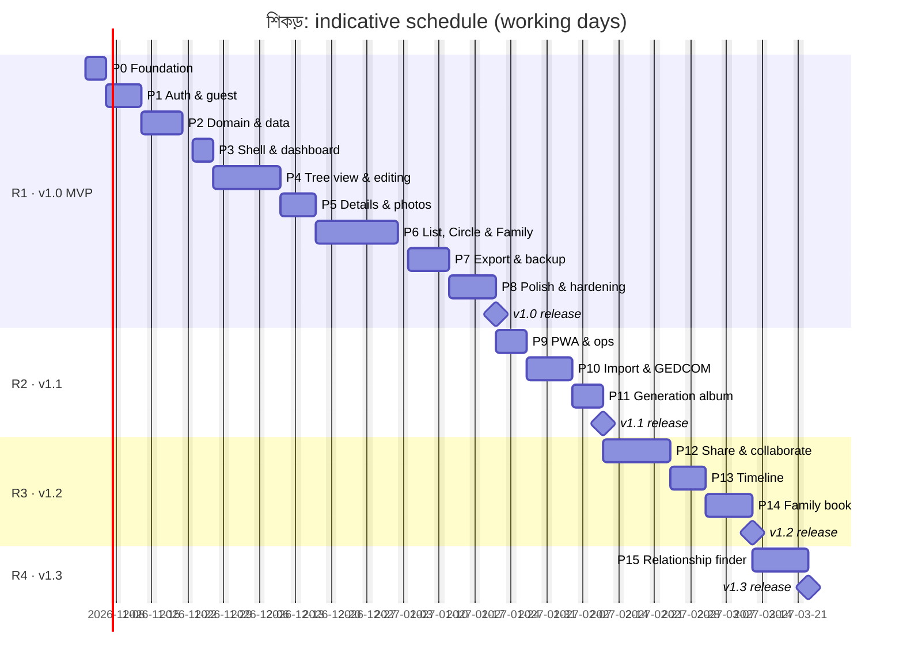

# Implementation Plan

**Product:** শিকড় (pronounced *Shikor*, meaning "roots"), a bilingual (বাংলা / English) family-tree builder
**Document version:** 1.3 (adds the Family card, Generation album, Timeline and Family book; later phases renumbered; product named শিকড়)
**Date:** 2026-10-22
**Inputs:** [SRS](./SRS.md) (what) · [Design Document](./DESIGN.md) (how)

> This plan is a **living document**. Tick task checkboxes in the same pull request that completes the task, and keep the phase status table in sync with the [README](../README.md#project-status).

---

## Table of contents

1. [How to use this plan](#1-how-to-use-this-plan)
2. [Delivery approach](#2-delivery-approach)
3. [Phase overview](#3-phase-overview)
4. [Phase details](#4-phase-details)
5. [Releases & milestones](#5-releases--milestones)
6. [Definition of Ready / Done](#6-definition-of-ready--done)
7. [Risk tracking](#7-risk-tracking)
8. [Before Phase 0: setup actions for the product owner](#8-before-phase-0-setup-actions-for-the-product-owner)

---

## 1. How to use this plan

- Work proceeds **phase by phase**. A phase starts when its dependencies meet their exit criteria.
- Every task has an ID (`P4-07`). Use it in branch names (`feat/p4-07-bulk-add-children`), commit scopes and PR titles. Each task lists the **SRS requirement IDs** it satisfies, which keeps the plan, the code and the requirements traceable.
- Estimates are in **ideal working days for one full-time developer working with an AI coding assistant**. Treat them as ranges, not commitments. They are re-estimated at the start of each phase.
- Items marked *(Could)* are time-boxed and may move to a later release without a change request.

---

## 2. Delivery approach

| Aspect | Approach |
| --- | --- |
| Methodology | Iterative phases (about 1–2 weeks each) with a demo-able increment at the end of every phase |
| Branching | Trunk-based. Currently small, frequent commits directly to `main` (owner's choice), each passing the checks; short-lived `feat/*` branches with PRs once collaborators join |
| Commits | Conventional Commits (`feat(tree-view): add couple connectors`), enforced by commitlint |
| Reviews | Every PR: CI green, self-review checklist (§6), preview deployment checked on a phone and on a desktop |
| Environments | local (emulators) → CI (production build + E2E on every push) → production on the Contabo VPS, deployed from `main` (prod Firebase) |
| Versioning | SemVer tags at releases (`v1.0.0` …); `CHANGELOG.md` updated in every user-facing PR |
| Documentation | README, DESIGN, this plan and CLAUDE.md are updated **in the same PR** as the change |
| Quality gates | typecheck · lint · i18n parity · unit · rules · build (every PR); E2E + a11y (PRs into `main`); Lighthouse budgets (on `main`) |

---

## 3. Phase overview

| Phase | Name | Main SRS scope | Est. (days) | Depends on | Release |
| --- | --- | --- | --- | --- | --- |
| **P0** | Foundation & tooling | NFR-MAINT, I18N-06, OPS-05 | 3–4 | n/a | R1 |
| **P1** | Authentication & guest session | AUTH-01..05, 08..11, 13, 15 | 4–5 | P0 | R1 |
| **P2** | Domain core, data layer & security rules | REL-01/10, UX-01, OPS-04, NFR-SEC-01 | 5–6 | P0 | R1 |
| **P3** | App shell, dashboard, tree management, guest merge | TREE-01..03/05..08, AUTH-06/07/10/12 | 3–4 | P1, P2 | R1 |
| **P4** | Tree view & core editing | TV, VIS, REL-02..12, PER-01/04..06, UX-01..03/06/07 | 8–10 | P3 | R1 |
| **P5** | Person details & photos | PER-02/03/07..10, MED-01..07 | 5–6 | P4 | R1 |
| **P6** | List, Circle & Family card views, ancestor mode | LV-01..06, CV-01..07, FC-01..08, TV-06/07/10 | 11–14 | P4 | R1 |
| **P7** | Export & JSON backup | EXP-01..09, FC-09, BAK-01 | 5–7 | P5, P6 | R1 |
| **P8** | Onboarding, polish, hardening → **v1.0** | ONB, AUTH-03, UX-04/05, NFR-* | 6–8 | P7 | **R1** |
| **P9** | PWA, offline & operations | PWA-01..05, AUTH-14, OPS-01 | 4–5 | P8 | R2 |
| **P10** | Import & GEDCOM | BAK-02..05, TREE-04, TV-08, CV-06, EXP-10 | 6–8 | P8 | R2 |
| **P11** | Generation album → **v1.1** | GA-01..08 | 3–4 | P8 | **R2** |
| **P12** | Sharing & collaboration | SHR-01..09, VIS-07 | 8–10 | P8 | R3 |
| **P13** | Timeline | TL-01..08 | 5–6 | P8 | R3 |
| **P14** | Family book → **v1.2** | FB-01..07 | 6–8 | P7, P12 (shared redaction) | **R3** |
| **P15** | Relationship finder → **v1.3** | KIN-01..07 | 6–8 | P8 (P12 recommended) | **R4** |

**Totals:** MVP (P0–P8) ≈ **50–64 days** (about 10–13 weeks). All releases (P0–P15) ≈ **88–113 days**.

*P1 and P2 can run in parallel if two people are working, and so can P11 and P13 after v1.0. The schedule assumes one developer.*

---

## 4. Phase details

### P0: Foundation & tooling

**Goal:** an empty but production-grade skeleton. It runs in both languages, deploys previews, and every quality gate is wired up.

- [x] **P0-01** Scaffold Next.js 16 (package name `shikor`; App Router, `src/`, TypeScript, Tailwind v4) with pnpm (via Corepack, pinned in `packageManager`). Add `.nvmrc` (Node 22) and `.editorconfig`.
- [x] **P0-02** `tsconfig`: `strict`, `noUncheckedIndexedAccess`, path alias `@/*`. Pin TypeScript `6.0.x` (DESIGN §3).
- [x] **P0-03** ESLint flat config (next, typescript-eslint, import order). Add `no-restricted-imports` guards: `firebase/*` only inside `src/lib/firebase` and `src/lib/repositories`; no `react` or `firebase` in `src/lib/domain`; `firebase-admin` only in server files. Add Prettier with the Tailwind plugin. *(Done with ESLint 9: `eslint-plugin-react`, `-import` and `-jsx-a11y` do not support ESLint 10 yet.)*
- [x] **P0-04** Husky + lint-staged (format, lint changed files) + commitlint (Conventional Commits).
- [x] **P0-05** Vitest + Testing Library + coverage thresholds (`src/lib/domain/**` ≥ 90%).
- [x] **P0-06** Playwright with `mobile-chrome`, `mobile-safari` and `desktop-chrome` projects, plus `@axe-core/playwright`.
- [x] **P0-07** Firebase: `firebase.json` and `.firebaserc` (dev/prod aliases), Emulator Suite (Auth, Firestore, UI), initial **deny-all** `firestore.rules` and the rules test harness (`firebase/tests`). *(Local work uses the `demo-shikor` emulator project, so no Firebase account is needed; emulators bind to 127.0.0.1.)*
- [x] **P0-08** `src/lib/firebase/client.ts` (persistent multi-tab cache, emulator connection) and `admin.ts` (`server-only`, service account from env).
- [x] **P0-09** next-intl: `src/i18n/*`, `src/proxy.ts` (with the matcher excluding `api`, `_next`, `__/` and static files), `messages/en.json` and `bn.json` with namespaces, and the `scripts/check-i18n.ts` parity check. *(The parity check also compares ICU arguments and syntax; unused-key detection is added in P8-09.)*
- [x] **P0-10** Design tokens (DESIGN §21.2) in `globals.css` for light and dark; fonts (Inter + Hind Siliguri through `next/font`, the Bengali subset loaded in both locales); `src/lib/brand.ts` with `APP_NAME = 'শিকড়'` and the `<AppName />` component *(I18N-10)*; `next-themes`; an automated **contrast test** for the token pairs.
- [x] **P0-11** shadcn/ui init and base components: Button, Input, Textarea, Select, Dialog, Drawer (vaul), Sheet, DropdownMenu, Popover, Tabs, Tooltip, Command, Sonner, Skeleton. *(Sources taken from the official shadcn/ui repository and adapted to our paths.)*
- [x] **P0-12** `[locale]/layout.tsx` (html `lang`, providers), placeholder landing, `not-found`, `error`.
- [x] **P0-13** Security headers baseline in `next.config.ts` (HSTS, nosniff, Referrer-Policy, frame-ancestors; CSP in report-only mode).
- [x] **P0-14** GitHub Actions `ci.yml` (checks, rules, build), PR template, `CHANGELOG.md`, `.env.example`.
- [x] **P0-15** ~~Vercel project~~ → **Deployment pipeline for the owner's Contabo VPS** (decision D7): production `Dockerfile`, `/api/health`, `deploy/compose.yml` with Caddy, `deploy/setup-server.sh`, `deploy/deploy.sh` with automatic rollback, the `Deploy` workflow and a CI image build. Tested locally with Docker (deploy, health, rollback). *(DESIGN §27.4, docs/DEPLOYMENT.md)*
- [ ] **P0-17** **First deployment** to the VPS. *(Waiting for the owner: server setup, domain DNS and GitHub secrets, docs/DEPLOYMENT.md §3.)*
- [x] **P0-16** `scripts/seed-emulator.ts` skeleton and `pnpm` scripts (`dev`, `build`, `typecheck`, `lint`, `format`, `test`, `test:rules`, `test:e2e`, `emulators`, `seed`, `i18n:check`).

**Deliverables:** a running skeleton, CI, preview URL, verified README "Getting started".
**Exit criteria:** `pnpm dev` serves `/bn` and `/en`; CI is green; a preview deploy is reachable; a fresh clone runs by following the README alone.

**Status (2026-10-22):** done except P0-17. `/bn` and `/en` are served, a fresh clone passes every check by following the README, CI runs on every push to `main`, and the deployment pipeline is ready. The first deploy follows once the owner has set up the VPS.

---

### P1: Authentication & guest session

**Goal:** every visitor to the app gets a persistent guest session and can upgrade it without losing anything.

- [x] **P1-01** `SessionProvider`, `useSession()` and the session state machine (DESIGN §9.2). `<AuthGate>` for the `(app)` route group, with skeleton states. *(AUTH-01, AUTH-13)*
- [x] **P1-02** Guest bootstrap with exponential-backoff retry while offline. Create `users/{uid}` (`isGuest`, `locale`, …). Daily `lastActiveAt` stamp. *(AUTH-01/02)*
- [x] **P1-03** Auth pages: login, sign-up, reset password. Zod forms, bilingual errors, Google button. *(AUTH-04/05/09)*
- [x] **P1-04** **Linking** flows: `linkWithCredential` (email), `linkWithPopup` (Google) with a redirect fallback on `popup-blocked`, and an error-code → message map. *(AUTH-04/05)*
- [ ] **P1-05** `/__/auth/*` rewrite and an auth-domain configuration guide (README). Verify the redirect on iOS Safari against a preview domain. *(DESIGN §9.5)* — *Rewrite and guide done; the iOS Safari check needs a real domain, so it happens with the first deploy (P0-17).*
- [x] **P1-06** In-app browser detection with an "Open in your browser" guide and copy-link. *(AUTH-15)*
- [x] **P1-07** Email verification send and resend banner. *(AUTH-08)*
- [x] **P1-08** Server foundation: `lib/server/auth.ts` (`verifyRequest`), `http.ts` (error format and codes), App Check on the client (production) and verification on the server (a no-op with emulators).
- [x] **P1-09** Sign out (registered users). Guest chip and popover explaining guest storage; the prompt framework for milestone upgrade prompts (`useUpgradePrompt`, wired up in P8). *(AUTH-03, AUTH-10)*
- [x] **P1-10** Settings: display name, language, theme, persisted to the profile. *(AUTH-11, I18N-01)*
- [x] **P1-11** Rules for `users/{uid}` and their tests.
- [x] **P1-12** Tests: state-machine unit tests. E2E: *guest persists across reload and a new browser context with the same storage state* (AC AUTH-02); *sign-up keeps the user ID and data* (AC AUTH-04, against the emulator).

**Exit criteria:** AC AUTH-02 and AUTH-04 pass in E2E on mobile and desktop projects; the in-app browser guide shows when the user agent is spoofed.

**Status (2026-10-22):** done except the iOS Safari redirect check in P1-05, which needs the production domain. Visitors become guests when they enter the app (never on the landing page), and the guest survives reloads and new browser contexts. Sign-up links email or Google to the guest and keeps the user ID. Log-in, reset, verification, settings and the server foundation are in place. `e2e/auth.spec.ts` covers the acceptance criteria against the emulators on every CI run.

---

### P2: Domain core, data layer & security rules

**Goal:** a correct, tested model of families, plus safe, undoable writes.

- [x] **P2-01** `lib/domain/types.ts`, `schemas.ts` (Zod, SRS §6.2 limits), `ids.ts` (`parentLinkId`, `spouseLinkId` with sorted IDs).
- [x] **P2-02** Graph engine: `build` (with issue reporting), `families`, `descendants` (refs, `hiddenCount`, path keys), `ancestors`, `validate` (cycle, single biological parent per gender, spouse/parent conflict, date warnings, duplicates), `generations`, `dAboville`, `reachable`, `branchOf`. *(REL-10, VIS-08/09, REL-11)*
- [x] **P2-03** `names.ts` (display rules, grapheme-safe initials with `Intl.Segmenter`), `dates.ts` (partial dates: validate, compare, format bn/en), `search.ts` (normalize and rank). *(I18N-02/03/04)*
- [x] **P2-04** Firestore converters and repositories: `trees`, `persons`, `relationships`, `users`, `batch` (chunking ≤ 450 operations).
- [x] **P2-05** Full `firestore.rules` (DESIGN §8) and `firestore.indexes.json` (composite indexes plus field exemptions). **Rules tests cover the whole §8 checklist.** *(NFR-SEC-01)*
- [x] **P2-06** Stores: `treeStore`, `uiStore`, `historyStore`. `useTreeSession(treeId)`: cache-first hydrate, three listeners, `docChanges` application, save/offline status. *(TREE-07, NFR-REL-01)*
- [x] **P2-07** Command framework: types, executor (batch, no await for UI), undo/redo, coalescing (2 s window per person), and the conflict-check hook (used in R3). *(UX-01, ADR-010)*
- [x] **P2-08** Commands: `createTree`, `addPerson`, `addChildren` (auto other parent), `addSpouse`, `addParent`, `addSibling`, `linkExisting`, `updatePerson`, `deletePerson` (only, or with descendants), `setParentKind`, `setSpouseStatus`, `changeOtherParent`, `reorderChildren`, `moveBranch`, `removeRelationship`, `setRoot`. *(REL-01..09, PER-06, TREE-05)*
- [x] **P2-09** `lib/server/treeAdmin.ts`: `listOwnedTrees`, `transferTrees`, `recursiveDeleteTree`.
- [x] **P2-10** Fixture generator: 10, 150, 500 and 2,000 persons, multiple wives, a cousin marriage, adoption, long Bangla and English names, partial dates.
- [x] **P2-11** Tests: domain ≥ 90% coverage; command integration tests against the emulator (forward, then undo restores the exact state).

**Exit criteria:** every command round-trips (do → undo → redo) against the emulator; the rules suite passes; coverage gates pass.

**Status (2026-10-22):** done. Every command round-trips against the emulator under the security rules, the rules suite passes (72 tests including the integration tests), and domain coverage is 100% of lines. Notes for later phases:

- The `history.*` labels and the user-facing text for validation codes (`cycle`, `tooManyBiologicalParents`, `possibleDuplicate`, …) are added with the editor UI in P4, where the wording can fit its context.
- The debounced tree "touch" for edits that don't add or remove people (DESIGN §7.3) comes with the editor shell (P3/P4).
- `touched` paths are recorded on every command; the R3 conflict check reads them through the executor's `confirmUndo` hook.
- Cloudinary photo deletion after the undo window (PER-06) arrives with photos in P5.

---

### P3: App shell, dashboard, tree management & guest merge

**Goal:** users can manage trees, the editor frame exists, and guests can merge into existing accounts.

- [x] **P3-01** App header (desktop) and compact header (mobile): tree switcher, save status, language switch, account menu, guest chip. *(TREE-07, PWA-03)*
- [x] **P3-02** Dashboard: realtime tree list, create (dialog), rename, delete (typed confirmation if > 10 people), tree cards (cover, counts, updated, role). *(TREE-01..03)*
- [x] **P3-03** Editor shell `/trees/[treeId]`: view tabs (desktop) and bottom nav with a "More" sheet (mobile), feature flags for staged views (`lib/features.ts`, ADR-014), URL state (`?view=&focus=`), details container (side panel ≥ 1024 px, vaul drawer below), empty-tree state with "Add the first person". *(VIS-01)*
- [x] **P3-04** Tree settings dialog (name display, colour by, photos, dates, default view). *(TREE-06)*
- [x] **P3-05** Statistics popover (people, generations, living/deceased, earliest year). *(TREE-08, Could)*
- [x] **P3-06** **Guest merge:** `POST /api/account/merge-ticket`, `POST /api/account/merge` (transaction, idempotent), `MergeDialog` (move/discard per tree), resume through `shikor:pendingMerge`. *(AUTH-06/07, DESIGN §9.4)*
- [x] **P3-07** **Account and guest-data deletion:** `POST /api/account/delete` (recent-login check, recursive delete, membership removal; Cloudinary prefix deletion stubbed until P5). *(AUTH-10/12)*
- [x] **P3-08** Tests: API (merge idempotency, ticket expiry and reuse, a non-anonymous ticket creator is rejected). E2E: AC AUTH-07; dashboard CRUD; deletion.

**Exit criteria:** AC AUTH-07 passes; a deleted account leaves no documents behind (verified in the emulator).

**Status (2026-10-23):** done. AC AUTH-07 passes end to end (email log-in path; the Google path runs the same code after `auth/credential-already-in-use`), and the API tests show a deleted account or guest leaves no documents or auth user behind. 87 emulator tests, 293 unit tests and 38 E2E tests per browser pass. Notes for later phases:

- **Interim views:** until P4 (Tree) and P6 (the others), every view shows a "coming soon" card and lists everyone in the tree, so people can be selected and the details panel used. P4 replaces the placeholder per view.
- **Dashboard cards** show the root person's initials as the cover (one cached read per tree; the photo arrives with P5) and the role on every card. Generations appear in the statistics, not on the card, because they need the whole tree.
- **Tree settings** leave out the kinship style until the relationship finder uses it (R4).
- **Save status** shows Saving…/Saved/Offline. The pending-changes count of PWA-03 needs a count of unsent writes, which comes with offline work in P9.
- **Still open from P2:** the debounced tree "touch" for edits that don't add or remove people (DESIGN §7.3) moves to P4, where those edits start.
- **New endpoint:** `DELETE /api/trees/{treeId}` (owner only) deletes a tree on the server, because a client batch can't delete hundreds of people and their relationships in one go.

---

### P4: Tree view & core editing

**Goal:** the heart of the product. Build a family quickly and see it as a beautiful, interactive tree on phone and desktop.

- [x] **P4-01** `views/shared`: imperative d3-zoom camera hook, viewport culling, `measureText` cache (bn/en fonts), colour resolver (branch, gender, generation, none; DESIGN §21.3), collapse-state persistence. *(VIS-02/06/10)*
- [x] **P4-02** Tree layout (pure): family units, d3-flextree, connectors (marriage line, drop lines, bus), orientation swap. Snapshot tests on fixtures. *(TV-01/02)*
- [x] **P4-03** `PersonCard` (SVG): photo or initials, name wrapping, years, deceased style, me, reference, bloodline-spouse badges, `+N` pill, states. *(VIS-05, VIS-08/09)*
- [x] **P4-04** `TreeView`: render, select, expand/collapse, fit and centre, zoom buttons, focus/re-root with breadcrumb, `motion` transitions with thresholds. *(TV-03/05, VIS-03)*
- [x] **P4-05** Quick-add: "+" on the selected card (desktop), floating button and action sheet (mobile), context menu (right-click and long-press). *(TV-04, REL-02, UX-07)*
- [x] **P4-06** Minimal person form (names, gender) for add spouse/parent/sibling. `PersonPicker` for "link an existing person" with search. *(PER-01, REL-05/06/12)*
- [x] **P4-07** **Bulk add children** sheet: rows with a son/daughter toggle, Enter for a new row, multi-line paste, other-parent selector, duplicate warnings, single undo. *(REL-03/04, PER-07)*
- [x] **P4-08** Basic `PersonPanel`: view and edit of core fields with autosave and validation. *(PER-04/05)*
- [x] **P4-09** Delete flows (only this person, or with N descendants) with an Undo toast. Relationship editors: kind/status, change the other parent, **move branch** (picker), remove relationship, reorder children (up/down). *(PER-06, REL-07/08/09, UX-02)*
- [x] **P4-10** Undo/redo toolbar and shortcuts. Command palette (`⌘/Ctrl+K`) with person search → expand path → centre → highlight. *(UX-01/03, VIS-04)*
- [x] **P4-11** Keyboard navigation and shortcuts. *(TV-09)*
- [x] **P4-12** "Unplaced people" tray with a Connect action. *(REL-11)*
- [x] **P4-13** **Performance benchmark** on the 500- and 2,000-person fixtures at 4× CPU throttle. Record FPS and render time, and decide whether the Canvas2D fallback (R-04) is needed.
- [x] **P4-14** Tests: E2E AC REL-04 and REL-10, undo/redo across reload boundaries, the mobile flow (tap → FAB → bulk add), the desktop flow (keyboard).

**Exit criteria:** a 3-generation, 10-person tree can be built on a phone in under 3 minutes (internal dry run); NFR-PERF-03 is met on the 500-person fixture.

**Status (2026-10-23):** done. NFR-PERF-03 is met on the 500-person fixture (render 112–194 ms, pan and zoom 53–60 fps at 4× CPU throttle; `docs/PERFORMANCE.md`), so the Canvas2D fallback is not needed. AC REL-04 and AC REL-10 pass end to end on phone and desktop. The 3-minute phone dry run is for the owner: the E2E phone flow builds a small family in a few taps, but a real person on a real phone is the test. 338 unit tests and 42 E2E tests per browser pass. Notes:

- **Animation** uses CSS transitions on the cards' transforms instead of `motion` (no extra library; still off above 300 cards and with reduced motion). **d3-flextree** brings its own hierarchy; `d3-hierarchy` arrives with the Circle view.
- **Quick add on phones** is the "+" in the selection bar above the bottom navigation rather than a separate floating button: the same thumb zone, without covering the tree.
- **Phones** keep the tree name readable next to search and undo by moving the account avatar into the ⋮ menu, which gains Log out and Redo.
- **Keyboard:** arrows move on screen (they follow the tree's direction); shortcuts work with a Bangla keyboard layout; dialogs opened from shortcuts return focus to where it was.
- **Fixed on the way:** a tree opened right after it was created could show "This tree isn't available" when its listeners reached the server before its write (DESIGN §11.2). Reloading within a moment of an edit, before "Saved", can still lose that edit if the browser hadn't stored it yet; the E2E tests wait for "Saved". A leave-page warning while saving is a product decision for later.
- **The tree "touch"** from P2/P3 is done: edits that don't write the tree document add a stamps-only tree update at most once a minute per tree (`commands/touch.ts`), so the dashboard's "last change" follows them.
- **Still open:** photos on cards (P5), and the minimap and the "me" badge (later polish).

---

### P5: Person details & photos

**Goal:** rich profiles and photos that show up everywhere.

- [x] **P5-01** Full `PersonForm`: every PER-02 field, a partial-date input (year / month / day plus "approximately"), a phones list, present and permanent addresses, custom fields, character counters, bilingual validation. *(PER-02/03)*
- [x] **P5-02** Details view mode: formatted values, `tel:` and `mailto:` links, life span, age (PER-09), "This is me" toggle (PER-10), date plausibility warnings.
- [x] **P5-03** Server: `lib/server/cloudinary.ts`, `POST /api/media/sign` (role check, rate limit, signed parameters per DESIGN §15.2), `POST /api/media/delete` (prefix check). *(MED-07)*
- [x] **P5-04** `PhotoPicker` (camera, gallery, drag-and-drop), `Cropper` (square, zoom, rotate), compression, XHR upload with progress, cancel and retry; disabled offline. *(MED-01/02/03/06)*
- [x] **P5-05** `cloudinaryUrl` variants, an `Avatar` component (thumbnail with initials fallback, lazy decoding), lightbox. *(MED-04)*
- [x] **P5-06** Replace and remove a photo, with deferred deletion after the undo window. Wire the prefix deletion into tree deletion, account deletion and merge discard. *(MED-05/07)*
- [x] **P5-07** Tests: API (role, prefix, rate limit, signature parameters); component (form validation in bn/en); E2E photo flow with Cloudinary mocked through Playwright route interception.

**Exit criteria:** a photo uploaded on mobile appears as a thumbnail in the tree, panel and dashboard cover; deleting the person removes the Cloudinary asset (verified in the dev account).

**Status (2026-10-23):** done, except the check in a real Cloudinary dev account, which waits for the owner's keys. On a phone and on desktop, the E2E photo flow uploads a photo (Cloudinary mocked with Playwright route interception, `e2e/photos.spec.ts`) and sees the thumbnail on the tree card, in the details panel, in the lightbox and on the dashboard cover; removing it and undoing the removal bring the same photo back. The signing scheme is tested against the example in Cloudinary's docs, and the deletion calls against a mocked Admin API (`src/app/api/media/media.emulator.test.ts`). 372 unit and component tests, 97 rules and Route Handler tests and 43 E2E tests per browser pass. Notes:

- **No Cloudinary SDK and no compression library:** signing and Admin API deletion are a few `fetch` calls in `lib/server/cloudinary.ts`, and the cropper's canvas saves a JPEG of at most 1600 px at quality 0.85 (DESIGN §15.2). `react-easy-crop` is the only new dependency.
- **The undo window** for photos is "until nothing can bring it back": a replaced or removed photo waits in a queue in this browser and is deleted once no person and no undo or redo step has it, and the server keeps any photo that is in use again (DESIGN §15.4). The person-delete photo cleanup is the same queue.
- **One thumbnail size** (`w_192`) serves cards and avatars at every screen density, so a photo costs at most four derived images (thumb, card, full, export).
- **"This is me"** is personal, so it is stored on the user (`users/{uid}.selfPersonIds`), not in the shared tree; a star marks that card.
- **Fixed on the way:** the Undo toast couldn't be tapped while the details sheet was open on phones (a modal turns off pointer events on the page; DESIGN §23).
- **Still open:** the orphan sweep (R2 cron) and the `print` variant for the Family book (R3).

---

### P6: List, Circle & Family card views, ancestor mode

**Goal:** the same family in three more beautiful, useful forms, including the simplest view for phones.

- [x] **P6-01** **List outline:** flattening, d'Aboville numbering, rows (avatar, names, partners, years, profession), chevrons, virtualization above 200 rows, ARIA `tree` pattern and keyboard support. *(LV-01/02/05/06)*
- [x] **P6-02** Inline quick add per row; sibling reorder (drag handle on desktop, up/down on mobile) → fractional `childOrder`. *(LV-03)*
- [x] **P6-03** **Directory mode:** sortable, filterable table (desktop) and cards (mobile). *(LV-04)*
- [x] **P6-04** **Circle layout** (pure): partition with leaf weighting, radii, padding, the 6 px seam gap, tint ramp per ring, label placement (tangential / radial / hidden, with flipping). Geometry tests. *(CV-01/02)*
- [x] **P6-05** `CircleView`: arcs, centre disc with photo, tooltips with spouses, selection, **zoom to person** with breadcrumbs, depth control (2–8), legend. *(CV-03/04/05/07)*
- [ ] **P6-06** **Ancestor (pedigree) mode** in the tree view. *(TV-06)*
- [ ] **P6-07** Shared legend; generation labels *(TV-10, Could)*; minimap *(TV-07, Could)*.
- [ ] **P6-08** View switching keeps selection and focus; collapse state is persisted per view.
- [ ] **P6-09** Tests: layout snapshots; axe on the list view; E2E view switching and circle zoom.
- [ ] **P6-10** **Family card model** (pure): `buildFamilyCard` (parents, partners with their children, siblings, trail, child counts), with unit tests for multiple spouses, unknown parents, adoptive parents and references. *(FC-01/03/05/07)*
- [ ] **P6-11** **Family card view:** parents row, siblings strip, couple cards with the spouse switcher, children grid, and empty "+ add" slots wired to the quick-add and bulk-add flows. *(FC-01/03/04/05/07)*
- [ ] **P6-12** **Family navigation:** focus changes through `uiStore` and `router.push` (browser Back works), breadcrumb, direction-aware transitions, sibling swipes, live-region announcements. *(FC-02/06/08)*
- [ ] **P6-13** Tests: E2E AC FC-02 on mobile and desktop; axe on the Family card view; focus sync with the Tree view.

**Exit criteria:** all four views render the 500-person fixture smoothly on a mid-range phone profile; the List and Family card views pass keyboard-only and screen-reader smoke tests.

---

### P7: Export & JSON backup

**Goal:** any view becomes a shareable PNG or PDF with perfect Bangla text.

- [ ] **P7-01** `ExportDialog`: format, view, paper, orientation, title and subtitle, photos, legend, date, quality, *expand all*. Remembers the last options. *(EXP-03/04)*
- [ ] **P7-02** Export scene builders for the tree and circle views (`mode="export"`), with the header, footer and legend in SVG. *(EXP-05)*
- [ ] **P7-03** Image inlining (export variant → data URL, cached) and font embedding.
- [ ] **P7-04** Both rasterization paths (SVG serialization for Tree/Circle; html-to-image for List/Family card, with the Safari double-render workaround). PNG pipeline with canvas clamping; PDF pipeline with *fit to one page* and **tiling** (overlap and crop marks); paginated list export; print stylesheet. *(EXP-01/02/06/09)*
- [ ] **P7-05** Progress, cancel, yielding to the main thread; Web Share or download; file naming. *(EXP-07/08)*
- [ ] **P7-06** **JSON backup export**, available to guests too. *(BAK-01)*
- [ ] **P7-07** **Family sheet:** export the current Family card as a one-page PNG/PDF through the HTML path (html-to-image). *(FC-09)*
- [ ] **P7-08** Tests: unit (tiling math, clamp, file names); E2E (a file is produced and non-empty, the PDF has the expected page count); **visual sign-off of conjunct-heavy names** (AC EXP-05) with a PNG screenshot baseline.

**Exit criteria:** AC EXP-05 is signed off by the product owner; a 500-person PDF is produced in under 10 s on desktop.

---

### P8: Onboarding, polish & hardening → v1.0

**Goal:** first-time users succeed without help, and the app is secure, fast and accessible enough to launch.

- [ ] **P8-01** Landing page (bn/en): hero, animated sample tree, features, privacy promise, CTA; SEO metadata, OG images, `sitemap`, `robots`. *(ONB-01, I18N-06)*
- [ ] **P8-02** **First-run wizard** (language → oldest ancestor → children → tour), coach marks per view, empty states; sample tree *(Could)*. *(ONB-02/03/04)*
- [ ] **P8-03** Wire the milestone upgrade prompts (5th person, first export, 3rd visit, 7-day snooze) and celebrations. *(AUTH-03, UX-04)*
- [ ] **P8-04** Help/FAQ and Privacy pages (bn/en), covering guest storage, retention, Cloudinary and deletion. *(ONB-05, NFR-PRIV-02)*
- [ ] **P8-05** Dark-mode polish across all screens and views. *(UX-05)*
- [ ] **P8-06** **Accessibility audit:** axe at 0 serious issues, keyboard pass, TalkBack and VoiceOver pass; fixes. *(NFR-A11Y-*)*
- [ ] **P8-07** **Performance pass:** bundle analysis, code-splitting checks, Lighthouse budgets in CI, FPS trace on the 500-person fixture. *(NFR-PERF-*)*
- [ ] **P8-08** **Security pass:** enforce the CSP, App Check enforcement, rules review, secret scan, dependency audit. *(NFR-SEC-*)*
- [ ] **P8-09** **Bangla copy review** by a native speaker; glossary consistency; unused-key detection in `pnpm i18n:check`. *(NFR-L10N-02)*
- [ ] **P8-10** Monitoring: Sentry with PII scrubbing (optional), an uptime monitor on `/api/health`, optional self-hosted cookieless analytics, quota runbook in the README. *(OPS-02/03)*
- [ ] **P8-11** **Usability test** with 5 target users (at least 3 on phones, at least 2 Bangla-first) against NFR-USE-01; fix the top issues.
- [ ] **P8-12** Production setup: prod Firebase project, rules and indexes deployed by CI, OAuth redirect URIs, custom domain, auth-domain proxy verified on iOS Safari; release **v1.0.0** (tag, CHANGELOG, README).

**Exit criteria (release gate R1):** all *Must* R1 requirements are met; CI is green including E2E and a11y; Lighthouse mobile is ≥ 90 on the landing page; there are no open high-severity bugs; the product owner signs off.

---

### P9: PWA, offline & operations (R2)

- [ ] **P9-01** **Spike:** Serwist with Next 16 and Turbopack. Choose `@serwist/next`, a webpack build for the service worker only, or a manual service worker (ADR-011, R-08).
- [ ] **P9-02** Manifest (localized names), icons (maskable), install prompt UX (2nd session or 10 people), iOS "Add to Home Screen" guide. *(PWA-01)*
- [ ] **P9-03** Runtime caching per DESIGN §19, an offline fallback page, and the update prompt. *(PWA-02/04/05)*
- [ ] **P9-04** Offline UX: server-backed actions disabled with explanations; pending-changes count. *(PWA-03)*
- [ ] **P9-05** `GET /api/cron/cleanup` (daily host cron on the VPS calling it with `CRON_SECRET`; add the cron line to `setup-server.sh` and DEPLOYMENT.md): stale guests (365 days), expired merge tickets, rate-limit documents, orphaned photos. Dry-run mode and summary logging. *(AUTH-14, OPS-01)*
- [ ] **P9-06** Tests: E2E going offline (`context.setOffline`), editing, reconnecting, and seeing the sync complete; cron logic against the emulator.

**Exit criteria:** the installed app opens a previously viewed tree in airplane mode and syncs offline edits when back online.

---

### P10: Import & GEDCOM (R2)

- [ ] **P10-01** **JSON import:** validate, preview, re-ID, chunked writes with progress, background photo copying. *(BAK-02/05)*
- [ ] **P10-02** **GEDCOM parser:** lines, CONT/CONC, BOM and encodings (ANSEL rejected), mapping to the domain, skipped-record report. *(BAK-04)*
- [ ] **P10-03** **GEDCOM serializer** (5.5.1, UTF-8) per DESIGN §18.2. *(BAK-03)*
- [ ] **P10-04** Import/export UI (dashboard and tree menu), size limits and errors.
- [ ] **P10-05** *(Could, time-boxed)*: duplicate tree (TREE-04), drag-and-drop re-parenting (TV-08), radial node-link style (CV-06), SVG export (EXP-10).
- [ ] **P10-06** Tests: JSON and GEDCOM round-trips on fixtures; malformed-file cases; a large import (5,000 people) on the emulator.

---

### P11: Generation album → v1.1 (R2)

**Goal:** a photo-first album of the family, one row per generation.

- [ ] **P11-01** `generationGroups` (pure): by generation or by branch, partners in their partner's generation, sibling order inside each row. Unit tests on the fixtures. *(GA-01/02)*
- [ ] **P11-02** `AlbumView`: generation rows (scroll-snap strips on phones, a grid on desktop), cards with lazy `card` images, the parents line ("Father: … · Mother: …"), filters, "Add photo" prompts for editors, virtualization above 60 cards. *(GA-01..04/06/07)*
- [ ] **P11-03** **Slideshow:** a full-screen dialog with the `full` variant, preloading, auto-advance, swipe and keyboard controls, pause, and reduced-motion support. *(GA-05, Could)*
- [ ] **P11-04** **Contact-sheet export** (PNG/PDF) through the HTML rasterization path. *(GA-08)*
- [ ] **P11-05** Feature flag on; the album added to the desktop tabs and the mobile "More" sheet.
- [ ] **P11-06** Tests: E2E album on mobile and desktop (lazy loading, tapping a card opens details); axe; a performance check with the 500-person fixture.
- [ ] **P11-07** Release **v1.1.0** (P9–P11).

**Exit criteria:** a 500-person album scrolls smoothly on a mid-range phone profile; images below the fold are not requested until scrolled near.

---

### P12: Sharing & collaboration (R3)

- [ ] **P12-01** Share dialog: create, revoke and regenerate view-only links with options (hide contact info, hide living people's details, allow export). *(SHR-01/02)*
- [ ] **P12-02** Public page `/{locale}/s/{shareId}`: server-side load with the Admin SDK, **redaction** (a pure `redact()` function in `lib/domain`, reused by the Family book), read-only views, export per option, `noindex`. *(SHR-02/09, VIS-07, ADR-012)*
- [ ] **P12-03** Invites: creation (verified owners), invite page, `POST /api/invites/accept` (transaction), guest → sign-up → accept continuation. *(SHR-03/04)*
- [ ] **P12-04** Members: list, change role, remove, leave tree; `POST /api/trees/{id}/transfer`. *(SHR-05)*
- [ ] **P12-05** Read-only mode for viewers across every view and panel. *(VIS-07)*
- [ ] **P12-06** Live collaboration UX: remote-change highlights, "edited by", deleted-while-editing handling, undo conflict prompt. *(SHR-06)*
- [ ] **P12-07** Activity log: entries written in the same batch, a drawer UI, 90-day pruning in the cron. *(SHR-07)*
- [ ] **P12-08** Share actions: copy, native share, WhatsApp and Messenger links. *(SHR-08)*
- [ ] **P12-09** Rules for share links, invites and activity, plus the full role matrix; E2E collaboration across two browser contexts.

---

### P13: Timeline (R3)

**Goal:** lifespans on a year axis, showing who lived at the same time.

- [ ] **P13-01** `lib/domain/timeline.ts` (pure): `lifeRange` (partial and approximate dates, living, unknown end), `aliveOverlap`, `ageAt`; `historyEvents.ts` with bilingual label keys. Unit tests for every date shape. *(TL-02/05/06)*
- [ ] **P13-02** Timeline layout: `d3-scale` year axis, grouping and ordering, row model, the "undated" list. Geometry snapshot tests. *(TL-01/03)*
- [ ] **P13-03** `TimelineView`: sticky year axis and name column, virtualized rows, bars (approximate fades, living arrowheads, dashed unknown ends), marriage and child-birth markers, historical markers with a toggle, the "today" line. *(TL-01/02/04/05/07)*
- [ ] **P13-04** Interaction: x-only zoom and pan (wheel, pinch, buttons), tooltips with ages at markers, overlap highlighting on selection, tapping a name opens details, the "add dates" link to the Directory filtered to *no birth year*. *(TL-06/07)*
- [ ] **P13-05** Export: a full-height SVG scene, PNG and vertically tiled PDF. *(TL-08)*
- [ ] **P13-06** Feature flag on; tests: E2E (select → overlap highlight, zoom buttons), axe on the controls, a performance check with the 2,000-person fixture.

**Exit criteria:** the timeline renders the 500-person fixture smoothly on a mid-range phone profile; people with year-only and approximate dates render without invented dates.

---

### P14: Family book → v1.2 (R3)

**Goal:** a printable keepsake book of the whole family, with correct Bangla.

- [ ] **P14-01** Book model (pure): sections in d'Aboville order, scope by branch, redaction through the shared `redact()` function, the name-index data. Unit tests. *(FB-01/02/03)*
- [ ] **P14-02** Page templates (HTML, A4/Letter frames): cover, dedication, contents, overview chart, family section, index, running header and page numbers, in bn and en. *(FB-01/06/07)*
- [ ] **P14-03** **Pagination** pass: measure off-screen, flow sections across pages without orphaned headings, then assign page numbers, cross-references and the index. Tests with fixture trees. *(FB-03)*
- [ ] **P14-04** **Render pass:** page-by-page html-to-image → JPEG → jsPDF, quality options, progress, Cancel, releasing memory after each page, the 300-page warning and 600-page limit. *(FB-04/05)*
- [ ] **P14-05** `print` Cloudinary variant (DESIGN §15.3) and the book options dialog in the Download menu and the mobile "More" sheet. *(FB-02)*
- [ ] **P14-06** Tests: E2E for a 150-person book (page count, "see page N" correctness on sampled pages); a manual check of a printed copy; a memory check on a real phone for a 300-page book.
- [ ] **P14-07** Release **v1.2.0** (P12–P14).

**Exit criteria:** AC FB-01 passes; a 300-page book completes on a mid-range Android phone without crashing; the printed sample is signed off by the product owner.

---

### P15: Relationship finder → v1.3 (R4)

- [ ] **P15-01** Path finding: blood relationships (lowest common ancestors) and affinal ones (≤ 2 spouse edges), up to 3 results. *(KIN-01/07)*
- [ ] **P15-02** Signature encoding: elder/younger, half-siblings, step and adoptive markers. *(KIN-04)*
- [ ] **P15-03** Term tables `bd`, `wb` and `en` with alternates; **native-speaker review**. *(KIN-03/05)*
- [ ] **P15-04** Descriptive fallback composer (Bangla genitives, English possessives). *(KIN-06)*
- [ ] **P15-05** UI: "How are we related?" in the details panel, a two-person picker, results with **path highlighting** in the tree view. *(KIN-01/02)*
- [ ] **P15-06** Tests: a table-driven test for every signature, fallback cases, cousin-marriage multi-paths, the style switch.
- [ ] **P15-07** Release **v1.3.0**.

---

## 5. Releases & milestones

| Milestone | Contents | Gate |
| --- | --- | --- |
| **M0** Skeleton live | P0 | CI green; preview URL |
| **M1** Guest can build a tree | P1–P4 | Internal demo: build a 10-person tree on a phone, reload, data is still there |
| **M2** Feature-complete MVP | P5–P7 | All R1 *Must* items implemented |
| **R1 · v1.0** Public launch | P8 | Release gate (P8 exit criteria) |
| **R2 · v1.1** Offline, portability & album | P9–P11 | Offline E2E, GEDCOM round-trip and album performance checks pass |
| **R3 · v1.2** Families together: sharing & stories | P12–P14 | Role-matrix rules tests, two-user E2E, timeline performance and the printed Family book sample pass |
| **R4 · v1.3** "How are we related?" | P15 | Kinship tables approved by the native reviewer |

---

## 6. Definition of Ready / Done

**Ready** (before starting a task):

- The SRS requirement IDs are identified, and the acceptance criteria are clear.
- The relevant DESIGN section exists (or the task updates it first).
- Dependencies are merged. Any external setup (keys, projects) is available.

**Done** (every PR):

- [ ] `pnpm typecheck`, `pnpm lint` and `pnpm test` pass; domain coverage gate holds.
- [ ] Rules tests updated and passing if data access changed.
- [ ] **Every new UI string exists in `messages/en.json` and `messages/bn.json`**; `pnpm i18n:check` passes.
- [ ] Verified at **360 × 740 (mobile)** and **1440 × 900 (desktop)**, in **bn and en**, in **light and dark**.
- [ ] Keyboard accessible; no new axe serious violations on touched screens.
- [ ] No console errors; no secrets; no `any` without a justification comment.
- [ ] Docs updated: README (features/status), DESIGN (if the design changed), this plan (checkboxes), CHANGELOG (user-facing changes).
- [ ] The PR title and description reference the task ID(s) and SRS ID(s).

---

## 7. Risk tracking

The risk register lives in [DESIGN §29](./DESIGN.md#29-risks--mitigations). These phase tasks retire specific risks:

| Risk | Retired / checked by |
| --- | --- |
| R-04 large-tree performance | P4-13 benchmark, P8-07 |
| R-05 Bangla in exports | P7-08 visual sign-off |
| R-06 iOS canvas limits | P7-04, tested on a real iPhone |
| R-07 Google sign-in edge cases | P1-05, P1-06, P8-12 |
| R-08 Serwist and Turbopack | P9-01 spike |
| R-09 kinship correctness | P15-03 native review |
| R-11 rules gaps | P2-05, P8-08, P12-09 |
| R-02/R-03 quotas | P8-10 runbook; monthly review |
| R-14 Family book memory and size | P14-04, P14-06 (real-phone memory check) |
| R-15 sparse dates on the Timeline | P13-03 "undated" list and P13-04 "add dates" link |

---

## 8. Before Phase 0: setup actions for the product owner

These steps need your accounts, so they can't be automated from the repository:

1. **Firebase:** one production project on the Spark plan. Development uses the local emulators, so a separate dev project is optional.
   - [x] Project **`shikor-fe44d`** created, with a **Web app** registered (2026-10-22).
   - [x] **Firestore Database** created in **production mode** (verified 2026-10-22: unauthenticated reads are denied). Location **`asia-south1` (Mumbai)**, the closest to Bangladesh (confirmed by the owner 2026-10-22; it cannot be changed later).
   - [x] **Authentication** with Anonymous, Email/Password and Google sign-in enabled (verified 2026-10-22).
   - [ ] Later (Phase 3, before the first server feature): create a **service account key** for the Admin SDK. Store it only in the server's `/opt/shikor/.env` (and a password manager).
   - [ ] Before launch (P8): restrict the browser API key to the app's domains in Google Cloud Console → APIs & Services → Credentials.
   - Google Analytics may stay linked to the project, but the app never loads it (NFR-PRIV-04).
2. **Cloudinary:** create a free account and note the **cloud name, API key and API secret**. In *Settings → Security*, keep **unsigned uploads disabled**.
3. **VPS and domain:** follow [docs/DEPLOYMENT.md](./DEPLOYMENT.md).
   - [x] `main` is the GitHub default branch (2026-10-22), so the Deploy workflow can run.
   - [ ] Point the domain at the Contabo VPS, run `setup-server.sh`, and add the GitHub secrets and variables (P0-17).
4. **reCAPTCHA v3 (App Check):** create a site key for the production domain (this can wait until P8).
5. **Decisions** (SRS §9): domain name (Q1), licence (Q2), commercial plans (Q4), Bangla reviewer (Q5).

Once the docs are approved and steps 1–3 are done, **Phase 0 can start.**
