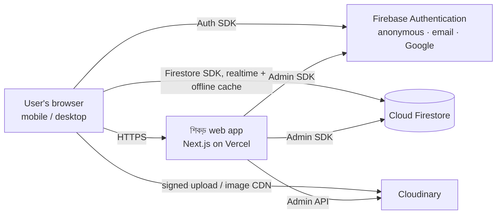
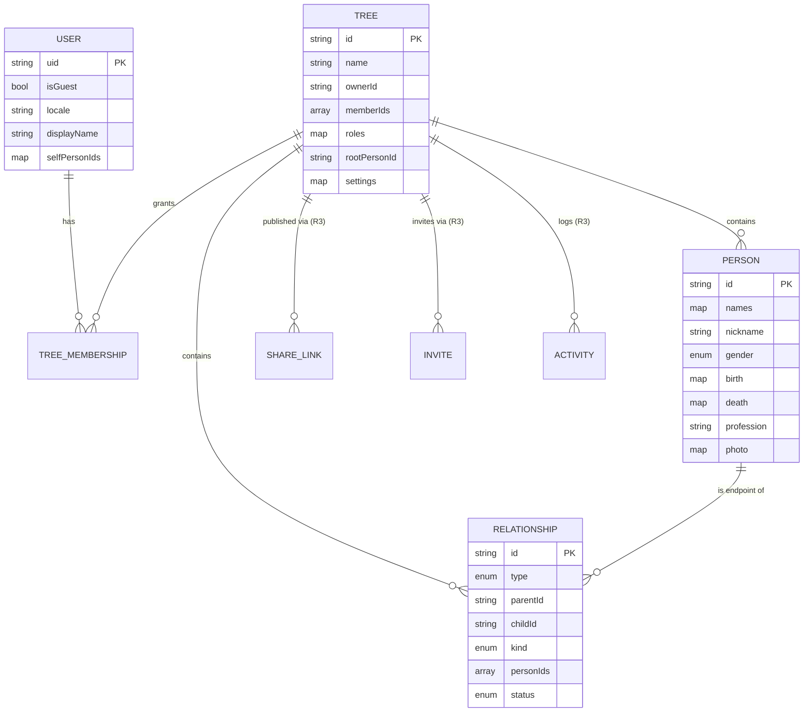

# Software Requirements Specification (SRS)

**Product:** শিকড় (pronounced *Shikor*, meaning "roots"), a bilingual (বাংলা / English) family-tree builder
**Document version:** 1.3
**Date:** 2026-10-22
**Status:** Baseline for implementation
**Related documents:** [Design Document](./DESIGN.md) · [Implementation Plan](./IMPLEMENTATION_PLAN.md) · [README](../README.md)

| Version | Date       | Author                  | Change                                                        |
| ------- | ---------- | ----------------------- | ------------------------------------------------------------- |
| 1.0     | 2026-10-22 | Product owner + Claude  | Initial baseline after the requirements Q&A (see §1.6)          |
| 1.1     | 2026-10-22 | Product owner + Claude  | Added Family card, Generation album, Timeline and Family book (decision D5) |
| 1.2     | 2026-10-22 | Product owner + Claude  | Product named শিকড় (decision D6) |
| 1.3     | 2026-10-22 | Product owner + Claude  | The name is always written in Bangla script, in both languages (D6 updated, I18N-10) |

---

## Table of contents

1. [Introduction](#1-introduction)
2. [Overall description](#2-overall-description)
3. [Functional requirements](#3-functional-requirements)
4. [External interface requirements](#4-external-interface-requirements)
5. [Non-functional requirements](#5-non-functional-requirements)
6. [Data requirements](#6-data-requirements)
7. [Use cases](#7-use-cases)
8. [Release mapping & traceability](#8-release-mapping--traceability)
9. [Open questions & future considerations](#9-open-questions--future-considerations)
10. [Appendix A: Bangla UI glossary](#appendix-a-bangla-ui-glossary)

---

## 1. Introduction

### 1.1 Purpose

This document specifies the requirements of **শিকড়** (pronounced *Shikor*, meaning "roots"), a web application for building, exploring and sharing family trees, in Bangla and English. It is written for:

- the **product owner**, to confirm the scope;
- **developers**, including AI coding agents, who build the app from it;
- **testers**, who derive test cases from the acceptance criteria.

### 1.2 Scope

শিকড় lets anyone open the website and immediately start recording their family, beginning with the oldest ancestor they remember (for example their grandfather), then his sons and daughters, then their children, and so on. Ease of use is the **number-one product priority**.

**In scope**

- Instant, sign-up-free use through an automatic **guest account**. Data is saved to the cloud database and survives reloads and later visits.
- Upgrading a guest to a permanent account (email + password, or Google). The guest's data moves into that account.
- Creating and editing **people** (with photo, description, profession, address, phone and more) and **relationships** (parent→child and spouse).
- Several interactive views of the same data: **Tree**, **Family card** (one family at a time, built for phones), **Circle** (radial, oldest ancestor in the centre) and **List/Index**. Later releases add a **Generation album** (photos by generation) and a **Timeline** (lifespans across the years).
- Downloading any view as an **image (PNG)** or **PDF**. A later release adds a printable **Family book**.
- A full **Bangla and English** user interface.
- Responsive layouts for **mobile phones and desktop**.
- Later releases add backup import/export (JSON, GEDCOM), an installable offline app (PWA), sharing and collaboration, and a Bangla **relationship finder**.

**Out of scope (for all releases in this document)**

- DNA analysis, historical record search, and matching people across other users' trees.
- Native iOS/Android apps (the PWA covers installation).
- Payments and subscriptions.
- Printing or shipping physical posters.
- Merging two different users' trees into one.

### 1.3 Definitions, acronyms and abbreviations

| Term | Definition |
| --- | --- |
| **Person** | One individual in a tree (shown in the UI as a "node" or card). |
| **Relationship** | A stored link between two persons. There are two types: **parent link** (parent → child) and **spouse link** (between two partners). |
| **Parent link kind** | `biological`, `adoptive`, `step` or `foster`. |
| **Family unit** | A derived grouping of one person, one of their spouses (or none) and the children they share. It is not stored. |
| **Bloodline person** | A person who descends from the tree's root ancestor. |
| **Married-in spouse** | A spouse of a bloodline person who is not a descendant of the root, for example a daughter-in-law. |
| **Root ancestor** | The person a tree starts from by default. Usually the oldest known ancestor. |
| **Focus person** | The person a view is currently centred on. Defaults to the root ancestor. |
| **Generation** | Distance in parent links from the focus person (the root is generation 1). |
| **Guest account** | A Firebase **anonymous** account, created automatically and kept in the browser. |
| **Permanent account** | An account with email/password or Google sign-in. |
| **Linking** | Attaching a permanent credential to the current guest account. The user ID is unchanged, so no data moves. |
| **Merge** | Moving a guest's trees into a *different*, already existing permanent account. This happens on the server. |
| **Member / role** | A user with access to a tree: `owner`, `editor` or `viewer`. |
| **Share link** | An unlisted, revocable, read-only public URL to a tree. |
| **Kinship term** | A culturally specific relationship name, such as চাচা (father's brother) or খালা (mother's sister). |
| **d'Aboville numbering** | Hierarchical outline numbering of descendants: 1, 1.1, 1.2, 1.1.1 … |
| **GEDCOM** | The standard genealogy data interchange format (5.5.1 / 7.0). |
| **PWA** | Progressive Web App: an installable website that can work offline. |
| **MoSCoW** | Requirement priority: **M**ust, **S**hould, **C**ould, **W**on't (this time). |
| **R1–R4** | Releases: R1 = v1.0 MVP, R2 = v1.1, R3 = v1.2, R4 = v1.3 (see §8). |

### 1.4 References

- IEEE/ISO/IEC 29148: Requirements engineering (structure inspiration)
- Firebase Authentication: anonymous auth and account linking (firebase.google.com/docs/auth/web/anonymous-auth, /account-linking)
- Firebase redirect sign-in best practices (firebase.google.com/docs/auth/web/redirect-best-practices)
- Cloud Firestore data model, security rules and quotas (firebase.google.com/docs/firestore)
- Cloudinary upload API and transformations (cloudinary.com/documentation)
- WCAG 2.2 (w3.org/TR/WCAG22)
- FamilySearch GEDCOM 5.5.1 and 7.0 specifications

### 1.5 Document overview

- §2 describes the product context, its users and its constraints.
- §3 lists the functional requirements, grouped by feature area. Each has an ID, a priority and a release.
- §4 covers the external interfaces.
- §5 covers the non-functional requirements (performance, security, usability and others).
- §6 describes the data.
- §7 gives detailed use cases.
- §8 maps requirements to releases.
- §9 lists open questions.

### 1.6 Decisions captured from stakeholder Q&A (2026-10-22)

| # | Question | Decision |
| --- | --- | --- |
| D1 | Include spouses and mothers, or only bloodline edges? | **Spouses and both parents.** Multiple marriages are supported. Children link to father **and** mother. |
| D2 | Photo storage (Firebase Storage needs the paid Blaze plan) | **Cloudinary free tier.** Firebase stays on the free **Spark** plan. |
| D3 | Backend shape | **Next.js full-stack.** There is no separate Express server. Privileged operations run in Next.js Route Handlers using the Firebase Admin SDK. |
| D4 | Extra features | **All in scope**, delivered in phases after the MVP: share & collaborate, Bangla relationship finder, backup import/export (JSON + GEDCOM), installable offline app (PWA). |
| D5 | Additional views | **Family card** (R1), **Generation album** (R2), **Timeline** (R3) and **Family book** (R3) are added. The fan chart, hourglass chart and কুরসিনামা-style print were proposed but not selected. |
| D6 | Product name | **শিকড়**, meaning "roots". The name is **always written in Bangla script, in both the Bangla and the English interface**; it is never translated or romanized in the UI. The Latin form `shikor` is used only for technical identifiers that cannot contain Bangla letters (domain, package name, project IDs, storage prefixes). The domain is still open (Q1). |

---

## 2. Overall description

### 2.1 Product perspective

শিকড় is a new, self-contained web application. It depends on three external managed services:

### 2.2 Product functions (summary)

1. Automatic guest session, then optional upgrade to a permanent account without losing data.
2. Multiple family trees per user.
3. Fast creation of people and relationships, including bulk entry ("add all children at once").
4. Rich person profiles with a photo.
5. Tree, Family card, Circle and List views, with expand/collapse, search, focus, pan and zoom. Later: Generation album and Timeline.
6. Export to PNG and PDF. Later: a printable Family book.
7. Full Bangla and English UI and data entry.
8. Undo and redo, autosave, and offline tolerance.
9. Later releases: PWA, JSON/GEDCOM backup, sharing and collaboration, relationship finder with Bangla kinship terms.

### 2.3 User classes and characteristics

| User class | Description | Frequency | Technical skill |
| --- | --- | --- | --- |
| **Guest** | First-time visitor, using the app without an account | High (every new user) | Low to medium |
| **Registered user / tree owner** | Has a permanent account and owns one or more trees | Medium | Low to medium |
| **Collaborator: editor** (R3) | Invited family member who can edit a tree | Low to medium | Low |
| **Collaborator: viewer** (R3) | Invited family member with read-only access | Low | Low |
| **Share-link visitor** (R3) | Anyone holding a public read-only link; no login | Low | Low |
| **Operator** | Developer/maintainer: deploys, monitors, runs cleanup jobs | Rare | High |

**Personas**

- **Abdur Rahim, 58, Rajshahi.** Uses an Android phone and prefers Bangla. He types with a Bangla keyboard and wants to record his lineage for his grandchildren. He remembers up to his grandfather. He gives up if a form is too long.
- **Nadia, 27, Dhaka.** Uses a laptop and a phone and is comfortable in English. She builds both her father's and her mother's sides of the family, and wants a beautiful PDF to share in the family WhatsApp group before an Eid reunion.
- **Tanvir, 34, working abroad.** He receives a shared link in Messenger and opens it inside Messenger's in-app browser. He wants to view the tree and later help edit it.

### 2.4 Operating environment

- **Browsers:** the last 2 major versions of Chrome, Edge, Firefox and Samsung Internet; Safari on macOS and iOS 16.4+. In-app browsers (Facebook/Messenger, WhatsApp) are supported for viewing and guest use. Google sign-in in those browsers is redirected to the system browser (see AUTH-15).
- **Devices:** phones from 320 px wide up to 2560 px desktops; touch, mouse and keyboard.
- **Network:** must work on slow 3G/4G and offline (cached data).

### 2.5 Design and implementation constraints

| ID | Constraint |
| --- | --- |
| C-01 | Authentication **must** use Firebase Authentication. Data **must** be stored in Cloud Firestore. |
| C-02 | Photos are stored and served by **Cloudinary** (free plan: 25 monthly credits shared by storage, bandwidth and transformations). |
| C-03 | The Firebase project stays on the **Spark (free) plan** at launch, so there are **no Cloud Functions and no Firebase Storage**. Privileged server logic runs in **Next.js Route Handlers** on Vercel. |
| C-04 | Spark quotas: 50,000 document reads, 20,000 writes and 20,000 deletes per day; 1 GiB stored. The data access design must be read-efficient. |
| C-05 | Tech stack priority: **TypeScript, Next.js (App Router), React.** No separate Express server (decision D3). |
| C-06 | The Bangla script needs correct complex-text shaping (conjuncts, vowel signs) in the UI **and in exported images/PDFs**. |
| C-07 | Vercel Hobby is for personal, non-commercial use. A commercial launch needs Vercel Pro or another host. Vercel Hobby cron jobs run at most once a day. |
| C-08 | Firestore security rules allow at most 20 document-access calls per batched write. Rules therefore cannot check graph integrity across many documents, and graph validation lives in the client domain layer (see DESIGN §8). |

### 2.6 Assumptions and dependencies

- A typical tree has **50–500 persons**. The system must support **2,000 persons** per tree with acceptable performance.
- A guest's access depends on the browser's persisted storage. Clearing site data, private browsing or switching devices loses the guest *session*. The data is still in the database but cannot be reached. Users are told this clearly (AUTH-03).
- Users understand basic family relationships but **not** genealogy jargon.
- Firebase, Cloudinary and Vercel are available within their published SLAs.
- Bangla kinship term tables are reviewed by native speakers before R4 ships.

### 2.7 Apportioning of requirements

Requirements are assigned to releases R1–R4 (§8). Anything marked **Could** may be deferred without a change request.

---

## 3. Functional requirements

**Format:** each requirement has an ID, a statement, a priority (M/S/C) and a release. Key requirements also have acceptance criteria (**AC**).

### 3.1 Authentication & accounts (AUTH)

| ID | Requirement | Pri | Rel |
| --- | --- | --- | --- |
| AUTH-01 | On the first visit to any app page, the system shall silently create a **guest (anonymous) account**. There is no form and no extra click. | M | R1 |
| AUTH-02 | The guest session shall **persist** across reloads, closed tabs, browser restarts and visits days or months later, in the same browser profile. | M | R1 |
| AUTH-03 | The system shall tell guests, without getting in the way, that their data is tied to this browser: a "Guest" chip in the header with an explanation popover. It shall prompt them to create a free account at milestones: after the 5th person, before the first export, and on the 3rd visit. Each prompt can be dismissed for 7 days. | M | R1 |
| AUTH-04 | **Sign up with email + password** shall *link* the credential to the current guest account, keeping the same user ID and all data. | M | R1 |
| AUTH-05 | **Continue with Google** shall link the Google credential to the guest account. If that Google account already exists, the system shall run the merge flow (AUTH-07). | M | R1 |
| AUTH-06 | **Sign in** to an existing account (email or Google) while the guest has data shall run the merge flow (AUTH-07). | M | R1 |
| AUTH-07 | **Guest merge:** a dialog lists the guest's trees (name, number of people) with "Move to my account" (the default) or "Discard" for each. The server transfers ownership; the operation is atomic per tree and idempotent. The guest account is then deleted. | M | R1 |
| AUTH-08 | After email sign-up, the system shall send a verification email. Unverified users can use everything except inviting collaborators (R3). | S | R1 |
| AUTH-09 | Users shall be able to reset a forgotten password by email. | M | R1 |
| AUTH-10 | **Sign out** is available to permanent users. Guests are not offered sign out; they get "Delete my guest data" behind a clear confirmation instead. | M | R1 |
| AUTH-11 | Profile settings: display name, preferred language, theme (system/light/dark). | S | R1 |
| AUTH-12 | **Account deletion:** the user can delete their account and all owned trees and photos, with a typed confirmation. | M | R1 |
| AUTH-13 | Auth state stays consistent across multiple open tabs. | M | R1 |
| AUTH-14 | **Guest retention:** guest accounts inactive for more than `GUEST_RETENTION_DAYS` (default 365) may be purged with their data. This is disclosed on the privacy page and in the guest popover. | S | R2 |
| AUTH-15 | When the app runs in an **in-app browser** (Messenger, WhatsApp, Instagram and others), where Google blocks OAuth, the Google button shall show "Open in Chrome/Safari" guidance. Email/password must still work. | M | R1 |

**AC (AUTH-02):** Create a guest tree with 3 people → close the browser → reopen the site 7 days later in the same profile → the same tree with 3 people is shown without any login.
**AC (AUTH-04):** As a guest with 1 tree → sign up with email → the user ID is unchanged → the tree is still listed → the "Guest" chip is gone.
**AC (AUTH-07):** As a guest with tree "X" → continue with a Google account that already owns tree "Y" → the merge dialog shows "X (n people)" → confirm → the dashboard lists X and Y → the guest auth user no longer exists.

### 3.2 Tree management (TREE)

| ID | Requirement | Pri | Rel |
| --- | --- | --- | --- |
| TREE-01 | A user can create **multiple trees** (for example "Father's side" and "Mother's side") with a name and an optional description. | M | R1 |
| TREE-02 | The **dashboard** lists the user's trees with name, person count, last updated time, a cover (the root person's photo or initials) and a role badge. | M | R1 |
| TREE-03 | A user can rename a tree, edit its description and delete it. Deleting a tree with more than 10 people requires typing the tree's name. | M | R1 |
| TREE-04 | A user can duplicate a tree. | C | R2 |
| TREE-05 | Each tree has a **root ancestor**. Any person can be set as root, and views can temporarily focus on any person. | M | R1 |
| TREE-06 | **Tree settings:** name display (auto/English/Bangla/both), colour by (branch/gender/generation/none), show photos, show dates, default view, kinship style (Bangladesh/West Bengal; used in R4). | S | R1 |
| TREE-07 | **Autosave:** every change is persisted immediately. A save-status indicator shows *Saving…*, *Saved*, or *Offline: changes will sync*. | M | R1 |
| TREE-08 | **Statistics:** number of people, generations, living/deceased counts, earliest recorded birth year. | C | R1 |

### 3.3 Person management (PER)

| ID | Requirement | Pri | Rel |
| --- | --- | --- | --- |
| PER-01 | A person can be added with **only a name and gender** (Male / Female / Unknown). Everything else is optional. | M | R1 |
| PER-02 | **Person fields:** name in English and/or Bangla (at least one required); nickname (ডাকনাম); gender; living/deceased; birth date and place; death date and place; profession; education; present address; permanent address; up to 3 phone numbers; email; description/biography (≤ 2,000 characters, with a counter); photo. Dates are **partial**: year only, year + month, or full date, with an optional "approximately" flag. | M | R1 |
| PER-03 | **Custom fields:** up to 20 label/value pairs per person (for example "Blood group: B+", "Village: Shibganj"). | S | R1 |
| PER-04 | Clicking or tapping a person opens the **details panel**: a side panel on desktop, a bottom sheet on mobile that can expand to full screen. It has view and edit states. | M | R1 |
| PER-05 | Edits **autosave** (debounced, about 800 ms) with field-level validation. There is no "Save" button to forget. | M | R1 |
| PER-06 | **Delete person.** With no descendants: confirm, then an *Undo* toast. With descendants, the user chooses between "Remove only this person (keep their children)" and "Remove this person and all N descendants". Relationship records are removed together with the person. | M | R1 |
| PER-07 | **Duplicate warning** when adding a person whose name matches an existing close relative (parent, sibling or child). | S | R1 |
| PER-08 | **Deceased display:** life years ("1931–2004") and a muted card style. Wording is respectful (প্রয়াত). | S | R1 |
| PER-09 | Show age (living, birth date known) or age at death. | C | R1 |
| PER-10 | A user can mark **"This is me"** on one person per tree. This drives the R4 relationship finder and a highlight on the person's node. | S | R1 |

### 3.4 Relationship management (REL)

| ID | Requirement | Pri | Rel |
| --- | --- | --- | --- |
| REL-01 | **Relationship types:** parent→child, with kind `biological`/`adoptive`/`step`/`foster`; spouse, with status `married`/`divorced`/`separated`/`widowed`, an optional marriage date and a sequence number for multiple marriages. All relationships are stored as records in the database. | M | R1 |
| REL-02 | **Quick actions** on every person: *Add son/daughter*, *Add spouse*, *Add father/mother*, *Add brother/sister*. | M | R1 |
| REL-03 | **Automatic other parent:** a child added to a person with exactly one spouse is linked to both parents. With several spouses, the user picks the other parent; the default is the first spouse by marriage order. With no spouse, only one parent is linked, and the other can be added later. | M | R1 |
| REL-04 | **Bulk add children:** enter several names at once (one per line, or as chips), each with a son/daughter toggle. They are added in birth order in one step. | M | R1 |
| REL-05 | **Add sibling** creates a child of the person's parents. If the person has no parents, the system offers to add a parent first. | S | R1 |
| REL-06 | **Link an existing person:** any "add relative" action can pick an existing person (searchable) instead of creating a new one. This covers cousin marriages and corrections. | M | R1 |
| REL-07 | **Edit relationships:** change kind or status, change which mother/father a child belongs to, reorder children (birth order), reorder spouses. | M | R1 |
| REL-08 | **Move a branch:** change a person's parent. Their descendants move with them. This uses a picker, plus drag-and-drop in the desktop tree view (Could). | M | R1 |
| REL-09 | Remove a relationship without deleting either person. | M | R1 |
| REL-10 | **Validation:** no self-relationships; no cycles (nobody can be their own ancestor); at most one biological father and one biological mother; no duplicate relationships; two people cannot be both parent/child and spouses. Implausible dates (a parent born after the child, or less than 12 years before) produce a warning but do not block. | M | R1 |
| REL-11 | **Unplaced people:** persons who cannot be reached from the root are listed in an "Unplaced people" tray with a *Connect* action. | S | R1 |
| REL-12 | **Gender-aware wording:** "Add father"/"Add mother", "son"/"daughter", "husband"/"wife" in both languages. | M | R1 |

**AC (REL-04):** On a person with one spouse, open *Add children* → type "Karim", "Rahima", "Salam" on 3 lines → set Rahima as daughter → confirm → 3 child cards appear in that order under the couple. A single *Undo* removes all 3.
**AC (REL-10):** Trying to set a person's own grandson as their father is blocked with a clear message.

### 3.5 Visualization: common (VIS)

| ID | Requirement | Pri | Rel |
| --- | --- | --- | --- |
| VIS-01 | **Views** of the same data: **Tree**, **Family card**, **Circle** and **List** (R1), **Album** (R2) and **Timeline** (R3). Desktop has a tab for each view. Mobile has a bottom navigation bar with Tree, Family, Circle and List, plus **More** for the rest. Selection and focus are kept when switching. | M | R1 |
| VIS-02 | **Expand/collapse** any person's descendants. A collapsed person shows a "+N" badge with the number of hidden descendants. Also: *Expand all* and *Show N generations*. | M | R1 |
| VIS-03 | **Focus:** "Show tree from this person" on any person, with a breadcrumb back to the root. | M | R1 |
| VIS-04 | **Search** by name or nickname in either script. Choosing a result expands the path to that person, then centres and highlights them. | M | R1 |
| VIS-05 | **Person card:** photo thumbnail (or a coloured initials avatar), name (per display setting), life years, deceased style, "me" marker, selected and hover states. | M | R1 |
| VIS-06 | **Colour coding** by branch, gender, generation or none, with a legend. Colour is never the only way information is conveyed. | S | R1 |
| VIS-07 | **Read-only rendering mode** for viewers and share links. | M | R3 |
| VIS-08 | **Married-in spouses** are drawn beside their bloodline partner. If the spouse's own parents are in the tree, "Show [spouse]'s family" re-focuses the view on them. | M | R1 |
| VIS-09 | **Repeated persons** (for example cousin marriages) are drawn once in full. Every other occurrence is a **linked reference** marker that jumps to the full one. | M | R1 |
| VIS-10 | **Collapse state** is remembered per tree and per view on the device. | S | R1 |

### 3.6 Tree view (TV)

| ID | Requirement | Pri | Rel |
| --- | --- | --- | --- |
| TV-01 | Top-down hierarchical layout of the focus person's descendants. Families are grouped by couple, and connector lines run from each couple to their children. | M | R1 |
| TV-02 | Horizontal (left→right) orientation toggle. | S | R1 |
| TV-03 | **Pan** (drag/swipe), **zoom** (wheel, pinch, +/− buttons), *Fit to screen*, *Centre on selected*. Zoom range is 10%–300%. | M | R1 |
| TV-04 | A selected card shows an inline **"+" button** that opens the quick-add menu (REL-02). | M | R1 |
| TV-05 | **Animated** expand, collapse, add and remove transitions. These are turned off when "reduce motion" is set or more than 300 cards are visible. | M | R1 |
| TV-06 | **Ancestor (pedigree) mode** shows the selected person's ancestors (both father's and mother's lines). | S | R1 |
| TV-07 | **Minimap** for large trees on desktop. | C | R1 |
| TV-08 | Drag-and-drop re-parenting on desktop. | C | R2 |
| TV-09 | **Keyboard:** arrow keys move between parent, children and siblings; Enter opens details; `C` add child, `S` add spouse, `P` add parent, `Del` delete, `/` search, `F` fit, `Ctrl/⌘+Z`/`Shift+Z` undo/redo. | S | R1 |
| TV-10 | Generation labels along the side ("১ম প্রজন্ম" / "Generation 1"). | C | R1 |

### 3.7 Circle view (CV)

| ID | Requirement | Pri | Rel |
| --- | --- | --- | --- |
| CV-01 | **Radial descendant chart:** the focus person (by default the oldest ancestor) is in the centre, and each generation forms a ring around it. Each person is an arc, sized by the number of descendant "leaves", so every person gets a visible slice. | M | R1 |
| CV-02 | Names follow the arc (tangential) when there is space, otherwise they run outward (radial). If neither fits they are hidden and shown on hover/tap. Text is never upside down. | M | R1 |
| CV-03 | Tapping an arc selects that person (details). "Make centre" (double-tap, or a button) zooms into that person's sub-chart with an animation; a breadcrumb leads back. | M | R1 |
| CV-04 | A **generation-depth control** (show 2–8 rings; default 5). Deeper generations are indicated with an outer tick. | S | R1 |
| CV-05 | Spouse names are shown in the arc tooltip and the details panel ("& Karima"), not as separate arcs. | S | R1 |
| CV-06 | Alternative **radial node-link** style. | C | R2 |
| CV-07 | The centre shows the focus person's photo or avatar and name. | M | R1 |

### 3.8 List / Index view (LV)

| ID | Requirement | Pri | Rel |
| --- | --- | --- | --- |
| LV-01 | An **indented, collapsible outline** of descendants with d'Aboville numbering (1, 1.1, 1.1.2 …) and generation badges. | M | R1 |
| LV-02 | Each row shows avatar, name, nickname, spouse name(s), life years and profession. Tapping a row opens the details panel. | M | R1 |
| LV-03 | Inline quick-add per row. Reorder siblings with a drag handle (desktop) or move up/down (mobile). | S | R1 |
| LV-04 | **Directory mode:** a flat, sortable, filterable list of all persons (filters: living/deceased, generation, branch, gender). It becomes cards on mobile. | S | R1 |
| LV-05 | Lists with more than 200 rows are virtualized. | M | R1 |
| LV-06 | The list view is the **accessible alternative** to the graphical views: full keyboard and screen-reader support. | M | R1 |

### 3.9 Family card view (FC)

A view that shows one family at a time, built for phones and for people who find large charts hard to use.

| ID | Requirement | Pri | Rel |
| --- | --- | --- | --- |
| FC-01 | The **Family card** shows one family: the focus person and their spouse(s) in the centre, the focus person's parents above, and their children below. No panning or zooming is needed. | M | R1 |
| FC-02 | **Navigation:** tapping a child opens that child's family, and tapping a parent opens the parent's family. A back button and a breadcrumb of ancestors lead back. On mobile, swiping left or right moves between siblings. The browser's back button works. | M | R1 |
| FC-03 | **Multiple spouses:** a switcher shows the children of each marriage separately. "All children" is also available. | M | R1 |
| FC-04 | **Add in place:** empty slots invite input ("+ Add father", "+ Add mother", "+ Add spouse", "+ Add children") and open the same quick-add flows as the other views. | M | R1 |
| FC-05 | Each person shows photo, name(s), life years and profession. Each child also shows how many children they have ("3 children ›"). Tapping a photo or name opens the details panel. | M | R1 |
| FC-06 | The focus person is shared with the other views. Switching from Family card to Tree centres the tree on the same person, and the reverse. | M | R1 |
| FC-07 | A **siblings strip** shows the focus person's brothers and sisters as small chips for moving sideways. | S | R1 |
| FC-08 | Built from standard headings, buttons and lists (no canvas), so it is fully accessible. It serves as the simplest view for elderly users and screen-reader users. | M | R1 |
| FC-09 | The current family can be exported as a one-page **family sheet** (PNG/PDF). | S | R1 |

**AC (FC-02):** From the root person's family, tap the child "Salam" → Salam's family appears, with his parents (Karim and Rahima) above → press Back → the root person's family is shown again.

### 3.10 Generation album (GA)

A photo-first view that feels like a family album.

| ID | Requirement | Pri | Rel |
| --- | --- | --- | --- |
| GA-01 | The **Generation album** groups people by generation, relative to the focus person, with one row per generation ("1st generation", "2nd generation" …). Rows scroll sideways on mobile and wrap into a grid on desktop. Spouses appear in their partner's generation. | M | R2 |
| GA-02 | Group by **generation** (default) or by **branch** (each child of the focus person). | S | R2 |
| GA-03 | Each card shows the photo (or an initials placeholder), the name, life years, and the parents ("Father: Karim · Mother: Rahima"). Tapping a card opens the details panel. | M | R2 |
| GA-04 | Filters: only people with photos; living / deceased. | S | R2 |
| GA-05 | **Slideshow:** full-screen photos with names. Advances automatically; supports swipe, keyboard and pause. | C | R2 |
| GA-06 | Images load lazily as rows scroll into view, and large albums stay smooth. | M | R2 |
| GA-07 | Editors see a gentle "Add photo" prompt on people without a photo. | S | R2 |
| GA-08 | The album can be exported as a PNG or as a PDF contact sheet. | S | R2 |

### 3.11 Timeline (TL)

Lifespans on a year axis, which shows things a tree cannot: who lived at the same time, and how old people were at key moments.

| ID | Requirement | Pri | Rel |
| --- | --- | --- | --- |
| TL-01 | A **lifespan timeline**: one bar per person on a year axis, from birth to death, or to today for living people. Names stay visible in a fixed column. | M | R3 |
| TL-02 | **Partial dates.** Year-only dates are drawn normally, and approximate dates have faded bar ends. A deceased person without a death year gets an open, dashed end; no date is guessed. People without a birth year are listed separately, with a count and a link to add dates. | M | R3 |
| TL-03 | Group or order by generation (default), branch or birth year. Scope: the focus person's descendants (default), their ancestors, or everyone. | S | R3 |
| TL-04 | **Life events** on the bars: marriages (from marriage dates) and the births of children. | S | R3 |
| TL-05 | **Historical markers** (can be turned off): 1947 Partition (দেশভাগ), 1952 Language Movement (ভাষা আন্দোলন), 1971 Liberation War (মুক্তিযুদ্ধ). | S | R3 |
| TL-06 | **Overlap insight:** selecting a person highlights everyone alive at the same time. The tooltip shows their age at each marker ("Age 23 in 1971"). | S | R3 |
| TL-07 | Zoom between decades and centuries, pan, and a "today" line. Works with touch and mouse. | M | R3 |
| TL-08 | The timeline can be exported as PNG or PDF. | S | R3 |
| TL-09 | Custom family events, for example "Moved to Dhaka, 1985". | C | Future |

### 3.12 Export & print (EXP)

| ID | Requirement | Pri | Rel |
| --- | --- | --- | --- |
| EXP-01 | Export the Tree, Family card, Circle or List view as **PNG**. The Album and Timeline views gain this when they ship (GA-08, TL-08). | M | R1 |
| EXP-02 | Export the Tree, Family card, Circle or List view as **PDF**. The Album and Timeline views gain this when they ship. | M | R1 |
| EXP-03 | **Export options:** paper size (A4, A3, Letter, or "Single page: fit everything"), orientation (auto/portrait/landscape), title and subtitle, include photos, include legend, include export date, quality (1×/2×/3×). | S | R1 |
| EXP-04 | Export covers the **whole tree as currently expanded**, not only what fits on screen. There is also an *Expand all before export* option. | M | R1 |
| EXP-05 | **Bangla text renders correctly** in all exports (conjuncts and vowel signs intact). | M | R1 |
| EXP-06 | Large exports stay within browser canvas limits: auto-scale for PNG, page tiling for PDF. | M | R1 |
| EXP-07 | On mobile, the exported file is offered through the **native share sheet** when available (so it can be sent straight to WhatsApp), otherwise downloaded. | S | R1 |
| EXP-08 | A progress indicator and Cancel. The UI stays responsive. | M | R1 |
| EXP-09 | Print stylesheet for the list view (browser print, selectable text). | C | R1 |
| EXP-10 | SVG export of the Tree and Circle views. | C | R2 |

**AC (EXP-05):** Exporting a tree that contains "ক্ষমা", "শ্রাবন্তী" and "রুদ্র" produces a PNG and a PDF in which those names look exactly as they do on screen.

### 3.13 Family book (FB)

A printable book of the whole family: a keepsake for elders, reunions and future generations.

| ID | Requirement | Pri | Rel |
| --- | --- | --- | --- |
| FB-01 | Generate a printable **Family book** (PDF) containing: a cover (title, cover photo, date), a table of contents, an overview chart (tree or circle), one section per family, and an index of names. Each family section shows the couple with photos, details and descriptions, and lists their children with page references. | M | R3 |
| FB-02 | **Options:** scope (whole tree or one branch), heading language (Bangla/English), paper (A4/Letter), include photos, **include contact details (off by default)**, include details of living people, image quality (standard/high). | M | R3 |
| FB-03 | Families appear in d'Aboville order, matching the List view's numbering, with cross-references such as "see page 12". | S | R3 |
| FB-04 | Bangla text renders correctly on every page, using the same approach as EXP-05. | M | R3 |
| FB-05 | Large books (300+ pages) are built page by page, with progress and Cancel, without freezing the app or exhausting a phone's memory. A warning suggests splitting very large books by branch. | M | R3 |
| FB-06 | An optional introduction or dedication page, written by the user. | C | R3 |
| FB-07 | Print-ready layout: margins, page numbers, running headers. | M | R3 |

**AC (FB-01):** For a 150-person tree, the book has a cover, contents, an overview chart, family sections and a name index. Every "see page N" reference points to the correct page, and Bangla names render correctly.

### 3.14 Media / photos (MED)

| ID | Requirement | Pri | Rel |
| --- | --- | --- | --- |
| MED-01 | Upload one profile photo per person, from the camera or gallery on mobile, or a file picker or drag-and-drop on desktop. JPEG, PNG, WebP and HEIC (where the browser can decode it); at most 10 MB before compression. | M | R1 |
| MED-02 | A **square crop** step with zoom before upload, plus rotate (Should). | M | R1 |
| MED-03 | Client-side **compression** to at most 1600 px on the long edge before upload. | M | R1 |
| MED-04 | Face-aware **thumbnails** on cards; the full photo appears in the details panel and a lightbox. | M | R1 |
| MED-05 | Replace or remove a photo. The previous image is deleted from storage. | M | R1 |
| MED-06 | Upload progress, error and retry. While offline, upload is disabled with an explanation. | M | R1 |
| MED-07 | Only tree owners and editors can upload. Uploads are **signed by the server**. Photos are deleted when their person, tree or account is deleted. | M | R1 |
| MED-08 | Multiple photos per person (gallery). | C | Future |

### 3.15 Internationalization (I18N)

| ID | Requirement | Pri | Rel |
| --- | --- | --- | --- |
| I18N-01 | The **complete UI is available in Bangla and English.** The user can switch at any time without losing their place. The choice is remembered in the profile (and a cookie). The default comes from the browser language. | M | R1 |
| I18N-02 | **Locale-aware formatting:** Bangla digits (০–৯) and month names in `bn`; plural rules; dates. | M | R1 |
| I18N-03 | **Names:** English and/or Bangla name per person. They are displayed according to the tree setting, falling back to whichever name exists. | M | R1 |
| I18N-04 | Search matches English names, Bangla names and nicknames. Bangla text is Unicode-normalized, and zero-width joiners are ignored. | M | R1 |
| I18N-05 | Proper Bangla web fonts and line heights (no clipped vowel signs). | M | R1 |
| I18N-06 | Locale-prefixed routes (`/bn/...`, `/en/...`), a correct `<html lang>`, and localized metadata. | M | R1 |
| I18N-07 | Relationship words in the UI use the natural Bangla forms (ছেলে, মেয়ে, স্বামী, স্ত্রী, বাবা, মা …). | M | R1 |
| I18N-08 | Transliteration search (typing "Rahim" finds "রহিম"). | C | Future |
| I18N-09 | Bengali calendar (বঙ্গাব্দ) date display option. | C | Future |
| I18N-10 | The product name **শিকড়** is always shown in Bangla script, in both languages: header, page titles, installed-app name, emails, exports. On English pages it is marked `lang="bn"` so screen readers pronounce it correctly, and the Bangla font loads on every page. | M | R1 |

### 3.16 Onboarding & help (ONB)

| ID | Requirement | Pri | Rel |
| --- | --- | --- | --- |
| ONB-01 | **Landing page** with a clear value proposition and the primary call to action **"Start your family tree, no sign-up needed"**. | M | R1 |
| ONB-02 | **First-run wizard** (skippable): ① choose language → ② "Who is the oldest ancestor you remember?" (name + gender) → ③ "Add their children" (bulk add) → ④ land in the tree view with a short tour. | M | R1 |
| ONB-03 | Contextual empty states and first-use tips (coach marks) for each view. | S | R1 |
| ONB-04 | A sample tree to explore. | C | R1 |
| ONB-05 | A bilingual help/FAQ page and a privacy page. | S | R1 |

### 3.17 Editing experience (UX)

| ID | Requirement | Pri | Rel |
| --- | --- | --- | --- |
| UX-01 | **Undo/redo** for every data change in the session, at least 50 steps. Bulk operations undo as a single step. | M | R1 |
| UX-02 | Destructive actions show a toast with **Undo**. | M | R1 |
| UX-03 | **Command palette / global search** (`Ctrl/⌘+K`). | S | R1 |
| UX-04 | **Delight:** smooth animations, friendly microcopy, a small celebration at milestones (10, 50 and 100 people; 5 generations). Respects reduced motion. | C | R1 |
| UX-05 | **Dark mode** (system/light/dark). | S | R1 |
| UX-06 | Touch targets ≥ 44×44 px. Primary actions sit in the thumb zone on mobile. | M | R1 |
| UX-07 | No action needs more than 2 taps from a selected person to start adding a relative. | M | R1 |

### 3.18 Backup import/export (BAK)

| ID | Requirement | Pri | Rel |
| --- | --- | --- | --- |
| BAK-01 | Export a tree as a **JSON backup**: versioned schema, includes photo references. Available to guests as well. | S | R1 |
| BAK-02 | **Import a JSON backup** as a new tree, with schema validation and a preview (counts). | M | R2 |
| BAK-03 | Export **GEDCOM 5.5.1 (UTF-8)**: individuals, families, names (Bangla/English variants), sex, birth/death, occupation, education, residence, phone, email, notes, photo URL, custom facts. | M | R2 |
| BAK-04 | **Import GEDCOM** 5.5.1 (and 7.0 on a best-effort basis) as a new tree, with a preview and a report of skipped or unsupported data. | M | R2 |
| BAK-05 | Import limits: up to 5,000 individuals or 10 MB. Writes are chunked, and progress and resumable status are shown. | M | R2 |

### 3.19 PWA & offline (PWA)

| ID | Requirement | Pri | Rel |
| --- | --- | --- | --- |
| PWA-01 | **Installable:** manifest, icons (including maskable), theme colours, and an install prompt shown at a sensible moment. | M | R2 |
| PWA-02 | **Offline use:** the app shell and previously opened trees load offline. Edits are queued and sync automatically when back online. | M | R2 |
| PWA-03 | An offline indicator and a pending-changes count. | M | R1 |
| PWA-04 | Update flow: "A new version is available — Reload". | S | R2 |
| PWA-05 | Recently viewed photo thumbnails are available offline. | S | R2 |

*Note:* the Firestore offline cache that underpins PWA-02 is turned on from R1, so reloads are instant and edits made offline are not lost even before the PWA ships.

### 3.20 Sharing & collaboration (SHR)

| ID | Requirement | Pri | Rel |
| --- | --- | --- | --- |
| SHR-01 | The owner can create a **read-only share link** (an unlisted, unguessable URL), and revoke or regenerate it at any time. | M | R3 |
| SHR-02 | Share-link visitors (no login) see all the views and may export them (owner setting). **Contact fields (phone, email, addresses) are hidden** by default. An option hides details of living people. | M | R3 |
| SHR-03 | **Invite collaborators** through an invite link with role *Editor* or *Viewer*. Links expire after 7 days by default and have a use limit. | M | R3 |
| SHR-04 | Accepting an invite requires a **permanent account**. Guests are guided to sign up first, and their guest trees are kept through AUTH-04/07. | M | R3 |
| SHR-05 | **Member management:** list members, change roles, remove members, leave a tree, transfer ownership (Should). | M | R3 |
| SHR-06 | **Real-time co-editing:** other members' changes appear live. Conflicts resolve by field-level last write wins, and an "edited by …" indicator is shown. | M | R3 |
| SHR-07 | **Activity log:** who added, edited or deleted what and when (kept 90 days). | S | R3 |
| SHR-08 | Share actions: copy link, native share sheet, WhatsApp/Messenger deep links. | S | R3 |
| SHR-09 | Share pages are not indexed by search engines (`noindex`). | M | R3 |

### 3.21 Relationship finder (KIN)

| ID | Requirement | Pri | Rel |
| --- | --- | --- | --- |
| KIN-01 | Pick two persons (default: "me" plus the selected person). The system shows their relationship in plain English and as a **Bangla kinship term**, and highlights the connecting path in the tree view. | M | R4 |
| KIN-02 | Each person's details panel shows "How is this person related to me?" when "me" is set (PER-10). | M | R4 |
| KIN-03 | **Coverage:** grandparents and great-grandparents (দাদা, দাদি, নানা, নানি, পরদাদা …); parents' siblings and their spouses (চাচা/চাচি, ফুপু/ফুপা, মামা/মামি, খালা/খালু); cousins (চাচাতো, ফুপাতো, মামাতো, খালাতো ভাই/বোন); nieces and nephews (ভাতিজা/ভাতিজি, ভাগ্নে/ভাগ্নি); grandchildren (নাতি/নাতনি); in-laws (শ্বশুর, শাশুড়ি, শালা, শালী, দেবর, ভাসুর, ননদ, ভাবি, দুলাভাই, জামাই, পুত্রবধূ, বেয়াই, বেয়াইন, ভায়রা ভাই, জা). | M | R4 |
| KIN-04 | **Elder/younger distinctions** where Bangla requires them (বড় ভাই/ছোট ভাই, বড় চাচা/ছোট চাচা, দেবর/ভাসুর), using birth dates or birth order. | S | R4 |
| KIN-05 | **Regional style setting:** Bangladesh (default) or West Bengal (ঠাকুরদা, ঠাকুমা, দাদু, দিদিমা, জেঠু, কাকা, পিসি, মাসি, বৌদি, জামাইবাবু …). | S | R4 |
| KIN-06 | When no single term exists, a descriptive chain in natural language ("বাবার মামাতো ভাই" / "father's maternal cousin"). | M | R4 |
| KIN-07 | When two people are related in more than one way (for example a cousin marriage), up to 3 relationships are shown, shortest first. | S | R4 |

### 3.22 Administration & operations (OPS)

| ID | Requirement | Pri | Rel |
| --- | --- | --- | --- |
| OPS-01 | A daily **guest cleanup job** purges guests inactive for longer than the retention period (AUTH-14), including their trees and photos. | S | R2 |
| OPS-02 | **Error monitoring** on client and server, with PII scrubbing. | S | R1 |
| OPS-03 | **Quota monitoring:** documented procedures and alerts for Firestore usage and Cloudinary credits. | S | R1 |
| OPS-04 | Data **schema versioning** and migrations (`schemaVersion` on documents). | M | R1 |
| OPS-05 | Security rules and indexes are deployed from the repository through CI, never edited by hand in the console. | M | R1 |

---

## 4. External interface requirements

### 4.1 User interfaces

- **Breakpoints:** phone < 640 px, tablet 640–1023 px, desktop ≥ 1024 px. Portrait and landscape are both supported.
- **Desktop editor:** top bar (tree name, view tabs, search, save status, language, account); canvas; right-hand details panel (400 px); floating zoom controls.
- **Mobile editor:** compact top bar; full-bleed canvas; bottom navigation (Tree / Family / Circle / List / More, where More holds Album, Timeline, Ancestors and Family book); bottom sheet for details and add actions; a floating "+" button in the thumb zone.
- The visual language, wireframes and components are specified in [DESIGN.md §21](./DESIGN.md#21-uiux-design-system).

### 4.2 Hardware interfaces

Touch screens, mouse/trackpad, keyboard, and the device camera (through the file input's `capture` attribute) for photos.

### 4.3 Software interfaces

| System | Interface | Purpose |
| --- | --- | --- |
| Firebase Authentication | JS SDK (client), Admin SDK (server) | Anonymous, email/password and Google sign-in; linking; token verification; user deletion |
| Cloud Firestore | JS SDK with persistent cache (client), Admin SDK (server) | All structured data, realtime sync, offline queue |
| Cloudinary | Upload API (signed, from the client), Admin API (server), delivery CDN | Photo storage, thumbnails, deletion |
| Vercel | Hosting, serverless functions, cron | Web app, Route Handlers, scheduled cleanup |
| Browser APIs | IndexedDB, Service Worker, File API, Canvas, Web Share, Intl (Segmenter, NumberFormat, DateTimeFormat) | Offline, export, sharing, locale formatting |

### 4.4 Communication interfaces

HTTPS only (HSTS). The Route Handlers expose JSON REST endpoints authenticated with `Authorization: Bearer <Firebase ID token>` (plus an App Check token). Firestore uses its SDK transport.

---

## 5. Non-functional requirements

### 5.1 Performance

| ID | Requirement |
| --- | --- |
| NFR-PERF-01 | Landing page: Largest Contentful Paint < 2.5 s and Interaction to Next Paint < 200 ms on a mid-range Android phone over 4G (Lighthouse mobile ≥ 90). |
| NFR-PERF-02 | Editor: interactive < 3.5 s on first load; < 1.5 s on repeat loads (cache). |
| NFR-PERF-03 | Rendering a 500-person tree takes < 1 s after the data is loaded. Pan and zoom run at ≥ 50 fps on a mid-range phone. 2,000 persons are supported (with viewport culling). |
| NFR-PERF-04 | Every edit appears on screen within 100 ms (optimistic local update). |
| NFR-PERF-05 | Initial JavaScript for the editor route ≤ 250 KB gzipped. The visualization and export libraries are code-split. |
| NFR-PERF-06 | PDF export of a 500-person tree takes < 10 s on desktop and < 20 s on a mid-range phone. |

### 5.2 Reliability & data safety

| ID | Requirement |
| --- | --- |
| NFR-REL-01 | **No data loss on reload:** every edit is written to the local persistent cache (IndexedDB) immediately and synced to Firestore. Pending writes survive reloads and resume automatically. |
| NFR-REL-02 | Guest merge and account deletion are idempotent and safe to retry. |
| NFR-REL-03 | Multi-person operations (bulk add, delete branch, import chunk) are atomic per batch. |
| NFR-REL-04 | Data integrity: the graph builder tolerates dangling or invalid relationships (it skips and reports them) and never crashes the view. |

### 5.3 Usability

| ID | Requirement |
| --- | --- |
| NFR-USE-01 | A first-time user creates a 3-generation tree of 10 people in **under 3 minutes** on a phone, without help (usability test target). |
| NFR-USE-02 | Plain language in both locales. No genealogy or technical jargon in the UI ("node", "edge" and "GEDCOM" appear only in an advanced context). |
| NFR-USE-03 | Every error message says what happened and what to do next, in the user's language. |
| NFR-USE-04 | Consistent placement of primary actions across views. |

### 5.4 Accessibility

| ID | Requirement |
| --- | --- |
| NFR-A11Y-01 | Conform to **WCAG 2.2 AA**: contrast, focus visibility, keyboard operability, labelled controls, reduced motion. |
| NFR-A11Y-02 | The List and Family card views are the full screen-reader alternatives to the Tree, Circle and Timeline views. Graphical views expose selection changes through a live region. |
| NFR-A11Y-03 | Colour is never the only carrier of meaning. Gender and branch also have icons, labels or positions. |

### 5.5 Responsiveness & compatibility

| ID | Requirement |
| --- | --- |
| NFR-RESP-01 | Fully usable from 320 px to 2560 px wide, in portrait and landscape. |
| NFR-RESP-02 | Touch gestures: pan, pinch-zoom, tap, long-press (context menu), swipe the sheet down to close. |
| NFR-COMP-01 | Supported browsers per §2.4. Unsupported browsers get a friendly notice. |

### 5.6 Security

| ID | Requirement |
| --- | --- |
| NFR-SEC-01 | All data access is gated by **Firebase Security Rules** (least privilege). Rules are unit-tested against the emulator, covering every allow/deny path. |
| NFR-SEC-02 | Every Route Handler verifies the Firebase ID token (and the App Check token) and validates its input with Zod. |
| NFR-SEC-03 | Secrets (the Cloudinary API secret, Firebase Admin credentials, the cron secret) live only in server environment variables and are never shipped to the client. |
| NFR-SEC-04 | Security headers: CSP, HSTS, `X-Content-Type-Options`, `Referrer-Policy`, `frame-ancestors 'none'`, `Permissions-Policy`. |
| NFR-SEC-05 | Abuse protection: App Check (reCAPTCHA v3) enforced on Firestore and checked by the API routes; size limits on every field and upload. |
| NFR-SEC-06 | User-entered text is always rendered as text, never as HTML (XSS-safe). |
| NFR-SEC-07 | Share-link and invite IDs have at least 128 bits of randomness. |

### 5.7 Privacy

| ID | Requirement |
| --- | --- |
| NFR-PRIV-01 | Personal data about relatives (phone, address, email) is visible only to tree members. It is hidden from share links by default. |
| NFR-PRIV-02 | A privacy page in both languages explains guest data, retention, Cloudinary storage and deletion. |
| NFR-PRIV-03 | Users can export (BAK-01) and delete (AUTH-12) all of their data. |
| NFR-PRIV-04 | No third-party advertising or tracking. Analytics, if used, are cookieless and aggregated. |

### 5.8 Scalability & cost

| ID | Requirement |
| --- | --- |
| NFR-COST-01 | Run at **$0/month** for early usage (Firebase Spark + Cloudinary Free + Vercel Hobby). DESIGN §28 documents the quota math and the upgrade path. |
| NFR-SCAL-01 | Opening a tree reads its documents once per session and reuses the cache. Edits write only the changed documents. |

### 5.9 Maintainability

| ID | Requirement |
| --- | --- |
| NFR-MAINT-01 | TypeScript `strict`; ESLint and Prettier clean; no `any` without a justification comment. |
| NFR-MAINT-02 | Pure domain logic (graph, kinship, GEDCOM, layout) has ≥ 90% unit-test coverage. Overall coverage ≥ 70%. |
| NFR-MAINT-03 | Feature-based modular structure. Architecture decisions are recorded (DESIGN §4). The README and docs are updated in the same pull request as the feature they describe. |
| NFR-MAINT-04 | CI blocks merges on typecheck, lint, unit, rules and build failures. |

### 5.10 Localization

| ID | Requirement |
| --- | --- |
| NFR-L10N-01 | All user-visible strings are externalized. CI fails if the `en` and `bn` message keys differ. |
| NFR-L10N-02 | Bangla copy is reviewed by a native speaker before each release. |

---

## 6. Data requirements

### 6.1 Logical data model

*Tree membership* is stored inside the tree document (`memberIds` and `roles`), not as separate records. The physical model is in [DESIGN.md §7](./DESIGN.md#7-firestore-data-model).

### 6.2 Field constraints (validated on the client, in security rules and on the server)

| Field | Constraint |
| --- | --- |
| Person name (each language) | 1–120 characters, trimmed; at least one language required |
| Nickname | ≤ 60 characters |
| Description | ≤ 2,000 characters |
| Profession, education, place | ≤ 120 characters each |
| Address (each) | ≤ 300 characters |
| Phones | ≤ 3 entries, each ≤ 30 characters, characters `+0-9 -()` only |
| Email | valid email, ≤ 254 characters |
| Custom fields | ≤ 20 entries; label ≤ 40 characters; value ≤ 300 characters |
| Partial date | year between 1000 and the current year + 1; month 1–12; day valid for the month |
| Tree name | 1–80 characters |
| Tree description | ≤ 500 characters |
| Persons per tree | soft limit 2,000 (warning), hard limit 5,000 |
| Trees per user | 50 |

### 6.3 Data retention

| Data | Retention |
| --- | --- |
| Permanent users' data | Until the user deletes it |
| Guest data | Until it is upgraded or deleted, or after `GUEST_RETENTION_DAYS` of inactivity (R2 cleanup) |
| Activity log | 90 days |
| Photos | Deleted with the person, tree or account; orphans are swept periodically |

### 6.4 Volume estimates (first year)

About 2,000 users × 1.5 trees × 150 persons ≈ 450,000 person documents plus about 600,000 relationship documents. That is roughly 0.5 GB in Firestore, within Spark's 1 GiB. Photos: about 30% of persons have one, about 135,000 images × ~250 KB ≈ 34 GB. **That exceeds the Cloudinary free tier.** The trigger points for upgrading are in DESIGN §28.

---

## 7. Use cases

### UC-01: First visit, start a tree as a guest

- **Actor:** Guest
- **Precondition:** First visit; nothing stored in the browser.
- **Main flow:**
  1. The user opens the website and sees the landing page in their browser's language.
  2. The user taps **"Start your family tree"**.
  3. The system creates a guest account silently and opens the wizard.
  4. The wizard asks "Who is the oldest ancestor you remember?" The user enters "আব্দুল করিম" and chooses Male.
  5. The wizard asks "Add his children". The user types 4 names on separate lines and marks one as a daughter.
  6. The system creates the tree "আমার পরিবার" ("My family") with 5 persons and shows the tree view with a short tour.
- **Alternative 3a:** Anonymous sign-in fails (network) → "Can't connect. We'll keep trying." The wizard works locally and syncs when back online.
- **Postcondition:** The tree is stored in Firestore under the guest's user ID and survives a reload.

### UC-02: Quickly add a family branch

- **Actor:** Guest or registered user
- **Main flow:**
  1. The user taps a daughter's card and taps **+**.
  2. The user chooses **Add spouse** and types the husband's name. He appears beside her.
  3. The user taps **+** → **Add children** and types 3 names. They appear under the couple, linked to both parents.
- **Alternative 2a:** The husband already exists in the tree (cousin marriage). The user picks **Choose existing person**, searches and selects him. A link badge appears.
- **Postcondition:** 4 persons and 7 relationships are written in one batch. A single *Undo* reverts them.

### UC-03: Upgrade a guest to an account (sign up)

- **Actor:** Guest
- **Main flow:**
  1. The user taps **Save your tree: create a free account**.
  2. The user picks Google (or email + password).
  3. The system links the credential to the guest account.
  4. A toast confirms "Your tree is now saved to your account". The "Guest" chip disappears.
- **Alternative 3a:** The Google account already exists → UC-04.
- **Alternative 3b:** The app is open in an in-app browser → the "Open in Chrome/Safari" guide is shown. The user can choose email sign-up instead.

### UC-04: Sign in to an existing account while holding guest data (merge)

- **Actor:** Guest who already has an account
- **Main flow:**
  1. The user chooses **Sign in** with an existing email or Google account.
  2. The system captures the guest's identity token, signs in, and finds 1 guest tree with 12 people.
  3. A dialog asks: "Keep 'আমার পরিবার' (12 people) in your account?" (Move ✔ / Discard).
  4. The user confirms. The server moves the trees and deletes the guest account.
  5. The dashboard shows all the trees.
- **Alternative 4a:** The network fails during the merge → retry. The operation is idempotent.
- **Alternative 2a:** The guest has no trees → no dialog; the guest account is cleaned up in the background.

### UC-05: Edit a person and upload a photo

- **Actor:** Owner or editor
- **Main flow:**
  1. The user taps a person. The details sheet opens.
  2. The user edits profession and phone. The changes autosave and show "Saved".
  3. The user taps the photo placeholder and chooses Camera or Gallery.
  4. The user crops to a square and confirms.
  5. The system compresses the image, gets a signed upload, uploads with progress, and updates the person.
  6. The thumbnail appears on the card in every view.
- **Alternative 5a:** The upload fails → "Upload failed. Retry?" The previous photo is kept.

### UC-06: Switch views and export a PDF

- **Actor:** Any member
- **Main flow:**
  1. The user switches to the **Circle** view. The oldest ancestor is in the centre.
  2. The user taps **Download** → PDF, A3, landscape, title "করিম পরিবার".
  3. The system renders the full chart off-screen with progress, builds the PDF, and opens the share sheet (mobile) or downloads it (desktop).
- **Postcondition:** The PDF shows the correct Bangla text and photos.

### UC-07: Share a read-only link (R3)

- **Actor:** Owner
- **Main flow:**
  1. Open **Share** → *Create view-only link* (contact details hidden).
  2. Copy the link, or share it to WhatsApp.
  3. A recipient opens the link without logging in and browses the views.
  4. The owner later taps **Revoke**. The link now shows "This link is no longer active".

### UC-08: Invite a collaborator (R3)

- **Actor:** Owner (verified account)
- **Main flow:**
  1. Open **Share** → **Invite to edit** and create an invite link (Editor, 7 days).
  2. The relative opens the link. If they are a guest, they are asked to sign up first.
  3. The relative accepts. The server adds them as an editor, and the tree appears on their dashboard.
  4. Both users see each other's edits live.

### UC-09: Find a relationship (R4)

- **Actor:** Any member with "me" set
- **Main flow:**
  1. Open a person's details → **How are we related?**
  2. The system shows "চাচাতো ভাই — your father's brother's son". The path is highlighted in the tree.
- **Alternative 2a:** More than one relationship exists → up to 3 are shown.
- **Alternative 2b:** No relationship is found → "No connection found in this tree".

### UC-10: Import a GEDCOM file (R2)

- **Actor:** Registered user
- **Main flow:**
  1. On the dashboard, choose **Import** and pick a `.ged` file.
  2. The system parses the file and shows a preview: "214 people, 63 families, 3 items skipped (see details)".
  3. The user confirms. The tree is created with chunked writes and progress, then opens.

### UC-11: Browse the family on a phone with the Family card

- **Actor:** Any member (typically an elderly relative on a phone)
- **Main flow:**
  1. The user taps **Family** in the bottom navigation. The root couple is shown with their children below.
  2. The user taps "সালাম ›". Salam's family appears, with his parents above and his three children below.
  3. The user swipes left to move to Salam's sister Halima's family.
  4. The user taps the empty "+ Add spouse" slot on Halima's card and adds her husband.
  5. The user presses Back twice and returns to the root couple.
- **Postcondition:** The Tree view, when opened, is centred on the last focused person.

### UC-12: Create a family book (R3)

- **Actor:** Any member
- **Main flow:**
  1. The user opens **Download → Family book**.
  2. The user chooses the scope (whole tree), A4, headings in Bangla, and photos on. Contact details stay off.
  3. The system builds the book page by page, showing "পৃষ্ঠা ৩৪/১২০", and then offers to download or share the PDF.
- **Alternative 3a:** The book would exceed 300 pages → a warning suggests making one book per branch. The user can continue anyway, up to the hard limit.

---

## 8. Release mapping & traceability

| Release | Version | Theme | Requirement groups |
| --- | --- | --- | --- |
| **R1** | v1.0 MVP | Build, view and export a family tree, guest-first, bilingual | AUTH (except 14), TREE, PER, REL, VIS (except 07), TV, CV, LV, **FC**, EXP, MED, I18N, ONB, UX, BAK-01, PWA-03, OPS-02/03/04/05 |
| **R2** | v1.1 | Offline, portability and the photo album | PWA-01/02/04/05, BAK-02..05, **GA-01..08**, AUTH-14, OPS-01, TREE-04, TV-08, CV-06, EXP-10 |
| **R3** | v1.2 | Sharing, collaboration and family stories | SHR-01..09, VIS-07, **TL-01..08**, **FB-01..07** |
| **R4** | v1.3 | Relationship finder | KIN-01..07 |

Mapping to implementation phases: see [IMPLEMENTATION_PLAN.md §3](./IMPLEMENTATION_PLAN.md#3-phase-overview).

---

## 9. Open questions & future considerations

| # | Item | Owner | Status |
| --- | --- | --- | --- |
| Q1 | **Domain name.** The product name is decided: **শিকড়** (D6). Latin candidates: `shikor.app`, `shikor.com.bd`, `getshikor.com`. A Bangla-script domain such as `শিকড়.বাংলা` (Bangladesh's Bangla domain) could redirect to the main one. Availability to be checked. | Product owner | Open |
| Q2 | **License:** proprietary or open source? | Product owner | Open |
| Q3 | Default UI language when the browser is neither `bn` nor `en`: English proposed. | Product owner | Proposed |
| Q4 | Commercial launch? This affects the Vercel plan (C-07). | Product owner | Open |
| Q5 | Native-speaker reviewer for the Bangla copy and the kinship tables. | Product owner | Open |

**Future ideas (not scheduled):** multiple photos per person; custom family events on the timeline (TL-09); fan chart and hourglass chart; a কুরসিনামা-style lineage print; birthday and death-anniversary reminders; transliteration search; Bengali calendar dates; family events and stories; QR code on exported PDFs linking to the live tree; printable poster templates.

---

## Appendix A: Bangla UI glossary

This glossary is used consistently in the `bn` messages.

| English | বাংলা |
| --- | --- |
| Product name | শিকড় (never translated or romanized) |
| Family tree | পারিবারিক বংশতালিকা (short: বংশতালিকা) |
| Tree / Family / Circle / List view | ট্রি ভিউ / পরিবার ভিউ / বৃত্ত ভিউ / তালিকা ভিউ |
| Generation album | প্রজন্ম অ্যালবাম |
| Timeline | সময়রেখা |
| Family book | পারিবারিক বই |
| More | আরও |
| Person / Member | ব্যক্তি / সদস্য |
| Ancestor / Descendant | পূর্বপুরুষ / বংশধর |
| Generation | প্রজন্ম |
| Father / Mother | বাবা / মা |
| Son / Daughter / Child | ছেলে / মেয়ে / সন্তান |
| Husband / Wife / Spouse | স্বামী / স্ত্রী / জীবনসঙ্গী |
| Brother / Sister | ভাই / বোন |
| Add child / spouse / parent | সন্তান যোগ করুন / জীবনসঙ্গী যোগ করুন / বাবা-মা যোগ করুন |
| Nickname | ডাকনাম |
| Profession | পেশা |
| Education | শিক্ষা |
| Present / Permanent address | বর্তমান ঠিকানা / স্থায়ী ঠিকানা |
| Phone | ফোন |
| Description | বিবরণ |
| Photo | ছবি |
| Living / Deceased | জীবিত / প্রয়াত |
| Born / Died | জন্ম / মৃত্যু |
| Guest | অতিথি |
| Sign up / Log in / Log out | অ্যাকাউন্ট খুলুন / লগ ইন / লগ আউট |
| Continue with Google | Google দিয়ে চালিয়ে যান |
| Save / Saved / Saving… | সংরক্ষণ / সংরক্ষিত / সংরক্ষণ হচ্ছে… |
| Undo / Redo | আগের অবস্থায় ফিরুন / আবার করুন |
| Download / Export | ডাউনলোড |
| Share / Invite | শেয়ার / আমন্ত্রণ |
| Search | খুঁজুন |
| Expand / Collapse | বিস্তার করুন / গুটিয়ে নিন |
| How are we related? | আমাদের সম্পর্ক কী? |
| Offline | অফলাইন |
